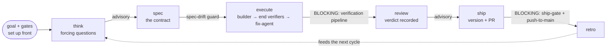
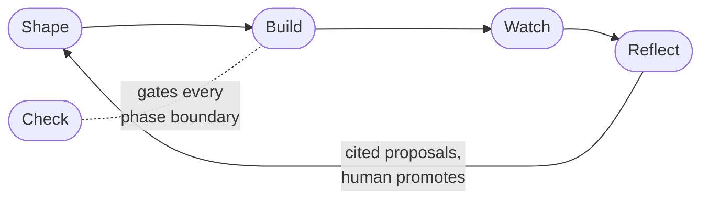

# MANUAL

Operator reference for dwarves-kit: every command and agent, a pointer to the hook inventory (`docs/hooks.md`), plus how to drive the kit from natural language and how to recover when it misbehaves. For the WHY behind any choice, see `docs/PHILOSOPHY.md`. For component fit and the SDLC state machine, see `docs/architecture.md`. For the end-to-end workflow contract (phases, risk-tier lanes, gates, flow/loop diagrams), see `WORKFLOW.md`. The install layers, the lifecycle at a glance, the five stages, the skills roster, the directory layout and the test and CI notes sit in the sections after `## Troubleshooting and recovery`.

Same loop, told as a story: an interview turns your ask into a blueprint, a crew builds it, a
logbook records the run, an inspector stamps every doorway, and a debrief writes up the lesson
for next time. The story names are prose only; every command and file below keeps its real
name. Full tour: `/kit:onboard`. Story-name lookup: `docs/glossary.md`.

## Conventions

- Plugin install path (recommended): commands invoked as `/kit:<name>` (e.g. `/kit:spec`).
- Bash install path: drop the prefix, commands invoked bare as `/<name>` (e.g. `/spec`).
- Hooks have no invocation, they fire on Claude Code events.
- Run-id tag: `/kit:spec` and `/kit:execute` put `rid=<rid>` in the `description` of every subagent they dispatch (`<rid>` is what `bash lib/gate/gate-ledger.sh rid` prints), so a transcript reader can count dispatches and tokens per run. `stats ceremony` reads it.
- Agents have no invocation, they are dispatched by commands.
- Self-intro banner: every `/kit:` command opens its first reply with one line, `[kit:<name>] <one-line purpose>` (from its frontmatter description), and every dispatched agent's report opens the same way, so you always see what is running and why (AGENTS.md "Self-intro").
- Teach on bad input: a command handed a bad or missing input names it, teaches why it matters in one line, and offers the concrete fix, never a dry "invalid input", never proceeding silently. Overrides run but get recorded. Convention + per-command tables: `docs/patterns/teach-on-bad-input.md`.
- Scenarios ride every shaping beat: think/design/grill/spec/test-plan surface survival and must-NOT-happen scenarios via one shared method, generated once at the cheapest altitude and refined downhill, never re-brainstormed from blank. Method: `docs/patterns/scenario-generation.md`; user guide: `docs/guides/scenarios.md`.

## Drive it by intent (start here)

You do not memorize commands. Say what you want; the kit reads your intent, runs the right command(s), and stops only at the real decisions. This table is the interface: find your intent on the left, the kit handles the rest. The `/kit:*` names are shown if you prefer to type them, but you rarely need to.

| You say | Claude invokes | Fires automatically | Stops at |
|---|---|---|---|
| "what's next / what's left" | `/kit:start` (detector) | context-readiness suggestion | nothing (read-only) |
| "assign ID-007" / "start ID-007" | `/kit:assign ID-007` | (none) | hands off to the lane |
| "apply SDD to X" (no ID) | `/kit:assign "<freeform>"` -> `/kit:spec` lane | spec-drift-guard once a spec exists | approve-before-allocate, lane/scope confirm, then per-phase |
| "discuss / iterate the design" | `/kit:design` (+ `/kit:devs-team`) | (none) | every section (human-in-loop) |
| "vague idea about X" | `/kit:think` / brainstorming | (none) | your approval of the objective |
| "run the full lane, your call" | the lane, autonomously | anti-rationalization (in a /goal loop) | hard stops + push/PR |
| "fix this bug / it regressed" | `/kit:debug` (bug lane) | guess-fix guard | root cause + fix verified (`debug.confirm_fix` gates the human step, default off) |
| "review this" / "ship it" | `/kit:review[-team]` / `/kit:ship` | ship gate, push-to-main | DO-NOT-SHIP verdict; the push/PR |
| "can a cold consumer succeed with this artifact alone" (onboarding docs, a runbook, a spec, an API surface) / "test our onboarding" | `/kit:gauntlet` | clean-room probe rounds, artifact revisions between rounds; onboarding is the reference preset | SOLID / REVISE / RECONSIDER (guide: `docs/guides/gauntlet.md`) |
| "who is working on what / who is stuck" | `bin/board work` (`--json` for the schema-1 form, `--idle-min N` for the PARKED threshold) | read-only join of board rows, mega sub-goals, git branches and worktrees, `orca worktree ps` and the run ledger; writes nothing | one table: item, worktree, agent state (working, idle, unknown), rung reached (none, validated, built, reviewed, shipped), lane, flags such as PARKED and DONE-UNSEEN. A worktree Orca does not list falls back to file activity and is marked `(files)`; with Orca itself missing the state reads unknown, never idle |
| "is the ceremony paying for itself" | `bin/stats ceremony` (`--from`, `--to`, `--since-sha` bound the window; `--json`) | read-only lens over the gate records, git and subagent transcripts | gate records and subagent dispatches per run and per week next to lines shipped, PRs merged and problems caught; the share is of gate records, never tokens or time, and an unrecorded value prints `?` |
| "is the gauntlet surface converging / what does a probe round cost" | `bash lib/gauntlet/stats.sh` (`--write` for a dated snapshot) | read-only projection over `docs/verification/gauntlet/` run records | one table: findings trajectory, rounds-to-clean, probe tokens/cost, probe-model deltas |

For the full playbook (every scenario, the autonomy dial, the freeform front door) see `## Operator scenarios`. For a per-command lookup see `## Command reference`. Hooks fire on their own; commands and skills are invoked, by you or by Claude reading your intent.

## Command reference (the kit invokes these from your intent; you rarely type them)

Index by loop stage (formerly "leg", ADR-0034; the "The five stages" section near the end of this manual tells the full story). Front-door and meta commands sit outside the stages on purpose:

| Stage | Commands |
|---|---|
| (front door) | `/kit:start`, `/kit:onboard`, `/kit:adopt` |
| Shape | `/kit:wayfind`, `/kit:grill`, `/kit:think`, `/kit:design`, `/kit:prototype`, `/kit:devs-team`, `/kit:visual-team`, `/kit:ui-design`, `/kit:assign`, `/kit:spec`, `/kit:spec-validate`, `/kit:test-plan`, `/kit:feature-map` |
| Build | `/kit:execute`, `/kit:next`, `/kit:dispatch`, `/kit:mega`, `/kit:debug` |
| Watch | `/kit:explain`, `/kit:pitch` (render the record outward; the read plane itself is the `stats` skill + `session` CLI, not a command) |
| Check | `/kit:review`, `/kit:review-team`, `/kit:test-plan-review-team`, `/kit:test-write`, `/kit:verify`, `/kit:quiz-gate`, `/kit:battery`, `/kit:ship`, `/kit:greenlight` |
| Reflect | `/kit:wrap`, `/kit:retro`, `/kit:docs`, `/kit:absorb` |
| (meta) | `/kit:kit-health`, `/kit:draft-agent`, `/kit:gauntlet` |

### `/kit:start`

**Phase:** entry router
**Reads:** project state (existence of `docs/specs/SPEC-NNN-<slug>.md`, git branch, dirty count, hook log activity, `_meta/BACKLOG.md` queue)
**Writes:** nothing; advises in chat which command to run next
**When to invoke:** opening a fresh session and you do not remember where you left off
**Common gotcha:** the router suggests a next step but does not run it. You decide.
**Spec resolution (dual-mode, SPEC-005):** the active spec is the lone non-SHIPPED/PARKED `docs/specs/SPEC-*.md`; with several live, the one whose slug matches the git branch; if zero or several match, it reports `spec:ambiguous(...)` and asks rather than guessing. Active-spec lookup is root only: `docs/specs/` is the sole location. Spec-number allocation (`spec-next.sh`), `validate-round` and the ship-gate also find co-located `<dir>/docs/specs/` specs via `lib/spec/spec-find.sh`. The same rule drives the `context-readiness` hook, `spec-drift-guard` (which greps the union of active specs), and `/kit:next`.

**Modes (`$ARGUMENTS`):**
- `/kit:start --brief` -- one line, max 120 chars: state + suggested command + `[branch | N dirty | spec]`. For returning users who want a cue, not a report. Example: `Spec VALIDATED, 3/8 tasks -> /kit:execute. [master | 2 dirty | VALIDATED]`
- `/kit:start` -- the default 3-4 line orientation (unchanged from prior versions).
- `/kit:start --full` -- the default block, then: SPEC task checklist, hook-log line counts (last 7 days, counts only, never raw lines), `git log -5 --oneline`, and the command map grouped by phase. For a new user or a deep status check.

### `/kit:onboard`

**Phase:** guided first-run (interactive orchestrator; SPEC-199)
**Reads:** install mode via `lib/onboard-detect.sh` (plugin / bash / both / none); adoption state via `lib/adopt.sh --check`; the module roster + consumer knobs via `bin/config list|explain` (the SPEC-198 registry, never a hardcoded list)
**Writes:** nothing of its own -- it only ever drives `lib/adopt.sh` (to inject the contract and/or seed `<repo>/.kit.toml` with your module choices), and every such write is previewed (`--dry-run` or a shown plan) and confirmed first; a decline is a strict no-op
**When to invoke:** the first ten minutes on a new machine or a repo you have not adopted yet. It ties together the four things that have to line up before the loop works: which install mode is live, whether this repo is adopted, which modules are on, and which env knobs make them non-inert.
**What it does, in order:** (A) detect the install mode and explain it in one line each -- for `both` it discloses the double-hooks hazard and points at the one-path fix but never mutates settings; for `none` it prints the two install paths and stops. (B) offer `/kit:adopt` for the current repo (preview then confirm; an already-adopted repo is reported healthy and nothing is written). (C) pick modules -- the list comes from `lib/config/modules.tsv`, the one module table `install.sh` and `lib/adopt.sh` both read, and the choice is written by driving `lib/adopt.sh --with` (this is how the plugin path, which has no `install.sh --with`, still gets per-repo module selection). (D) for the chosen modules only, surface the consumer knobs that make them non-inert -- a `.kit.toml`-keyed knob is offered as a previewed write, an env-only knob (e.g. `PROSE_RAG_INJECT`, `MONEY_GATE_REPOS`) yields printed `export` guidance. (E) on the plugin path, disclose the gaps honestly (no statusLine HUD, a frozen SHA vs `git pull`, the `--force-both` escape, older spelling `KIT_FORCE_FULL=1`, and its hazard). (F) on the bash path, INSTALL-STAMP staleness is ONE printed line + a `/kit:kit-health` pointer, never an upgrade flow. (G) end with two ideas (the lane, proof of done) and a one-line menu of opt-in commands, then `/kit:start` as the next step; the five-stage story is offered only to a newer user or on request.
**Fence (ADR-0034 decision 4):** onboard ORCHESTRATES; it calls start + adopt + config and reimplements none of them. It never changes `install.sh`, `adopt.sh`, or `bin/config`.
**Common gotcha:** it is not an upgrade wizard. If the kit is already installed and this repo is already adopted, onboard is a read-only health tour that writes nothing; to change modules later you hand-edit `<repo>/.kit.toml [modules]` and re-run `/kit:adopt --refresh`.

### `/kit:adopt`

**Phase:** front door (retrofit the operate-contract onto a repo)
**Reads:** the target dir (default: the repo root), its existing `AGENTS.md` / `CLAUDE.md` / `.kit.toml`, and `lib/config/modules.tsv` for the module list
**Writes:** a small `AGENTS.md` pointer, a `CLAUDE.md` loader, a `WORKFLOW.md` pointer, `docs/verification/README.md` (the proof marker that makes the ship-gate engage), a fresh `.kit.toml`, and the project's `.claude/settings.json` hook entries for the enabled modules (skipped when the plugin is installed)
**When to invoke:** the first time in a repo, or after editing `[modules]` in `.kit.toml` (`--refresh` re-wires). `--check` is status only. `--with a,b,c` seeds those modules in a FRESH `.kit.toml`. `--single-source` keeps one agent guide instead of a CLAUDE.md/AGENTS.md pair. Several repos at once: `bin/wrap adopt <repo>...`.
**Common gotcha:** idempotent and non-destructive. A repo's own `AGENTS.md`, `CLAUDE.md`, or `.kit.toml` is never overwritten, and `--with` on an existing `.kit.toml` is a no-op. It installs pointers, never a copy of `lib/` or the full WORKFLOW. Detail: `commands/adopt.md`.

### `/kit:grill`

**Phase:** intake (between type classification and the phase-0 `Done=` line)
**Reads:** the repo's code, glossary, ADRs, and existing specs (to orient before asking); the task's key nouns and target paths for the unknown-density precheck
**Writes:** each answer where it lives, as it resolves: the glossary (`CONTEXT.md`), `docs/QUALITY.md` for quality requirements, a sparse ADR for a hard-to-reverse trade-off, and the Q&A digest in the goal draft's or spec brief's Context. Records `grill ran` or `grill skipped` in the gate ledger.
**When to invoke:** before work on any non-tiny task whose territory is unfamiliar. A precheck fires the interview when 2 of 3 novelty signals fire (territory, domain, declared), or on declared novelty alone; otherwise it auto-skips with `reason=home-turf`, `density-low`, or `operator-wave`.
**Common gotcha:** one question at a time, each with a recommended answer. The tiny lane is exempt. A skip with no `reason=` token is refused by the ledger (exit 64). Altitudes: grill = what is this, `/kit:think` = should we build it, `/kit:design` = how. Detail: `commands/grill.md`.

### `/kit:think`

**Phase:** challenge an idea before writing a spec
**Reads:** the idea from chat
**Writes:** `docs/briefs/DECISION-BRIEF-<slug>.md` (legacy: `docs/briefs/DECISION-BRIEF.md`) only if the verdict is BUILD
**When to invoke:** before any non-trivial feature. Costs ~5 minutes.
**Common gotcha:** the 6 forcing questions are confrontational by design. If you accept them too easily, the brief is weak.

### `/kit:design`

**Phase:** opt-in interactive solution-design beat (between Think and Spec)
**Reads:** `docs/briefs/DECISION-BRIEF-<slug>.md` (legacy: `docs/briefs/DECISION-BRIEF.md`) (if present), the codebase
**Writes:** appends a `## Solution` section to `docs/briefs/DECISION-BRIEF-<slug>.md` (legacy: `docs/briefs/DECISION-BRIEF.md`) (never clobbers the brief's product framing); when the design is design-bearing, also appends a `## Design` section (diagram + ADR link(s), ADR-0031 §1 / SPEC-122) that `/kit:spec` folds into the spec
**When to invoke:** when you want to shape the solution with the agent (2-3 approaches, one question at a time, approve per section) before `/kit:spec`. Opt-in; skip it and `/kit:spec` works as before.
**Common gotcha:** under bypassPermissions the per-section `AskUserQuestion` prompts may auto-resolve, hollowing the feedback. Use it interactively. It does not execute and is not a gate. Realizes SPEC-008 Part C; forked from `superpowers:brainstorming`.

### `/kit:prototype`

**Phase:** opt-in throwaway-spike beat beside `/kit:design`
**Reads:** the design question at hand, the brief/spec if present
**Writes:** throwaway code on a `prototype/<name>` branch, never in master; the DECISION folds back into the brief/spec
**When to invoke:** a design question resists prose, a state model that only feels wrong once pushed through real cases (logic TUI, driven by hand), or a layout argued in the abstract (3-5 structurally different UI variants on one route)
**Common gotcha:** HITL by contract: the human drives the prototype and makes the call; the agent builds the instrument, it never answers the design question itself. The prototype is throwaway; only the decision survives.

### `/kit:wayfind`

**Phase:** pre-cycle intake shape for work too foggy for one session
**Reads:** the loose idea; the board
**Writes:** `_meta/megagoals/<slug>/map.md` (destination / decisions-so-far / fog / out-of-scope) + typed decision tickets (`research` / `prototype` / `grilling` / `task`), resolved one per session through the kit's own machinery
**When to invoke:** the OPEN questions outnumber the stateable ones. A well-scoped feature belongs on `/kit:grill` + `/kit:spec`; a decomposable build with a clear route belongs on `/kit:mega`; wayfind is only for genuine fog
**Common gotcha:** map-clear hands off to `/kit:spec` or a ROADMAP, never straight to execute. Grilling tickets are never delegated (the agent must not answer its own questions). User-invoked only (`disable-model-invocation: true`).

### `/kit:devs-team`

Opt-in design-critique lane between `/kit:design` and `/kit:spec`. Dispatches 5 engineering lenses (simplicity, performance, boundaries, data-model, operability) in parallel against the `## Solution`, read spec-first (the active spec if one exists, else the pre-spec `docs/briefs/DECISION-BRIEF-<slug>.md` (legacy: `docs/briefs/DECISION-BRIEF.md`)), merges findings, and appends a report-only `## Design critique` (SOLID / REVISE / RECONSIDER) to that same doc. Never blocks `/kit:spec`. The design analogue of `/kit:review-team`. Placement is spec-first per SPEC-023.

### `/kit:visual-team`

Opt-in visual-critique lane (downstream-facing; the kit has no UI). Dispatches 5 design lenses (hierarchy/typography, system-consistency, accessibility/contrast, restraint, expressiveness) in parallel against a described or linked visual design. Report-only. Does not generate mockups. Writes `## Visual critique` spec-first (the active spec if one exists, else the pre-spec brief, else inline-only) per SPEC-023.

### `/kit:ui-design`

Opt-in downstream UI-design loop (downstream-facing; the kit has no UI, so it cannot dogfood this lane). Resolves the active spec (else the pre-spec brief) and writes a structured `## UI design` brief: aesthetic direction (purpose / tone-extreme / constraints / differentiation, the part `frontend-design` reads first), layout, a components-and-states matrix, responsive + named viewports, accessibility bars, a 3-tier token ladder, and copy voice. Delegates generation to the external `frontend-design` skill (the kit ships no renderer; degrades gracefully if it is absent), critiques via `/kit:visual-team`, and runs a bounded auto-revise loop (max 2 regenerations; terminates on a SOLID verdict, RECONSIDER, or the cap). Opt-in, report-only. Depends on the external `frontend-design` skill. Per SPEC-020.

### `/kit:test-plan`

Opt-in lane between `/kit:spec-validate` and `/kit:execute`. Reads the active spec's acceptance criteria and writes a `## Test plan` coverage matrix (with a `proof` column naming the command/artifact per case) into the active spec, across happy-path / boundary / failure-injection / security / regression. `/kit:execute` reads that section as its coverage target and uses each case's `proof` as the per-step verify. A coverage target, not exhaustive; not a roundtable. Next comes `/kit:test-plan-review-team --light` (Coverage and Oracle lenses, one pass), or the full team when the spec's `Depth:` names a blind-spot.

### `/kit:test-plan-review-team`

**Phase:** spec-time critique of the test plan
**Reads:** the active spec's `## Test plan`, its acceptance criteria, and any named failure modes
**Writes:** a `## Test plan critique` section in the same spec (replaces an existing one), and a revised `## Test plan` when the revise loop runs
**When to invoke:** after `/kit:test-plan`, before `/kit:execute`. `--light` is the cheap two-lens pass (coverage, oracle falsifiability) every plan gets; the full 6-lens run is for a spec whose `Depth:` line names a `blind-spot`.
**Common gotcha:** report-only, it never blocks `/kit:execute`. The revise loop is bounded (3 rounds, a distinct reviser, findings must fall by severity). With no `## Test plan` it tells you to run `/kit:test-plan` first and stops. Detail: `commands/test-plan-review-team.md`.

### `/kit:test-write`

Materializes a reviewed test plan into real test code, after `/kit:test-plan-review-team` records a SOLID `## Test plan critique`. Dispatches the `test-writer` agent per matrix row, in the repo's existing test framework and conventions. Refuses to run on a missing, stale, or non-SOLID critique. Done means every row is covered or reported skipped, and the written tests execute; making assertions pass is `fix-agent`'s job in the build, not this command's.

### `/kit:feature-map`

**Phase:** shape (inventory of an existing project)
**Reads:** the project locations you name (one repo or several, each tagged), plus any named surface with no readable source (a Discord channel, a Notion automation), documented by reference
**Writes:** one spec per module (default `docs/specs/<module>.md`) and a top-level checklist (default `docs/CHECKLIST.md`), both source-cited with `file:line`
**When to invoke:** you need to know what a codebase does, or you need a source of truth for a port or migration. It dispatches `kit:research-features` per module in parallel, then asks you to approve the scope.
**Common gotcha:** a named port target gets a Parity contract; a plain inventory gets a Behavior contract. Re-running refreshes: unchanged rows keep their status, drifted rows become `NEEDS REVIEW`, and a signed-off spec is never silently overwritten. It audits a target project, never this kit (that is `kit:topology-drift`). Detail: `commands/feature-map.md`.

### `/kit:assign`

**Phase:** orchestrate (backlog item -> goal draft -> lane)
**Reads:** `$ARGUMENTS` = either an `ID-NNN` (today's path) OR **freeform intent** (anything not matching `^ID-[0-9]+$`, e.g. "apply SDD to X"); `_meta/BACKLOG.md` Active queue, the item's Lane column, `AGENTS.md` zones (the projection source for the six-section goal) + the active spec's `## Verification` / `## After state`. Freeform delegates the crystallize interview to `/kit:think`.
**Writes:** `.claude/goals/<slug>.md` (the SPEC-005 draft contract; never `.claude/last-goal.md`), a six-section operating directive (Context-to-read / Constraints / Operating rules / Validation loop / Done-when / Pause-if). On the **freeform path** it first writes a new sanitized `_meta/BACKLOG.md` row with a freshly allocated ID (row-before-draft, approve-before-allocate).
**When to invoke:** you picked an `ID-NNN` from "what's left?", OR you have a freeform feature idea / vague brief with no ID yet, and want it scoped into a goal and routed into the right lane.
**Suggestion and diff floor:** the classifier defaults to `normal` and never returns `full` from words; a trigger match prints one `LANE-SUGGEST: full (<flags>)` line (recorded in the run ledger with `--rid`). At push, `hooks/ship-gate.sh` runs `bash lib/classify/lane-classify.sh floor <root> <base>`: a diff that touches a migration, auth, secret, CI workflow, `.kit.toml`, or an added data-loss line must carry the full lane's gates whatever the spec's `Lane:` says. One exception, at the ship-gate only: a test file that loops over the canonical SQL injection literal (`for x in "x'; <drop> table t;--"`) as rejection input does not count as a data-loss line; the push prints a `data-loss skip` advisory for each one (SPEC-412). Lane phases are data in `kit.toml` `[lane.<name>]`; `docs/WORKFLOW.md` shows them. A `start --amend` line in the run ledger overrides the spec's `Lane:` at push (last amend wins, up or down); the diff floor above still applies.

**Floor check (advisory):** after the lane is chosen, it runs `bash lib/classify/lane-classify.sh check <chosen> "<title>"`. A `LANE-DOWNGRADE` warning means the task text matches a heavier lane than you chose: size up, or narrow the scope and say why. It warns + logs to `completeness.log` (reviewed at `/kit:ship`); it never blocks ("Detect, don't dictate"). This is the guard for the classify-then-route gap: the classifier suggested a lane, but nothing caught an under-sized choice until now.
**Common gotcha:** it is a mutator-dispatcher: it sets up the goal and hands off, it does NOT execute. The freeform path **delegates** the interview to `/kit:think` (it does not embed one). It detects the goal-loop activator (built-in `/goal`, `ralph-loop`, or `goal-craft`) and degrades to a plain draft file if none is installed. Idempotent per id (and per slug for freeform). Source: SPEC-006 + ADR-0011; freeform front door SPEC-026; floor check SPEC-053.

### `/kit:dispatch`

**Phase:** orchestrate / cross-phase (N specs -> N concurrent worktree workers -> converge)
**Reads:** `$ARGUMENTS` = the specs to fire (or detects `Status: VALIDATED` specs with a `## Touches` section); each spec's `## Touches` directory-prefix globs; the lead-owned hands-off shared-surface list (from WORKFLOW.md, via `lib/gate/dispatch-gate.sh`).
**Writes:** nothing in the main checkout itself. Each dispatched worker writes its own `goal/<slug>` branch in an isolated worktree; the lead integrates the hands-off surfaces once via `/kit:ship`.
**When to invoke:** you have 2+ INDEPENDENT validated specs and want to fire them, tab away, and collect finished branches. The disjointness gate (`lib/gate/dispatch-gate.sh`) decides which run in parallel vs serialize; the drift guard checks each worker stayed in its globs.
**Common gotcha:** cross-goal ONLY (it never parallelizes one spec's tasks; that is `/kit:execute`, still sequential). It NEVER auto-merges (the human merges at `/kit:ship`) and is NOT a DAG: dependent/sequenced sub-goals are `/kit:mega` territory (its orchestrator runs waves of dependency-independent sub-goals with disjoint `## Touches` concurrently, default `WAVE_CAP=2`); a full ordering-graph scheduler with crash recovery is GSD v2. A spec without `## Touches` is rejected by the gate, not assumed-empty. Runs under bypassPermissions for tab-away. Source: SPEC-032; ADR-0019 (boundary), ADR-0020 (primitive), SPEC-031 (convergence).

### `/kit:mega`

**Phase:** orchestrate / cross-phase (one destination -> 3-8 dependent sub-goals -> one bounded loop, one PR per sub-goal)
**Reads:** the conversation's multi-objective intent; `CLAUDE.md` for a `megagoal_root:` / `mega_merge_posture:` hint; each sub-goal's `Done =` + ship-gate ledger via `lib/gate/gate-ledger.sh`; `lib/gate/proof-ledger.sh deployable` (SG-07's classifier) to decide the deploy/UAT terminus.
**Writes:** the scaffold (`ROADMAP.md`, `goals/NN-*.md`, `POINTER_PROMPT.md`, `HANDOFF.md`, `DECISIONS.md`) at the resolved mega-goal directory (SPEC-034 DEC-002: `.claude/goals/<slug>/` for this repo, never `_meta/`, which is reserved for the BACKLOG cockpit). Nothing else until the loop runs; `/kit:mega` itself opens no PR.
**When to invoke:** ONE destination reached through 3-8 genuinely DEPENDENT sub-goals (a single chain, no fan-in/fan-out) -- the sequenced complement to `/kit:dispatch`'s independent/parallel case.
**Common gotcha:** it MIRRORS the ops-toolkit `plan-for-mega-goal` skill's decompose + front-load-checkpoint + per-run-merge-config beats; it does not fork or replace the skill (prefer the skill when installed for anything this command does not cover). Ship-layer auto-merge is real but narrow: only an `auto`-tagged sub-goal's PR can auto-merge, and only once `lib/goal/mega-merge.sh gate` confirms its ship-gate passed (`lib/gate/gate-ledger.sh check`, reused verbatim, never re-implemented, plus the ship-gate's large-spec validate rule and hard-path floor through the shared `lib/gate/ship-rules.sh`, so a green gate means the push passes them too; SPEC-399); a failing/missing gate REFUSES unconditionally, and the action is dry-run unless `--execute` is passed. `gate`-tagged sub-goals and the final PR under the default `gated-final` posture always stop for a human; the command opens them via `lib/goal/mega-merge.sh mark` (draft + `do-not-merge`) so the `_merge_exclusion` guard always has a mark to catch (SPEC-100 mark half, ID-089). `MEGA_MERGE_POSTURE=per-pr-review` (or `--posture=per-pr-review`) forces dry-run on every PR for a team run, overriding `--execute`. **Opt-in Orca backend (trial):** `bash lib/queue/orchestrate.sh run <dir> --backend orca` (or `MEGA_BACKEND=orca`; the flag wins) runs the same ROADMAP through Orca Tasks and supervised Claude workers instead of one `claude -p` per sub-goal. It is off unless asked for and never changes the default run mode. `orchestrate.sh status <dir>` prints one derived state per sub-goal (READY, RUNNING, PARKED, HELD, DONE-UNSEEN, DONE and so on); the ROADMAP box stays the only proof of done; `orchestrate.sh orca-reset <dir>` rolls one run back. Source: ADR-0028 P2/P3; SPEC-034 (roadmap conventions, ID-037); SPEC-096 (this command + `lib/goal/mega-merge.sh`, kit-hardening SG-08); SPEC-095 / SG-07 (the reused `deployable` classifier).

### Multi-session concurrency (the running-goal registry, `lib/goal/goal-registry.sh`)

`/kit:dispatch` is the single-session axis (one lead, N workers). The other axis is
**multi-session**: one operator opens several Claude sessions on one machine (one goal
each) and walks away. A passive registry under
`$(git rev-parse --git-common-dir)/kit-goals/` (shared by every worktree, never committed)
keeps the sessions from colliding. It is a `lib/` helper, not a slash command.

- `bash lib/goal/goal-registry.sh claim <slug> <lane> <glob>...` -- register a goal. Admitted
  only if its globs are disjoint from every active goal (the `lib/gate/dispatch-gate.sh` rule,
  reused); an overlap is REFUSED with the colliding goal named. `/kit:assign` runs this.
- `bash lib/goal/goal-registry.sh list` -- the cross-session monitor: every running goal +
  lane + status. Surfaced by `/kit:start` (count always, full table in `--full`). It is
  the kit-level companion to the native agent view, which sees only one session's workers.
- `bash lib/goal/goal-registry.sh log <slug> "..."` -- append to the goal's attempt log
  (`<slug>.attempts`), the running, human-legible "what it tried" trail.
- `bash lib/goal/goal-registry.sh status <slug> <state>` / `release <slug>` -- update status /
  drop the entry on completion. A stale `running` entry from a crashed session shows in
  `list` and is cleared with `release` (no GC daemon, by design).

**Common gotcha:** the slug is the bare spec/goal slug (no `goal/` prefix, no slashes).
What stays L5 (Nimbalyst / GSD v2): coordination across machines, by 3+ live human
operators, or with goal-ordering chains. The registry records and compares; it never
schedules, sequences, or merges. Source: SPEC-036; ADR-0022.

### `/kit:spec`

**Phase:** generate the development spec
**Reads:** `docs/briefs/DECISION-BRIEF-<slug>.md` (legacy: `docs/briefs/DECISION-BRIEF.md`) (if present), the codebase via the 4 parallel research subagents when the `Depth:` line asks for repo research, or chat (greenfield)
**Writes:** `docs/specs/SPEC-NNN-<slug>.md` (Status: DRAFT), `docs/research/YYYY-MM-DD-<slug>-{stack,features,architecture,pitfalls}.md`
**When to invoke:** after `/think`, or directly if the work is well-scoped already
**Depth:** step 1 writes a `Depth:` line under `Lane:` (`standard`, `research (repo|outside: ...)`, `blind-spot (failure: ...)`). Research runs only when the line asks for it, so a `standard` brownfield spec sends zero research agents; `bash lib/spec/spec-depth.sh check <spec>` validates the line.
**Common gotcha:** the research agents (when the depth asks for them) are parallel-dispatched via Task tool. If your Claude Code is older than v2.0.60, they fall back to inline research and the run is slower.
**Template sections:** the generated spec scaffolds Solution depth (approaches / chosen + why / extensibility, SPEC-008), plus an optional `### Interfaces (I/O contract)` under Technical Design and an optional `## Failure modes` table. Both optional sections are lane-scoped; Reviewers 2 and 5 check them when present. It also pins `## Verification` (the command(s) that prove the spec done) and `## Open questions` (the blocker landing zone a `/goal` loop appends to), so a validated spec is natively pointer-`/goal`-ready (SPEC-012 P1). An optional, on-demand `## Amendments` section (added only when a mid-flight amend happens, never an empty scaffold) records add-scope provenance during a build.

### `/kit:spec-validate`

**Phase:** adversarial review of the spec
**Reads:** `docs/specs/SPEC-NNN-<slug>.md`
**Writes:** the Spec Validation Report; on APPROVED, Status VALIDATED and `Validate ran`; on NEEDS REVISION, `Validate skipped "NEEDS REVISION: <criticals>"`; on a Reviewer 6 critical, `design-record skipped "critical: <finding>"`. Dispatched READ-ONLY, it writes nothing and the lead records.
**When to invoke:** rarely by hand. `/kit:spec` step 5 dispatches it in a fresh-context `general-purpose` subagent after `Spec ran` (Sonnet for Reviewers 1 to 5 and 7 on every lane, Reviewer 6 on Opus), and `/kit:execute`'s validation preflight dispatches it on a normal, full, or backfill spec whose rid has no passing validate line; a critical stops execute before task 1. Both run it on large specs only: a small spec (normal lane, `standard` or absent `Depth:`, at most 3 tasks; `bash lib/spec/spec.sh depth size <spec>`) records a Validate override and relies on the post-build review. `/kit:wrap` step 10 workers stop with `VALIDATE PENDING` and the lead validates. Never run it on a spec you wrote: a self-run pass is not validation.
**Common gotcha:** 7 reviewers (security, failure-mode, assumption-destroyer, scope-critic, solution-design & extensibility, design-record, sustainability) run sequentially. Budget ~12-14 minutes. The 5th reviewer flags shallow or non-extensible designs and is calibrated against false positives + legacy specs. The 6th, Reviewer 6 (SPEC-122 / ADR-0031 §1), is the one BLOCKING check in the set: a design-bearing spec with an empty `## Design` block cannot flip to VALIDATED. The 7th (SPEC-314) is advisory: a spec that leaves a long-lived job, service, dependency, credential, or paid call behind must answer run cost, owner and liveness, dependency lifespan, retirement, and handover; a short-lived spec passes in one line.

### `/kit:execute`

**Phase:** autonomous build
**Reads:** `docs/specs/SPEC-NNN-<slug>.md` (must be Status: VALIDATED or APPROVED)
**Writes:** code, tests, marks SPEC task checkmarks, appends to SPEC Decision Log
**Dispatches:** one builder subagent for the whole spec, then one end `task-verifier` pass over every task, `integration-verifier` (multi-task), `acceptance-verifier`, and `fix-agent` on FAIL:fixable (retry max 2); `recheck-verifier` on a sampled run (`execute.recheck_sample`, default 1 in 5 keyed on the rid; every PASS on the full lane) and on every self-attested row
**When to invoke:** when handing off to a contractor OR running the kit on yourself end-to-end
**Common gotcha:** a defect surfaces at the end of the build, not after the task that caused it; per-task commits localize it. A build that cannot meet a criterion after two fix rounds ends `Result: PARTIAL` and names the unmet criterion. A spec with more than 6 tasks splits into slices up front. The builder gets a brief (goal, acceptance, routes, territory) and decides its own build order.
**Mid-flight amend:** if a build reveals scope that must be added now ("also do Y"), do not silently edit the spec or restart the lane. With your approval, amend at a task checkpoint (append `- [ ]` tasks, record an `## Amendments` entry, Status stays VALIDATED) and resume with `/kit:next`. The canonical rule is WORKFLOW.md "## Mid-flight amend"; the operator card is "## Operator scenarios" Scenario 6 below.

### `/kit:next`

**Phase:** manual single-task build
**Reads:** `docs/specs/SPEC-NNN-<slug>.md`
**Writes:** code, tests; you drive the verification yourself
**When to invoke:** when you want hands-on control or the next task needs subtle judgment that the verification pipeline might over-correct on
**Common gotcha:** picks the next unchecked task only. To skip a task or pick a specific one, edit SPEC.md task ordering first. This unchecked-only behavior is also why `/kit:next` (not a fresh `/kit:execute`) is the way to resume after a mid-flight amend: it runs the newly appended tasks and skips the done rows.

### `/kit:draft-agent`

**Phase:** build (meta-tooling)
**Reads:** a one-line role description (or a unit-of-work description) from `$ARGUMENTS`
**Writes:** by default INSTALLS a new subagent, `agents/<name>.md` + the roster rows (MANUAL/architecture) + `~/.claude/agents/<name>.md` for runtime; `--draft` stops at a staged draft; `subgoal:` mode drafts a mega-goal sub-goal file (never installed)
**Dispatches:** the `meta-agent` (drafts to staging; the command promotes/installs)
**When to invoke:** when a task needs a specialist role no existing agent covers and you want it as a reusable, named kit agent. `/kit:execute` does not dispatch the meta-agent; it picks a builder with the `role-classify.sh agent-for` lookup (see below).
**Common gotcha:** a freshly installed agent is dispatchable only NEXT session (Claude Code loads the agent registry at session start); the command prints the granted tools + an `rm` undo. Sharing an installed agent with the team still goes through a reviewed PR. Design: SPEC-089.

Related, **builder lookup** (inside `/kit:execute`): the spec text is classified by `lib/classify/role-classify.sh`, and `agent-for <domain>` names a predefined worker (`db-migration-worker`, `data-etl-worker`) as the builder's `subagent_type`; an empty result runs the general builder. `/kit:draft-agent` is the manual, install-a-named-agent path.

### `/kit:debug`

**Phase:** off-cycle (the `bug` lane: defect, regression, failing test, not a new feature)
**Reads:** the bug report / error / failing test, `git diff`, `git log`, `git bisect`
**Writes:** `.claude/debug/<slug>.md` (the evidence ledger), `.claude/debug/<slug>.log` (tagged instrumentation), then a failing test + a single root-cause fix
**When to invoke:** when something is broken and you would otherwise guess-fix. Runs four phases (root cause -> pattern -> hypothesis -> fix) under the iron law "no fix without a recorded root cause," with a 3-failed-fixes-question-architecture wall.
**Common gotcha:** while the ledger's `## Root cause` is blank, the anti-rationalization hook blocks any guess-fix "done" claim and sends you back to Phase 1. That guard is gated on an open debug session, so it never fires in normal coding. After a confirmed fix, run `/kit:review` on the diff. Forked from `superpowers:systematic-debugging` + GSD/doraemonkeys mechanisms; see ADR-0012.

### `/kit:review`

**Phase:** paranoid single-pass review
**Reads:** `git diff`, `docs/specs/SPEC-NNN-<slug>.md`
**Writes:** a `## Review` section in the active spec (replace-not-stack); inline in chat if no spec exists
**When to invoke:** small change (under ~300 lines diff) where one careful pass beats parallel lens-reviewers
**Common gotcha:** outputs a verdict (`SHIP / FIX-REQUIRED / REJECT`). `/ship` reads this and gates on it.

### `/kit:review-team`

**Phase:** parallel 3-lens review
**Reads:** `git diff`
**Dispatches:** 3 `code-reviewer` subagents (security, architecture, test-coverage lenses) in parallel + the deeper `security-reviewer` agent
**Writes:** a `## Review` section in the active spec with per-lens subsections (replace-not-stack); inline in chat if no spec exists
**When to invoke:** medium-to-large diff (>300 lines) or any change touching auth, payments, multi-tenant boundaries
**Common gotcha:** the FIX-THEN-SHIP path dispatches `responding-to-review` to triage findings without performative agreement. `review.apply_findings` ships `true`, so `fix-agent` applies every finding `responding-to-review` VERIFIED and the PR is your review surface; a finding it pushed back on is never applied. Set the key `false` to have them proposed for you to apply by hand.

### `/kit:verify`

**Phase:** on-demand test re-run (V-model right arm), read-only
**Reads:** the active `docs/specs/SPEC-NNN-<slug>.md` (done tasks + acceptance criteria), the working tree / branch
**Dispatches:** `task-verifier` (per done task) + `integration-verifier` (multi-task), read-only
**Writes:** nothing; prints a PASS/FAIL verdict (never dispatches `fix-agent`)
**When to invoke:** after a manual edit post-build, on a branch built elsewhere, or for a read-only `/goal`-loop check, when you want the test levels re-run without a rebuild
**Common gotcha:** it reports, it does not fix. On FAIL, run `/kit:next` or `/kit:execute` to repair. The integration base ref is the merge-base with the default branch (no build base ref exists outside `/execute`).

### `/kit:battery`

**Phase:** verify (the full independent right arm for a finished branch)
**Reads:** a target (default: the cwd branch; or a worktree path, or `owner/repo#N`), the spec's `## Verification`, and the diff against the compare ref
**Writes:** no code. Three legs run in parallel in fresh contexts: acceptance verify (re-executes the commands verbatim), code review (domain lenses on escalation), and the `kit:advisor` lens. Findings merge into one verdict (SHIP / FIX THEN SHIP / DO NOT SHIP), recorded in the gate ledger under the branch slug; the lead applies fixes.
**When to invoke:** you ask for "the battery" or "overtest this", or a LARGE or hard-path change finishes. A Size gate (`lib/gate/battery-gate.sh`) prints `SKIP` below the changed-line floor (150 by default) unless the diff touches a hard path.
**Common gotcha:** a SKIP is final unless you explicitly asked for the battery; a small change owes a proof of done instead. State a numeric baseline of known failures, or known debt reads as new failures. Never review inline in the session that wrote the code and call it the battery. Detail: `commands/battery.md`.

### `/kit:docs`

**Phase:** doc sync
**Reads:** `git diff`
**Writes:** updates README.md, CHANGELOG.md, and any other doc files whose content drifted from code
**When to invoke:** after `/execute` succeeds, before `/ship`
**Common gotcha:** the command does not invent doc content. If a feature is undocumented in the spec, the command will not document it from the diff alone.

### `/kit:explain`

**Phase:** understanding (the AFTER gate, ADR-0031 §2)
**Reads:** a git ref (`$ARGUMENTS`: a commit / PR / spec), the ACTUAL diff via `lib/explain.sh`, plus recorded test results under `docs/verification/`
**Writes:** a literate-diff explainer artifact under `docs/verification/explain-command/`, background -> goal + intuition -> a prose-ORDERED diff (reading order, not git alphabetical) -> a diagram
**When to invoke:** after a significant change ships, when you want to UNDERSTAND it (stay a participant in the next loop) instead of click-to-merge a raw diff. Advisory, never blocks (engage / defer / wave).
**Composes:** `narrate-log` (the prose arc) + `svg-knowledge-diagram` (a richer figure); the kit does not reinvent pedagogy.
**Common gotcha:** the explainer is grounded in the diff, NOT the agent's narrative, if the commit message or your recollection contradicts the code, the diff wins. The 5-question quiz built ON this artifact is a separate step (`deep-understand`); this command produces the material, not the quiz.

### `/kit:pitch`

**Phase:** understand (the outward twin of `/kit:explain`)
**Reads:** for one `<rid>` (the branch slug): the spec, the proof-of-done, `docs/implementation-notes/<rid>.md`, and the gate ledger's grill and DEBT lines
**Writes:** the 5-section doc (Outcome, Unknowns we accounted for, Evidence, Cost / not shipped, The ask) to stdout, or to `--out <file>` (for example `docs/verification/pitch-command/pitch-<rid>.md`); records `pitch ran` in the gate ledger
**When to invoke:** after a gated run, when a teammate, client, or approver who was not in the room must decide whether to say yes.
**Common gotcha:** it assembles, it does not write. Every claim traces to a file or ledger line, and a missing source is reported as missing, never invented. It never posts anywhere; sending the doc is your action. Engine: `lib/pitch.sh`. Detail: `commands/pitch.md`.

### `/kit:quiz-gate`

**Phase:** understanding (the AFTER gate's speed regulator, ADR-0031 §2/§3)
**Reads:** a git ref + `<rid>` (`$ARGUMENTS`), the ACTUAL diff + recorded tests via `lib/gate/quiz-gate.sh` (which reuses `lib/explain.sh`), and `lib/classify/significance-classify.sh`'s verdict for the change
**Writes:** the human's engage/defer/wave choice to the debt ledger (`| DEBT | response=...` via `gate-ledger.sh debt-response`); on engage, dispatches the `deep-understand` mastery gate with 5 diff-grounded questions
**When to invoke:** at the merge boundary of a `gate`/gated-final PR. It NUDGES only when the change is `tap` (significant AND understanding-worthy); a `wave` or `not-significant` change is never quizzed (anti-fatigue). Advisory, never must-pass, a waved change still merges.
**Composes:** `deep-understand` (the AskUserQuestion mastery gate); the kit builds the questions and routes, it scores nothing.
**Common gotcha:** the quiz questions come from the DIFF + recorded tests, NEVER the agent's narrative, a quiz on the agent's misconceptions is worse than none. `questions`/`route` take a git ref only, so a false story cannot leak in. This gates the human's ATTENTION, not the merge.

### `/kit:ship`

**Phase:** review gate, version bump, changelog, commit, PR
**Reads:** `docs/specs/SPEC-NNN-<slug>.md` (including its `## Review` verdict), `VERSION`, the resolved changelog file (`docs/CHANGELOG.md` if it exists, SPEC-185, else root `CHANGELOG.md`)
**Writes:** bumped `VERSION`, a new entry in the resolved changelog file, git tag, PR via `gh`
**When to invoke:** review is green and docs are synced
**Common gotcha:** the command stops, and `hooks/ship-gate.sh` refuses `git push` and `gh pr create` (`[gate] review_verdict`, on by default), while the last verdict in the spec's `## Review` section is DO NOT SHIP. Use `/review-team` and `responding-to-review` to triage, then re-run `/kit:review`: it replaces the section and clears the block.
**Release-hygiene warn (Step 4a):** at the version step it warns (never blocks) on a phantom cut, `VERSION` naming a version with no matching git tag, with a heads-up when `[Unreleased]` is accumulating above it. Warn-only; tag `v<version>` or confirm intentional, then continue.

### `/kit:greenlight`

**Phase:** ship, after the push (CI-green lane)
**Reads:** an open PR through `gh` (the PR number in `$ARGUMENTS`, or the PR for the current branch): its state and check rollup
**Writes:** fix commits to the PR branch, only after a real failure is fixed through the `kit:fix-agent` shape and the project's tests pass locally. It opens no PR and posts no comments.
**When to invoke:** a PR is open and its checks are red or pending.
**Common gotcha:** opt-in and report-only; it never hard-gates ship or merge, and the human merges. It classifies each failure real vs flaky (uncertain means real), retries flaky checks 3 times per commit, and stops at 10 iterations. Ends in exactly one state: `done`, `stop_pr_closed`, `stop_exhausted_retries`, or `stop_error`. Bot-comment triage is not built. Detail: `commands/greenlight.md`.

### `/kit:retro`

**Phase:** post-release reflection
**Reads:** `docs/specs/SPEC-NNN-<slug>.md` (completion rate), `git log`, prior `docs/retro/*.md`
**Writes:** `docs/retro/v<version>.md`
**When to invoke:** after `/ship` lands; one per minor or major release, patch releases append to parent retro
**Common gotcha:** action items become real only if you carry them to the next cycle's spec. Track them, do not just write them.

### `/kit:absorb`

**Phase:** maintainer connective tissue (external absorption audit)
**Reads:** the Credits section of this manual + the pinned seed list in `docs/ABSORPTION.md`; prior proposals under `docs/absorption/`
**Writes:** a dated, proposal-only report under `docs/absorption/` (never a kit component; ends with a `git status` self-check)
**When to invoke:** the monthly-ish absorption ritual, re-audit upstream sources for new/changed patterns worth adopting
**Common gotcha:** maintainer-only and proposal-only, it never absorbs or adds a source to Credits itself (the human merge gate). Two lanes: Credits drift + a seed-rescan of the SPEC-014 set. QA/UI candidates needing binaries surface as "recommend external". Source: SPEC-004 + `docs/ABSORPTION.md`.

### `/kit:gauntlet`

**Phase:** meta (probe-convergence loop over an artifact)
**Reads:** four slots you confirm before round 1: the artifact under convergence (globs the reviser may touch), the outcome contract (probe card, checker, Tier 1 suite), the probe framing, and the clean-room recipe. `onboarding` is the reference preset.
**Writes:** revisions to the artifact between rounds, and a persisted run record each round under `docs/verification/gauntlet/` (read back with `lib/gauntlet/stats.sh`)
**When to invoke:** before an artifact faces cold consumers unaided (contributor docs, a runbook, a spec, an API surface), and after a major change to one.
**Common gotcha:** the artifact evolves; the probe is fixed and disposable, a fresh clean-room agent each round. A bare invocation asks which preset and never assumes `onboarding` in a repo without its fixtures. The loop is bounded and halts honestly. A host artifact needs explicit confirmation before round 1 because teardown is destructive. Detail: `commands/gauntlet.md`.

### `/kit:kit-health`

**Phase:** self-assessment against PHILOSOPHY.md
**Reads:** the kit itself (file counts, hook performance, settings validity, source citations), plus a repo-scoped release-hygiene check (a phantom cut: `VERSION` names a version with no matching git tag; degrades to a no-op outside the repo)
**Writes:** verdict in chat (`SHIP / FIX-REQUIRED / REJECT`)
**When to invoke:** maintainer-only, before tagging a release of the kit (the release-hygiene check is exactly the "before tagging" guard)
**Common gotcha:** the rejection-first verdict will REJECT on real violations. Do not soften the criteria; address them.

### `/kit:wrap`

**Phase:** session close-out (landing + optional distillation)
**Reads:** board, git state, `kit.toml` knobs (`wrap.*`), the session itself
**Writes:** commits/merges/tidies per the landing steps, the step-9 report; the distill half writes to home repos (memory notes, in-lane candidate builds)
**When to invoke:** "wrap up", "close out", "land it". The distill half resolves from `wrap.distill` (root-only): `true` runs it every wrap, `false` lands only, and `"harvest"` hands it to the transcript harvest sweep on hosts where the sweep is installed (the `sweep/installed` marker plus `harvest.enable`); there the report says `SKIPPED: distill runs in the harvest sweep` and carries a `STATE` row from `harvest_sweep.py --status`. On a host with no sweep, `harvest` resolves as `true`. The `distill` word in the invocation wins for one run either way.
**Landing refusal:** `bin/wrap land` (and `wrap adopt`, which calls it) also refuses, before anything is pushed or opened, when the worktree holds a gitignored file under a directory the branch touches, because a clean checkout will not have it and tests that read it pass only here. It prints each path with `LAND REFUSED` and exits 1. Build output, tool caches, local config, and the kit's own state are always allowed; `wrap.land_ignored_allow` (root-only, the operator or kit-root `kit.toml`) adds entries, and a project `.kit.toml` is never read for it. A secret-shaped path (`.env*`, a key, a credential, a token) never gets a commit hint. An unattended loop (a wrap step 10 worker, a `/goal` loop, a mega-goal wave) stops on this refusal and reports it to a human: it never retries, commits the file, deletes it, or adds an allow entry by itself.
**Common gotcha:** the knob is per-host in effect, not per-repo: a synced operator `kit.toml` that says `harvest` does not switch the mode on a machine the sweep was never installed on, which is what keeps wrap distilling where no sweep exists.

## Hooks (no invocation)

The full hook inventory (every hook, its event, the message it prints, its knobs, and its
source file) lives in ONE place: `docs/hooks.md`. For which hook backstops what and why (hard /
advisory / convenience), read `docs/architecture.md` "Hook fallback layer". This section
deliberately does not duplicate the inventory: a second copy drifted to 14 of 25 rows before the
2026-07-31 doc-drift run caught it, missing `ship-gate` among others.

One advisory worth knowing by name: `context-readiness` (SessionStart) reads the active spec's
status plus the board's queued count (`board:Nq`, SPEC-083) and suggests the next step; silent
when the project is healthy.

What to remember here: the blocking hooks, everything else advises or warns.

| Blocker | Event | What it stops |
|---|---|---|
| `safety-gate` | PreToolUse(Bash) | `rm -rf` (build-artifact allowlist), push to main, force push, `DROP TABLE`, `git reset --hard`, `kubectl delete`. Override needs explicit user OK. |
| `ship-gate` | PreToolUse(Bash, on push/PR-create) | Shipping without a recorded proof-of-done / gate-ledger record for the lane, or a diff that touches a hard path (migration, auth, secrets, CI workflow, kit config, data loss) without the full lane's gates. The answer to "why did my push get blocked": run `/kit:verify`, run the gate it names, or record the audited override. |
| `secrets-guard` | PreToolUse(Read\|Edit\|Bash) | Reads of secret files (`.env`, `~/.ssh`, `~/.aws`, `.pem`); canonicalizes the path first. Allows `.env.example`. Best-effort on the Bash surface. |
| `commit-format` | PreToolUse(Bash) | A `git commit -m` subject that is non-conventional, >72 chars, or carries a SPEC-/TASK-/phase marker. Subject only. |
| `anti-rationalization` | Stop | Premature "done": rationalization phrases, guess-fix during an open `/debug` session, unimplemented-stub markers in the diff. |

### Harvest sweep (scheduled capture)

The `harvest` hook stages learnings when a session compacts or ends. The harvest sweep is the scheduled path beside it. It reads new claude transcripts (plus devin when `harvest.sources` lists it) behind a per-source cursor, extracts learnings, stages them into ledgers, and writes a wrap-shaped report. It builds, pushes, and merges nothing.

| Command | What it does |
|---|---|
| `bash hooks/harvest.sh --sweep` | One run. Needs `harvest.enable = true` and the host marker; otherwise it exits 0 without work. |
| `... --sweep --dry-run` | Prints the manifest a run would produce. Changes no cursor, ledger, or report state (only the raw extract cache is written). |
| `... --sweep --since <iso\|epoch>` | Reads sessions from that time instead of the cursor. |
| `... --status` | Prints the newest report path, its candidate count, and the queued learning count, or `none`. |
| `... --flush-list` | Prints every queued learning as one JSON array. |
| `... --mark-flushed <row-id> <ref>` | Marks one learning routed to a durable home. |
| `bash deploy/macos/harvest-sweep/install [--apply\|--uninstall]` | Dry-run by default. `--apply` renders the LaunchAgent and writes the per-host `installed` marker. `--uninstall` removes both and keeps state. |

**Per host, not per repo.** A synced operator `kit.toml` cannot switch the sweep on. Only a host where `install --apply` wrote the marker sweeps. On that host the per-session hook stands down, unless `harvest.hook_when_sweep_on` is true.

**Extractor and fallback.** Each session is one `claude -p --model <harvest.extractor_model>` call (default `sonnet`, about 3 to 5 times Haiku's quota a call) with every tool, MCP server, and session write off. When it fails for any reason but auth, the same prompt runs once through `codex exec --sandbox read-only --ephemeral --ignore-user-config` on the host's ChatGPT login, from an empty 0700 temp dir, prompt on stdin. The reply goes through the same checks and redaction, and the report carries `STATE <source>: extractor fallback used: codex (limit|error)`. `harvest.extractor_fallback = "none"` turns it off; `harvest.extractor_fallback_model` passes `-m`. Codex cannot disable its shell: the sandbox blocks writes and network, not reads (SPEC-357 DEC-92).

**Usage limits.** A 5-hour or weekly limit that the fallback cannot cover holds the run: it stops, keeps the cursor, counts no failure, and exits 0. A probe that hits the limit holds too, so a limit never pages as an auth failure. The next scheduled run resumes.

**Reading the result.** Run `--status`, open the report it names, and flush queued learnings with `--flush-list` then `--mark-flushed`. Install detail: `deploy/macos/harvest-sweep/README.md`.

## Agents (dispatched, not invoked)

| Agent | Dispatched by | What it does |
|---|---|---|
| `task-verifier` | `/execute` (one end pass over every task) | Read-only verification of a task's acceptance criteria |
| `fix-agent` | `/execute` | Targeted fixes on FAIL:fixable (max 2 retries) |
| `integration-verifier` | `/execute` (Step 4, multi-task) | Read-only: verifies the tasks wire together (each component reaches its activation point + the spec's end-to-end chains) |
| `doc-verifier` | `/docs` (Step 4.5) | Read-only: fact-checks the just-updated docs against the live code (counts, names, existence, cross-refs); reports drift, `/docs` fixes |
| `agent-effectiveness` | `/kit:draft-agent` (Step 4.7) | Read-only: validates a new/changed agent def's effectiveness (tools minimal-yet-sufficient, description fires right, instructions unambiguous, tier fits); diff-keyed, advisory, fail-safe |
| `code-reviewer` | `/review-team` | Focused review with configurable lens |
| `security-reviewer` | `/review-team` | Deep OWASP-style audit |
| `break-it` | `/kit:battery` (escalation lens, behavioral code with tests) | Read-only adversarial prober: hunts one concrete input or call sequence the suite does not constrain, returns `PROBE`/`NO-PROBE`; rung 2 of the coverage -> probe -> mutation ladder, before `lib/gate/mutation-smoke.sh` |
| `advisor` | `/review-team` (Step 2b) and `/kit:battery` (leg 3), critique; `/kit:spec` design-time pass and `/kit:mega` convergence gate, over-suggest | Read-only kit-default EXTRA cross-cutting lens; two modes (P5 critique + P6 over-suggest); additive, never replaces the specialized reviewers |
| `brief-reviewer` | (right-arm parity roster; dispatchable on the brief/decision doc) | Read-only static left-arm reviewer of the design brief (`DECISION-BRIEF-<slug>.md` or a spec's Problem/Context) for clarity, completeness, testability |
| `acceptance-verifier` | (right-arm parity roster; dispatchable at the spec's acceptance boundary) | Read-only dynamic verifier: executes the active spec's `## Verification` section end to end, maps each AC to a passing check |
| `system-verifier` | (right-arm parity roster; dispatchable as the whole-project check) | Read-only dynamic verifier: runs the full unscoped project test suite, the right-arm mirror of design |
| `recheck-verifier` | `/execute` (fresh-context re-audit over a sampled right-arm PASS and every self-attested row) | Read-only: RE-EXECUTES a right-arm verifier's recorded check in a fresh context and re-judges; never a read-back of recorded evidence; the ADR-0028 trust metric made real |
| `responding-to-review` | `/review-team` (FIX-THEN-SHIP) | Triages findings without sycophancy |
| `slop-stripper` | `/review-team` (Step 5, opt-in deslop strip) | Behavior-preserving AI-slop strip pass: surgical edits only, never behavior changes unless fixing a real bug |
| `research-stack` | `/spec` | Brownfield stack mapping |
| `research-context` | `/spec`, `/kit:test-plan` | Quick brownfield orientation, capped at 80 lines |
| `research-architecture` | `/spec` | Brownfield architecture patterns |
| `research-pitfalls` | `/spec` | Landmine surfacing pre-build |
| `research-features` | `/kit:feature-map` | Deep, uncapped, source-cited feature inventory for any project; MIGRATE table + parity contract when porting, else a behavior contract |
| `meta-agent` | `/kit:draft-agent` | Generates a new subagent (or a sub-goal file) from a description; the command installs the agent by default (`--draft` to stop at a review draft) |
| `performance-reviewer` | `/review-team` | Read-only PERFORMANCE-lens reviewer (hot paths, N+1, allocations, caching, p95/p99, complexity); returns severity findings + a 0-10 score |
| `api-reviewer` | `/review-team` | Read-only API-CONTRACT-lens reviewer (breaking changes, versioning, schema, error codes, backward compat, idempotency); severity findings + score |
| `frontend-reviewer` | `/review-team` | Read-only FRONTEND-lens reviewer (a11y/ARIA, semantic HTML, focus/keyboard, loading/error/empty/disabled states, responsive, color-only signaling); severity findings + score |
| `infra-reviewer` | `/review-team` | Read-only INFRA-lens reviewer (deploy/rollback safety, CI/CD, container/IaC least-privilege, secret handling, idempotent provisioning, blast radius); severity findings + score |
| `db-migration-worker` | `/execute` builder lookup | Write-capable schema-migration implementer; writes up + DOWN/rollback + batched backfill + index changes, guards long locks, never drops data without an explicit ask |
| `data-etl-worker` | `/execute` builder lookup | Write-capable data-pipeline implementer; extract/transform/load, DuckDB SQL for the transform, idempotent re-runs, schema validation, no silent row drops |
| `claim-verifier` | dispatched on a load-bearing free-text claim | Read-only adversarial panel: runs N in-context independent skeptics (default N=3, distinct attack angles, default-refute-if-uncertain, fail-closed) over an ARBITRARY claim and returns a structured majority-vote verdict (HOLDS/REFUTED + tally + threshold + per-skeptic reasons) |
| `test-writer` | `/kit:test-write` | Write-capable: turns a reviewed test-plan coverage matrix into runnable test code, one case per matrix row, in the repo's existing test framework; scope-locked to test files, frozen-evaluator on the spec's AC/Verification |
| `audit-scanner` | doc-drift + topology-drift skills (Tier 2) | Shared read-only evidence scanner for audit-loop instances: receives a target set + contract + evidence class, returns per-item verdicts (audit-loop grammar) with quoted evidence and severity; never fixes, roster has no write path |
| `devops-triage` | on-demand ("triage this production alert/error") | Read-only production-alert triage: bounded root-cause verdict from Workers Logs history + git log/diff/show around the deploy sha; NOT for local repro or test failures (that is `/kit:debug`); cannot modify the codebase or post anywhere |

## Path-scoped rules

`rules/backend-go.md` and `rules/frontend-ts.md` are TEMPLATES. The bash installer (`install.sh`; not the plugin path, not a compat-only run) copies each into `.claude/rules/` of the directory you run it from and skips any file already there. On the plugin path, copy them into `.claude/rules/` by hand. They activate when Claude reads matching files; they do NOT fire on write or create.

## Operator scenarios (what you say -> what happens)

How to drive the kit from natural language: scenario -> trigger phrase -> response ->
orchestration hook. For the flow/loop internals read `WORKFLOW.md` "## Flow and loop
reference"; for the formal state machine read `docs/architecture.md` "## SDLC state
machine".

**The one thing to understand first: three layers, only one is automatic.** Your
sentence does not mechanically trigger a flow. Only hooks fire on their own:

| Layer | Fires how | Examples |
|---|---|---|
| **Hooks** | **Automatic**, on Claude Code events | `context-readiness`, `safety-gate`, `anti-rationalization`, `spec-drift-guard`, `push-to-main` |
| **`/kit:*` commands** | **Invoked** -- you type `/kit:x`, OR Claude reads your intent and runs it | `/kit:start`, `/kit:assign`, `/kit:spec`, `/kit:execute`, `/kit:ship` |
| **Skills** | **Invoked** -- Claude recognizes the situation and loads the skill | `goal-craft`, `superpowers:brainstorming`, `content-spec` |

So when you say "apply SDD," no hook fires on the word. Claude **interprets** the phrase
and **invokes** the right command/skill; the hooks then act as guardrails. A second
load-bearing fact: orchestration is **BACKLOG-ID-first**. `/kit:assign` takes an
`ID-NNN` **or** freeform intent; given freeform it runs the freeform front door (below),
minting the ID on the fly so nothing ships untracked.

**Scenario 1 -- "what's next / what's left".** Fresh session, you want orientation.
Say "what's next", "where were we", or `/kit:start` (`--brief` for one line, `--full`
for the checklist + commits). Claude runs `/kit:start` (a detector): it renders the
`_meta/BACKLOG.md` Active queue + active `.claude/goals/` drafts, read-only. Nothing
changes. Then choose `assign ID-NNN` or `next`.

**Scenario 2 -- "apply SDD to feature X" (no ID yet).** Say "apply SDD to X", "let's
spec this". Not a keyword trigger; Claude maps it to the spec-driven lane and invokes
`/kit:assign` with the freeform intent. `/kit:assign` runs the freeform front door:
delegate the interview to `/kit:think` -> you approve -> allocate ID + BACKLOG row ->
route into the lane (`/kit:spec` -> ... -> `/kit:ship` -> `/kit:retro`). It does not
auto-run the whole flow off a keyword; it sets up and starts the first step, confirming
lane + scope with you.

**Scenario 3 -- "run the full flow, your call".** You want autonomy end to end. Say it
explicitly: "run the full lane autonomously; only stop at hard stops" (autonomous to the
outward-facing step) or "run it all the way to a PR, your call" (autonomous to
merge-ready). Claude drives the lane without pausing at advisory checkpoints. It STILL
stops at the 4 hard stops and at outward-facing irreversible steps (the push, the PR),
unless you said "all the way to a PR." The maximal grant: *"Run the full lane
autonomously, including the push and PR; only stop at the safety hard-stops or a real
blocker."*

**Scenario 4 -- iterate the design (maximal checkpoints).** The opposite of Scenario 3.
Say "let's discuss the solution", "iterate on the design", or `/kit:design`. Claude runs
the opt-in interactive design beat (and/or `/kit:devs-team`, or `superpowers:brainstorming`
for open-ended exploration): it proposes 2-3 approaches, one question at a time, holds for
your approval per section, and appends the agreed Solution to
`docs/briefs/DECISION-BRIEF-<slug>.md` (legacy: `docs/briefs/DECISION-BRIEF.md`). It never auto-advances; leave with "the design is good,
write the spec."

**Scenario 5 -- a vague / ambiguous goal.** Say "I have a rough idea about X", "here's a
vague brief: ...". Claude interviews/grills you via `/kit:think` (6 forcing questions)
and/or `superpowers:brainstorming`; `goal-craft` sharpens a fuzzy intent into an
outcome-shaped `/goal`. On your approval of the crystallized objective, `/kit:assign`'s
freeform path allocates the ID + BACKLOG row and starts the lane. It will NOT write the
spec or start the lane until you approve the crystallized objective (a vague brief turned
straight into a spec is how scope drift starts).

**Scenario 6 -- mid-build "also do Y" (a mid-flight scope change).** You are mid-`/kit:execute`
on a `VALIDATED` spec and the work reveals scope to add now. Say "also do Y", "amend the
spec to cover Y". Claude recognizes a mid-flight amend and runs the declared micro-loop
(BUILDING -> SPECIFYING -> BUILDING) instead of silently editing the spec or restarting:
reach a task checkpoint (finish + verify + commit the in-flight task), append new `- [ ]`
tasks + delta the After-state/AC/Verification (completed `- [x]` tasks untouched), record
an `## Amendments` entry, re-validate the DELTA only, then `/kit:next` to resume. The
canonical rule + four invariants are in `WORKFLOW.md` "## Mid-flight amend".

### The freeform -> ID front door (what `/kit:assign` does internally)

Scenarios 2 and 5 are freeform (no ID). The orchestration is ID-first, so `/kit:assign`
mints the ID for you. Hand it freeform intent instead of an `ID-NNN`:

```text
  /kit:assign "<freeform intent>"
     1. delegate crystallize -> /kit:think runs the interview, returns a crystallized
                                objective + a lane (/assign consumes the result; it does
                                not embed the interview)
     2. approve              -> pause for your approval (approve-before-allocate: a vague
                                brief never auto-creates a row)
     3. sanitize + allocate  -> escape `|`/newlines for the table cells; reduce the slug
                                to [a-z0-9-]+; raise the mint floor past the working copy
                                with the board file's own git history (history_max_id(),
                                so a lagging or archived-row checkout cannot re-hand-out a
                                taken ID); write the next ID-NNN row into _meta/BACKLOG.md
                                in the same step, with a loud equal-ID collision check
                                (atomic-allocate)
     4. rejoin the ID tail   -> write the goal draft, pick the lane, route (Scenario 2's
                                flow), exactly as for an ID-NNN argument
```

It preserves ID-first traceability: even an ad-hoc idea gets a BACKLOG row and an ID
before any draft is written. It stays an **invoked command**, not an auto-firing keyword:
Claude interprets "apply SDD to X" and invokes `/kit:assign`; the kit does not watch for
the phrase. The four invariants it upholds: delegate-to-`/kit:think`,
approve-before-allocate, sanitize, atomic-allocate.

### Pre-authorization phrases (the autonomy dial)

| You say | Autonomy | Claude stops at |
|---|---|---|
| "propose it, don't run anything" | none | after planning; waits for go |
| "run it, check with me at each phase" | low (default) | every advisory phase boundary |
| "run the lane, only stop at hard stops" | high | the 4 hard stops + the push/PR (outward-facing) |
| "run it all the way to a PR, your call" | max | only the 4 hard stops + a real blocker |

The 4 hard stops (`safety-gate`, `push-to-main`, `anti-rationalization`, the verification
pipeline) are **never** waived by any autonomy level. The first three are hooks that exit 2 (anti-rationalization only while `[gate] understanding_gate` is on);
the pipeline is run by the `/kit:execute` command text, and `ship-gate` checks that its gate was
recorded. The rules code blocks on, each with the test that proves it, are listed in `docs/hard-rules.tsv`.

(The at-a-glance intent cheat-sheet now lives at the top: see `## Drive it by intent (start here)`.)

## Gate ledger CLI (the grammar commands record with)

Commands normally write these lines for you; when driving by hand (headless runs, a bare adopter
session), the shapes are:

```bash
bash lib/gate/gate-ledger.sh record  <rid> <phase> <ran|skipped> [reason]
bash lib/gate/gate-ledger.sh outcome <rid> <phase> <start|end> [caught=<true|false>]
bash lib/gate/gate-ledger.sh show    <rid>
```

- `<rid>` is the spec/branch slug (e.g. `payment-retry`), never a board `ID-NNN`: the ship-gate
  resolves the slug from the branch name and reads only entries recorded under it.
- Every `[reason]` is free text EXCEPT a `grill` + `skipped` line, whose reason must START with
  one closed-enum token: `reason=home-turf`, `reason=density-low`, or `reason=operator-wave`,
  optionally followed by `: <why>` (e.g. `reason=density-low: one-file doc fix`). Any other
  first token is refused at write time.
- The full verb list (`start`, `debt`, `override`, `check`, ...) is the usage header of
  `lib/gate/gate-ledger.sh` itself; run it with no arguments to print it.

## Troubleshooting and recovery

Diagnose and recover when the kit misbehaves. For why a behavior exists, see `docs/PHILOSOPHY.md` and `docs/decisions/`.

### First step always: turn on debug mode

```
export DWARVES_KIT_DEBUG=1
```

Every hook logs to stderr what it matched and what it decided. Run the failing scenario once with debug on; in 90% of cases the line tells you the bug.

### Where to look

| Symptom | Look at |
|---|---|
| Bash command blocked unexpectedly | `<ledger root>/hooks/safety-gate.log` |
| Stop event keeps firing complaints | `<ledger root>/hooks/anti-rationalization.log` |
| New file warned about unfairly | `<ledger root>/hooks/spec-drift-guard.log` |
| Slop-cleaner nagging on something fine | `<ledger root>/hooks/slop-cleaner.log` |
| Statusline showing defaults | run `bash hooks/statusline.sh < /dev/null` and inspect |
| Hook silently does nothing | `DWARVES_KIT_DEBUG=1` and re-trigger; check stderr |

Log paths (line format `timestamp | EVENT | detail | project_dir`). The **run corpus**
that feeds `/kit:retro` and the effectiveness eval (`runs/<rid>.log`, `completeness.log`,
`proof-overrides.log`) defaults to `${XDG_STATE_HOME:-~/.local/state}/dwarves-kit/logs/`
(SPEC-097: outside the plugin-reinstall blast zone so it survives a reinstall; an existing
`~/.claude/dwarves-kit/logs` corpus is migrated in additively at install time by `lib/telemetry/kit-migrate.sh`). The **hook
diagnostic logs** above (`safety-gate.log`, `slop-cleaner.log`, etc.) live in a `hooks/`
subdirectory of that same ledger root (`lib/telemetry/hook-log-dir.sh`), so a plugin reinstall
no longer erases the BLOCKED trail; the same install-time step copies any old
`~/.claude/dwarves-kit/logs/*.log` hook logs in. Set `DWARVES_KIT_LOG_DIR` (or `KIT_LEDGER_DIR`)
to redirect the corpus and the hook logs together (it also disables auto-migration, so an
explicit path never ingests the legacy corpus); the test suite sets it to a throwaway `mktemp`
dir so running tests never writes into your real tree.

### Common failure modes

#### Every hook fails with `No such file or directory` (bash install)

Symptom: a session opens with `SessionStart:startup hook error ... bash: $HOME/.claude/dwarves-kit/hooks/context-readiness.sh: No such file or directory`, and no kit hook fires. `settings.json` references every hook at `$HOME/.claude/dwarves-kit/hooks/<script>.sh`; the scripts are not there.

Cause: the bash installer was run from a checkout that is NOT `~/.claude/dwarves-kit` (a dev clone elsewhere, a CI clone, a template dir). Older `install.sh` (pre-SPEC-025) only worked when the repo was cloned in place at `~/.claude/dwarves-kit` (README Option 2); from anywhere else it never placed the scripts at the referenced path.

Fix: re-run the installer (`bash <your-checkout>/install.sh`). The fixed installer links each `hooks/*.sh` into `~/.claude/dwarves-kit/hooks/` (and skips linking when the kit IS in place). Verify:
```
ls -l ~/.claude/dwarves-kit/hooks/   # every referenced *.sh resolves
bash tests/test-meta.sh              # the "Installer materializes ..." guard is green
```
If you are pinned to an older installer, the in-place layout always works: clone (or move) the repo to `~/.claude/dwarves-kit` and run `install.sh` there.

#### `safety-gate` blocked a command I want to run

The hook's exit code 2 is final. Override paths in order:
1. Phrase the command differently. `rm` of one file is allowed; `rm -rf` triggers the block.
2. Use the suggested alternative. The block message names one (`trash` instead of `rm`, branch push instead of force).
3. Run the destructive op outside Claude Code. The hook only sees Claude's tool calls.
4. Last resort: comment out the matching pattern in `hooks/safety-gate.sh`, run the op, restore. Do NOT leave the kit in a relaxed state.

#### `anti-rationalization` keeps firing on legitimate work

Check `<ledger root>/hooks/anti-rationalization.log` for the pattern. The v1.1 trim narrowed to 5 phrases ("left as an exercise", "follow-up PR", "too many issues to address", "that's a separate concern", "follow-up task"). If a legitimate phrase is hitting, it is in this list. Options:
- Rephrase the completion note (this is the intended behavior; the hook is doing its job).
- If the pattern is genuinely too broad, propose removing it via a PR with sample false-positive logs from your `.log` file as evidence.

#### `spec-drift-guard` warns on a file you intentionally added outside the spec

The warning is a nudge, not a block. The file still gets written. The intent is to surface unplanned scope creep so it appears in the chat record. Two responses:
- The new file is genuinely needed. Update the active spec (`docs/specs/SPEC-NNN-<slug>.md`) to list it; the warning stops on subsequent edits.
- The file is genuinely off-spec. Delete it; tighten the spec or cycle through `/think` again.

#### `auto-format` adds 5+ seconds to every edit

The hook was downloading the formatter via `npx --yes` per edit (v1.0 bug). Fixed in v1.1: detection order is project-local > global > npx cache only (`npx --no`). If you still see slowness:
- Confirm the formatter is installed globally: `which prettier`, `which ruff`, etc.
- Confirm the hook is the v1.1+ version: `grep -- '--yes' hooks/auto-format.sh` should return nothing.

#### A rule was lost across compaction

Compaction sequence:
1. `pre-compact-backup.sh` writes a snapshot.
2. Claude Code compacts.
3. `post-compact-reinject.sh` (a SessionStart hook with matcher `compact`, so it fires when the compacted session resumes) re-injects critical rules.

If the rules are missing after a compaction, check:
- Bash install only: confirm both PreCompact and SessionStart(compact) hooks are registered in `settings.json`.
- Plugin install: same checks against `hooks/hooks.json`.

#### Statusline shows blank or default values

The script reads model, branch, context %, cost, and thinking mode from Claude Code's StatusLine JSON contract. If Anthropic changes the schema, the script shows defaults.

Diagnose:
```
bash hooks/statusline.sh < /dev/null
```

This runs the hook with no input. Compare what it prints to what a real StatusLine event would give. If a real event's JSON has unexpected fields, propose a hook update with the schema diff.

Plugin install path: statusline is NOT configured (v1 plugin schema gap). Either switch to bash install or wait for the schema to gain `statusLine` (sunset trigger in ADR-0009).

#### `task-verifier` blocks on something the spec actually allows

The verifier reads the spec literally. If a task's acceptance criterion is fuzzy ("works well", "is fast enough"), the verifier may FAIL it. Two responses:
- The spec criterion is too fuzzy. Edit the active spec (`docs/specs/SPEC-NNN-<slug>.md`) to make it concrete, then re-run.
- The criterion is concrete but the verifier is wrong. Inspect the verifier's report. If the verifier is hallucinating a requirement, file an issue with the SPEC excerpt + verifier output.

#### `fix-agent` retried twice and the task still fails

The retry cap is by design. After two FAIL:fixable verdicts, the orchestrator halts and asks the human. Read the verifier's final report:
- The task is genuinely harder than the spec assumed. Re-scope in `/think`.
- The fix-agent is making the wrong fix because the verifier's report is unclear. Edit the spec acceptance criterion to be more specific; re-run.
- The acceptance criterion is impossible to meet with the current stack. Update the spec or change the stack.

### Recovery paths

#### Reset hooks without uninstalling the kit

Bash install:
```
bash install.sh --uninstall   # removes kit hooks from settings.json
bash install.sh                # re-registers
```

Plugin install:
```
/plugin uninstall kit@dwarves-marketplace
/plugin install kit@dwarves-marketplace
```

#### Roll back a bad release

The kit ships atomic conventional commits, each scoped to a logical change. `git revert <sha>` per bad commit, then re-tag.

If `tests/test-hooks.sh` or `tests/test-meta.sh` start failing after a revert, that is signal: the change being reverted had cross-cutting test impact. Address the failing test before the next tag.

### When to escalate

File an issue at https://github.com/dwarvesf/dwarves-kit/issues with:
- The failing hook or command name.
- The relevant log file contents (redact paths if needed).
- Output of `DWARVES_KIT_DEBUG=1 ...` for the failing scenario.
- Kit version (`cat VERSION`) and Claude Code version.

Do NOT escalate for cases where the kit is doing exactly what it claims (e.g. blocking a `git push --force` to main). Those are working-as-designed; this section is for understanding why, not for routing around.

## The lifecycle, the gates and the toolbox

This section and the ones after it used to live in the README. They are the long-form reference: the full lifecycle, the module and install layers, the skills roster, the directory layout, and the test and CI notes. The command, agent and hook rosters are the Command reference, Agents and Hooks sections above and `hooks.md`. The README only routes you to all of it.

Agent workflows are shifting from `prompt -> output` to `goal -> loop -> evaluate -> improve -> result`. dwarves-kit is the **closed** kind of that loop: you set the goal and the gates up front, and agents iterate inside them until a read-only verifier passes, never grading their own homework.

It ships as a **toolbox, not an appliance.** Every subsystem is a standalone shell command that already works on its own, `bash lib/board/board.sh --help`, and the same for `gate`/`stats`/`classify`/`spec`/`goal`/`session`/`precedent`/`intake`/`wrap` (e.g. `bin/precedent find "<query>"`), so there is no `kit` uber-binary and no install step to just poke at it (the same bash reads under pi, opencode, Claude Code, or a bare terminal). Wiring it into Claude Code (`bash install.sh`) adds an always-on safety spine and lets you `--with` exactly the modules you want and nothing else; [Install options and modules](#install-options-and-modules) has the layers.

The loop itself is one spec-driven lifecycle, **think → spec → execute → review → ship → wrap → retro**, with a gate at every phase boundary:



That lifecycle is the middle of a longer arc. A board row becomes a landed PR like this:

```
  _meta/BACKLOG.md          /kit:assign                lane-classify.sh
  +----------------+  pull  +----------------+  size   +--------------------+
  | ID-NNN, queued | -----> | goal draft,    | ------> | tiny | normal |    |
  |                |        | scope fence    |         | full | bug |       |
  +----------------+        +----------------+         | backfill           |
                                                       +--------------------+
                                                                 |
      +----------------------------------------------------------+
      v
  think --> spec --> execute --> review --> docs --> ship
    |         |          |          |         |        |
  advisory  spec-    verification advisory advisory  ship-gate +
            drift    pipeline                        push-to-main
            guard                                      |
                                                       v
                                              PR open --> /kit:wrap
                                              board flip, merge own PR,
                                              deploy check, tidy, activity line
                                                       |
                                                       v
                                              ID-NNN row --> shipped
```

Two gate classes sit on those boundaries: **blocking** (the verification pipeline, the ship-gate, the push-to-main blocker, mechanical, they stop a bad outcome) and **advisory** (think, review, they surface findings, never block). The autonomous-loop hardening adds a fresh-context re-audit of every done-claim, a kit-default cross-cutting advisor lens on top of the specialized reviewers, and a deployable-done proof gate, so a closed loop can run long without drifting into self-graded slop.

One builder implements the whole spec, then every task runs through one end verification pipeline (verifiers → fix-agent retry), and hooks enforce safety automatically (`rm -rf`, push-to-main, force-push, and secret-file reads are blocked). The builder is a domain specialist when one exists (a migration or data-pipeline worker, picked by a deterministic lookup), and `/kit:draft-agent` installs a reusable named agent ([SPEC-089](specs/SPEC-089-dynamic-agent-synthesis.md)).

**You drive it by intent, not by memorizing commands.** Say what you want; the kit reads your intent, runs the right step, and stops only at the real decisions:

```
You: "add a --version flag to the CLI"
Kit: scopes it -> writes the spec -> builds + verifies -> ships,
     pausing only where it needs your call.
```

The `/kit:*` commands in the Command reference are those same actions named explicitly, for when you prefer to type them. You rarely need to.

It is bash-first (every hook readable in 30 seconds), and every component traces to a proven pattern, no novel inventions. The point of the kit is the handoff: a solo technical lead writes the spec, a contractor runs `/kit:execute` against the *same* spec.

New here? Start with [`QUICKSTART.md`](QUICKSTART.md); this manual is the full operator reference.

## Why a closed loop

An open loop (the agent roams free and judges its own output) is a fast slop machine unless your standard is airtight and your budget is unlimited. The kit takes the closed shape instead: a human designs the path once, agents iterate inside it. What makes the loop trustworthy is that the gates that block are mechanical (bash hooks, tests, read-only verifiers), never the agent grading its own homework. The remaining phase gates advise and route rather than block: detect, don't dictate.

| Open loop | dwarves-kit (closed) |
|-----------|----------------------|
| agent plans its own route | the spec is the contract, written before any build (validated on the full lane) |
| agent grades its own work | hard gates are mechanical: bash hooks, tests, read-only verifiers |
| loops until the budget dies | bounded: fix-agent retries max 2, then escalates to a human |
| one loop size fits all | risk lanes: tiny work skips the ceremony entirely |

## The five stages

The lifecycle above is what one run looks like. Across runs, the kit is organized as five stages (formerly called "legs", ADR-0034; the fifth renamed Learn -> Reflect by ADR-0036): **Shape** turns work into contracts, **Build** builds inside them, **Watch** records what happened, **Check** gates every boundary, and **Reflect** distills the record into proposals for the next cycle.



This diagram is the stages. For how DATA actually moves through them (telemetry -> proposal -> board -> ship, the ledger write/read paths, and the module map of who calls whom), see [`docs/data-flow.md`](data-flow.md).

Stages are metadata, not directories: each module keeps its name and install unit, and declares a primary stage. The authoritative assignment (machine copy in [`lib/config/module-registry.md`](../lib/config/module-registry.md), rendered by `config list`):

| Stage | Modules / subsystems |
|---|---|
| Shape (Specify) | `spec`, `classify`, `precedent`, `intake`, `goal`, `board` (input side), `sync` (spoke intake; outward mirror is its Watch side) |
| Build (Execute) | `queue`, `mega`, `worktree`, `quiz_gate` |
| Watch (Observe) | `stats`, `session` (capture side), `telemetry`, `sync` (outward mirror side; absorbed the bridge cockpit mirror 2026-07-16) |
| Check (Govern) | `gate`, `money_gate`, `advisor`, `gauntlet`, `wrap` |
| Reflect | `reflect` (was `learn`), `weekend_batch`, `session` (harvest), `board` (staging/promote), `skill-curator`, `prose_rag` (registry assignment, pending ADR-0034 amendment) |
| (no stage) | `cosmetic` (statusline; orthogonal to the loop) |

Two modules honestly span stages: **board** (Shape's intake on one side, Reflect's staging/promote on the other) and **session** (Watch's capture, Reflect's harvest).

**What happens to a run's data after it ships:** every gate decision and run outcome appends to the ledgers (append-only, never rewritten). `stats` projects them read-only; `session intel` writes the weekly digest, harness scorecard included; `reflect propose` distills cross-run evidence into cited proposals in a staging file; `reflect drain` renders that staging for review; `board promote` is the human gate that turns a proposal into a backlog row feeding the next Shape stage. Every automated stage ends at a staging file or a rendered surface, never a direct write to a board or ledger: propose, never dispose.

## Install options and modules

Layered by design: the SPINE installs unconditionally (six hooks guarding push, merge, secrets, and commit format, ADR-0024's irreversible boundary). A FRESH install also turns on the `core` modules, today just `board`. Everything else is an opt-in MODULE via `--with <a,b,c>`, recorded in your own project's `kit.toml [modules]` (a per-consumer install record, re-runnable; never a runtime registry a hook reads back). Run the installer with no `--with` at all to get the spine plus `board`.

**One table.** Every module's name, hooks (with their event), CLIs and default live in one file, `lib/config/modules.tsv`. `install.sh` and `lib/adopt.sh` both read it; `tests/test-modules-table.sh` pins `settings.json`, `hooks/hooks.json`, `kit.toml` and the registry to it. **Behavior change for new installs and new adopts only:** before, a default `adopt` seeded `session` and `advisor` on; now only `board` starts on, and session, advisor, cosmetic, money_gate and prose_rag are opt-in. An existing install keeps the modules it has, a re-run never adds the core set, and an existing `.kit.toml` is never rewritten.

| Module | What it wires | Kind |
|---|---|---|
| `board` | `backlog-stage` (SessionEnd: stage session work-items to a staging file, opt-in via `BACKLOG_STAGE_AUTO=1`, default off; also wired on SessionStart as `--surface`); that pass also runs `intake-sweep` (consumer-declared deferred-link sources, config-gated); `board-row-gate` (PreToolUse Bash: blocks a commit that adds a new board row without a `board-row-ok: <reason>` line) | 2 hooks |
| `session` | `context-readiness`, `output-offload`, `pre-compact-backup`, `post-compact-reinject`, `harvest`, `citation-guard`, `batch-debt-warn` (advisory PreToolUse: warns on a second PR merge with no lane start in the gate ledger), `context-budget` (warns once at 65% of the model's context window, again at 70%, `KIT_CTX_WARN_PCT`/`KIT_CTX_STRONG_PCT`/`KIT_CTX_WINDOW`); plus a PATH shim for the `session` CLI (`session <intel\|observe\|recall\|report\|semantic>`, ADR-0034: the five prefixed CLIs collapsed into one entry) | 8 hooks + 1 CLI |
| `advisor` | `context-hints` (session-elapsed + keyword skill hints) + `tool-policy-guard` (PreToolUse allow/ask/deny per tool domain; inert until a `tool-policy.json` exists) | 2 hooks |
| `cosmetic` | `auto-format`, `notification`, `slop-cleaner`, `statusline`, `codebase-index`, `permission-auto-approve` | 6 hooks |
| `queue` | `/kit:mega` + `/kit:dispatch` machinery (`lib/queue/orchestrate.sh`), the overnight queue launcher (`lib/queue/queue.sh`) | hookless (lib) |
| `stats` | the `stats` CLI, a read-only projection over the run/gate ledgers | hookless (uv CLI) |
| `quiz_gate` | `/kit:quiz-gate` (ADR-0031 understanding-gate nudge) | hookless (command) |
| `weekend_batch` | the debt-paydown reader/closer (`bin/reflect debt`; engine `lib/reflect/weekend-batch.sh`, relocated per ADR-0034, renamed from `learn` by ADR-0036), invoked by a consumer's own skill or directly | hookless (lib) |
| `worktree` | `worktree-provision` on PATH (manual worktree env-symlink + install provisioner, `lib/worktree-provision/`) | hookless (CLI) |
| `money_gate` | `money-gate` (PreToolUse Edit/Write guard for money-touching edits; inert until you set `MONEY_GATE_REPOS`) | 1 hook |
| `prose_rag` | `prose-rag` recall inject (UserPromptSubmit, dormant until `PROSE_RAG_INJECT=1`) + the `prose-rag` CLI alias over context-kit's `ctx` engine verbs (`lib/prose-rag/`) | 1 hook + 1 CLI |
| `sync` | `board sync` two-way spoke mirror (BACKLOG.md ⇄ Apple Reminders / Notion / Hermes kanban; engine `lib/sync/`, per-repo `.kit.toml [sync]` config), inert without `[sync] sources` | hookless (lib) |

`team_mode` is a reserved, not-yet-installable slot (parked, see `docs/PHILOSOPHY.md` "Team mode: parked, not absent"); naming it in `--with` errors on purpose.

**Add a module later** (a later module never re-onboards you): edit `.kit.toml`'s `[modules]` section
by hand, then re-run `/kit:adopt --refresh` (or `bash lib/adopt.sh --refresh <repo>`) to re-wire
`settings.json` to match. Full detail: [`commands/adopt.md`](../commands/adopt.md).

```bash
bash install.sh                         # fresh: spine + board (the core module); a re-run keeps what you have
bash install.sh --with session,stats    # add modules (additive; never un-wires one you already have)
bash install.sh --prune                 # explicit trim: spine only
bash install.sh --prune --with board    # explicit trim: spine + board
```

### Requirements

The bash installer needs `jq` (for the settings merge) and `git`, and refuses to start without them. The plugin path needs neither. `node` is optional: only the `system-design` engine's `--shots` and `test.mjs` use it, and no hook does.

### Option 1: Claude Code plugin (recommended)

In any Claude Code session:

```
/plugin marketplace add dwarvesf/dwarves-kit
/plugin install kit@dwarves-marketplace
```

That's it. Hooks, commands, agents, and the skill all install automatically. No bash, no `jq`, no symlinks. Updates via `/plugin update kit`.

To get the kit listed on Anthropic's official marketplace (`claude-plugins-official`), submit it via [claude.ai/settings/plugins/submit](https://claude.ai/settings/plugins/submit). One-time manual step; not blocking the self-hosted install above.

### Option 2: Codex plugin

```bash
codex plugin marketplace add dwarvesf/dwarves-kit
codex plugin add kit@dwarves-marketplace
```

Codex loads the five hard controls through `hooks/codex-hooks.json`: destructive-command safety, secret-file protection, ship completeness, commit format, and premature-completion protection. Open `/hooks` once after installation and trust the exact hook definitions. Each command pins the adapter and policy content hashes, so changed code fails closed before execution and also changes the trust definition when the manifest refreshes.

This first Codex package is a narrow enforcement adapter. It does not inspect prompts, assistant output, hosted tools, or every specialized tool path. The commands, agents, and skills remain Claude Code authoring surfaces until Codex-native loaders ship.

### Option 3: Bash installer (maintainer / power path)

Demoted from the default doc path (Moment 1 of the onboarding design is plugin-only). Reach for it
only in environments without Claude Code's plugin system (CI, project templates, older Claude Code
versions), or as a kit maintainer:

```bash
git clone https://github.com/dwarvesf/dwarves-kit.git ~/.claude/dwarves-kit
cd ~/.claude/dwarves-kit && bash install.sh
```

Needs `jq` and `git` (see Requirements above). No root / no package manager (CI images, locked-down containers): drop a static `jq` binary onto PATH instead, e.g. `mkdir -p ~/bin && curl -fsSL -o ~/bin/jq https://github.com/jqlang/jq/releases/latest/download/jq-linux-arm64 && chmod +x ~/bin/jq && export PATH="$HOME/bin:$PATH"` (pick the asset for your arch). Do not hand-copy the kit's files around a missing `jq`: the settings/hooks merge is the step that arms the guardrails, and a partial copy silently ships without them.

**Hooks arm only in a NEW Claude Code session.** The installer registers hooks in `settings.json`, but a session that was already running (and any single-shot headless run: `claude -p`, CI agents) never re-reads them, so every gate is advisory there: gate-ledger calls still work and record, but nothing blocks. Restart the session after installing; treat headless runs as unguarded by design.

Cloning in place is simplest, but `install.sh` also runs from a checkout anywhere. To uninstall: `bash ~/.claude/dwarves-kit/install.sh --uninstall`.

### Pick one (the bash installer is plugin-aware)

The two paths no longer collide. If the plugin is already installed, `install.sh` detects it (the same detector `/kit:onboard` shows, `lib/onboard-detect.sh`), says it **refused** to wire hooks, and does a **compat-only** install: it symlinks the legacy `~/.claude/dwarves-kit/{lib,WORKFLOW.md,AGENTS.md}` paths, so docs that still call `bash ~/.claude/dwarves-kit/lib/<x>.sh` (plain bash, where `${CLAUDE_PLUGIN_ROOT}` is unset) keep resolving, and skips the hook + command registration the plugin already owns. No double-registered hooks. A `--with` on a plugin machine is named as ignored. Wire the bash hooks anyway with `bash install.sh --force-both` (e.g. for the `statusLine` HUD, which the v1 plugin schema does not configure); every hook then fires twice. `lib/adopt.sh` follows the same rule: on a plugin machine it wires no per-repo hooks.

**Invocation differs by path:** installed as the plugin, commands are namespaced `/kit:<name>` (e.g. `/kit:spec`); via the bash installer they resolve bare `/<name>` (e.g. `/spec`). This manual uses the plugin form.

## Workflow at a glance

```
/kit:start          Detect state, suggest next command (entry point)
/kit:onboard        Guided first-run: install mode, adopt, module picker, two-idea tour
/kit:think          Challenge the idea (5 min)
/kit:design         Opt-in: shape the solution with you before /spec
/kit:spec           Generate the spec + 4 parallel researchers (15-30 min)
/kit:spec-validate  Stress-test the spec (10 min)
                     [hand off to contractor]
/kit:execute        Autonomous: builder > end verifiers > fix-agent retry loop
  or
/kit:next           Manual: pick next task, load context, you drive
                     [hooks enforce during build]
                     [statusline shows context budget]
                     [slop-cleaner flags bloat at stop points]
/kit:review         Single-pass review (10 min)
/kit:review-team    Parallel 3-lens review, confidence-gated + validated findings
/kit:verify         Re-run tests read-only; PASS / FAIL / INCONCLUSIVE
/kit:docs           Update all docs to match code (5 min)
/kit:explain        Literate-diff explainer: understand a change, not click-to-merge it
/kit:quiz-gate      ★-tap nudge: a 5-question quiz from the diff before merging a significant PR
/kit:pitch          Outward buy-in doc from the spec + proof + impl-notes + grill record; ends in an ask, never fabricates
/kit:ship           Review gate, version bump, changelog, commit, PR
/kit:retro          Retrospective (10 min, after shipping)
```

Work is sized by risk lane before it starts (tiny / normal / full / bug, plus a `backfill` lane for reviewing an existing codebase and writing the operating-layer docs without changing behavior). The default is `normal`, and the words of a task never pick `full`: the classifier only suggests it, and the diff floor at push gives any hard-path change the full lane's gates. Each lane's phases are data in `kit.toml` (`[lane.<name>]`), which a repo can override in its own `.kit.toml`. The lanes, the gate at each phase boundary, and the operate-contract the agent follows live in [`AGENTS.md`](../AGENTS.md) and [`WORKFLOW.md`](WORKFLOW.md).

## Verification pipeline (/execute)

The whole build goes through: builder > end verifiers (task-verifier over every task, integration, acceptance) > fix-agent (if needed). The builder never grades its own work; the verifiers are separate read-only agents.

```
            /kit:execute (orchestrator)
            owns the spec's task list,
            dispatches one builder for the spec
                       |
                       v
              +----------------+
              | builder        |  implements the spec
              +----------------+
                       |
                       v
              +----------------------+
              | task-verifier        |  read-only gate: acceptance
              | (cannot edit code)   |  criteria + tests
              +----------------------+
                 |        |          |
               PASS  FAIL:fixable  FAIL:escalate
                 |        |          |
                 v        v          v
            mark done  +-----------+  stop,
            tasks      | fix-agent |  ask the human
                       +-----------+
                            |
                            +--> back to task-verifier
                                 (max 2 retries, then escalate)
```

Within one spec, tasks run sequentially. Across specs, `/kit:dispatch` fans out disjoint `VALIDATED` specs into parallel git worktrees behind a disjointness gate; across sessions, a passive goal registry (`lib/goal/goal-registry.sh`) keeps concurrent same-machine sessions from colliding. The kit deliberately stops short of a DAG scheduler, a coordinating daemon, or cross-machine orchestration. For those, run GSD v2 or Nimbalyst alongside it.

## Skills (Claude-triggered)

Skills have no slash command. Claude loads one when your intent matches its description. The hook inventory lives in [`hooks.md`](hooks.md), every command in the Command reference above, and every agent in the Agents table above; the generated one-row-per-feature view is [`FEATURES.md`](FEATURES.md).

| Skill | What it does |
|-------|-------------|
| backlog-reconcile | Audits a repo's `_meta/BACKLOG.md` Active queue (audit-loop instance, general-purpose): row `Status` verdicted against its `Target artifact` spec's own `Status:` header or a git-log match, fixes behind a PR gate |
| doc-drift | Whole-estate doc audit (audit-loop instance): enumerates every living doc, verdicts each claim against the live repo, fixes drift behind a PR gate |
| ci-drift | Whole-estate CI audit (audit-loop instance): enumerates every workflow + GitHub-side state (enabled, secrets/vars, runners, releases, environment policy), verdicts each against the live repo, fixes drift behind a PR gate |
| gauntlet-proof-audit | Audits committed gauntlet run records (audit-loop instance, general-purpose): markers well-formed, recorded verdict vs committed `checker-output.txt`, findings-count reconciliation, scrub clean, run-dir grammar; REMOVE disallowed, report-first |
| repo-hygiene | Whole-repo decay audit (audit-loop instance, general-purpose): five detectors over one checkout (unreferenced doc, stale staging drop, record parked in a control surface, log past its documented budget, large cold gitignored dir), each finding carrying its evidence inline, `git mv` the only fix it ever applies, PR-gated. Repo-scoped: the machine surface belongs to ops-toolkit `tools/disk-reclaim` |
| topology-drift | **Maintainer-only** (dwarves-kit repo dev only): audits THIS KIT's own feature estate (audit-loop instance), cross-checks the generated `docs/FEATURES.md` registry against the `docs/workflow-paths.md` path index both directions, re-places only delta features on the topology, PR-gated. To inventory a project the kit is pointed at, use `/kit:feature-map` instead |
| web-drift | Live-website agent-readiness audit (audit-loop instance, general-purpose): probes every site in `WEB_DRIFT_SITES` with `lib/webcheck` over read-only HTTP (groundwork, page, API tiers), verdicts each `(site, check)` pair, and files fixes as board rows in the repo that owns the site's source. Inert until the consumer declares its sites |
| get-api-docs | Fetches curated API docs via Context Hub before coding |
| loop-engineering | Designs a new bounded loop for the kit's orchestration: the gate (should this be a loop), then the anatomy (artifact / scanner / reviser / stop condition) on the generic bounded-revise engine |
| memory-tidy | Audits a repo's `.claude/memory` store: evidence-gated verdicts, PR-gated merges/deletions, index rebuild (judgment half of `stats memory-sweep`) |
| observe | Queries/renders the control plane (runs, gate verdicts, conformance, spend/cache economics, replay, dashboard) via the lib/bench CLIs |
| skill-review | Reviews + promotes skill drafts staged by skill-curator |
| stats | Queries/renders the ledger read plane (relocated out of the stats library dir per ADR-0034 so it actually installs) |
| system-design | Owns a repo's `docs/SYSTEM-DESIGN.md` and renders it as a UML drawing set with the delta against a base ref marked new, changed or removed (engine: `lib/system-design/`) |

## Who this is for

A solo technical lead handing off implementation to contractors. The kit covers the full lifecycle with one shared spec format: the contractor running `/kit:execute` reads the same `docs/specs/SPEC-NNN-<slug>.md` you wrote with `/kit:spec`.

Also for a builder using Claude Code 6-8 hours a day who wants a context-budget HUD, automatic safety guards, pre-compact backups, and slop detection at stop points.

## Who this is NOT for

- **Teams of 10+ with a dedicated DevOps pipeline.** The kit targets one engineer (or one lead + delegated contractors); one lead can still fan out parallel workers (`/kit:dispatch`) and run concurrent same-machine sessions safely. Cross-machine orchestration, 3+ live operators, or goal-ordering chains are out of scope, pair the kit with Nimbalyst or Conductor for that.
- **Anyone who wants a UI.** The kit is bash hooks + markdown commands. Open any file in a text editor; it's all readable.
- **Projects already happy with GSD, gstack, or Trail of Bits' configs as standalone tools.** The kit's value is integration; if format-translation overhead between standalone tools isn't hurting you, don't switch.

## Project structure

<details>
<summary>Directory layout</summary>

```
dwarves-kit/
  tool.toml                     Kit metadata (name, version, language=bash, deps)
  AGENTS.md                     Tool-agnostic operate-contract front door (any runtime reads it first)
  WORKFLOW.md                   Pointer stub; the cycle, lanes, gates, and flow/loop reference live in docs/WORKFLOW.md
  MANUAL.md                     Pointer stub; the operator reference lives in docs/MANUAL.md
  CHANGELOG.md                  Pointer stub; the changelog lives in docs/CHANGELOG.md
  README.md / CONTRIBUTING.md / VERSION / LICENSE
  CLAUDE.md                     Project template; the Claude-Code layer on top of AGENTS.md
  install.sh / settings.json    Bash install path
  .claude-plugin/               Plugin install path (plugin.json, marketplace.json)
  .github/workflows/test.yml    CI: macOS + Ubuntu test matrix, on workflow_dispatch and v* tags only
  bin/                          STABLE consumer entrypoints (SPEC-184, one `<subsystem> <verb>` grammar per ADR-0034): `audit`/`board`/`classify`/`gate`/`goal`/`reflect`/`mega`/`precedent`/`intake`/`queue`/`session`/`spec`/`stats`/`config`/`plugin-check` thin forwarders to `lib/<subsystem>/`, plus the module CLIs (`prose-rag`, `worktree-provision`, `skill-improve`, `skill-review`) that keep their own names, and three standalone maintainer tools outside the forwarder pattern (`activate`, `release`, licensing and release cutting; `test-affected`, diff-scoped test runner with a pass cache). `learn` stays for one release as a deprecation forwarder to `reflect` (ADR-0036). A consumer (an adopted repo's board shim, the adopt-injected CLAUDE.md block) references `$DWARVES_KIT/bin/<name>`, NEVER a deep lib path, so an internal lib reorg cannot silently break it (the board-shim class of bug). Deployed by install.sh next to lib/.
  agents/                       Subagents dispatched by commands
  commands/                     Markdown command prompts
  hooks/                        Hook scripts + hooks.json plugin manifest
  lib/gate/dispatch-gate.sh          Disjointness gate + drift guard for /kit:dispatch (pure-bash concurrency moat)
  lib/classify/lane-classify.sh          Deterministic task-type -> risk-lane classifier + advisory floor check (used by /kit:assign + /kit:dispatch); optional `--files "<paths>"` on classify/explain/check escalates the kit-machinery gate on an actual EDIT to lib/ or hooks/, not a mere textual mention (SPEC-105, edit-vs-mention)
  lib/goal/goal-registry.sh          Cross-session running-goal registry: claim/list/log/release (multi-session moat + monitor)
  lib/goal/goal-drafts.sh            Goal-draft lifecycle: archive shipped drafts to .claude/goals/done/
  lib/telemetry/lane-telemetry.sh         Read-side lane-effectiveness aggregator over the run ledgers: report + misfires (reviewed at /kit:retro)
  lib/system-design/build             UML drawing-set engine behind `skills/system-design`: renders `docs/SYSTEM-DESIGN.md` to one HTML page with the delta against a base ref marked (bash + git; node optional, only for `--shots` and the engine's `test.mjs`)
  lib/queue/orchestrate.sh            Non-LLM mega-goal driver: one fresh `claude -p` session per sub-goal so no session marathons; session-per-sub-goal, NOT the GSD-v2 engine (no priority/cross-machine/state-store). `run <dir>` flags: `--dry-run` (plan only), `--step` (pause for the operator between sub-goals), `--stream` (live stream-json tee'd to `.orchestrate/<id>.stream.jsonl`), `--board=roadmap|kanban|both` (event-sourced per-mega-goal kanban derived to `<dir>/BOARD.md` via `lib/board/backlog.sh`; default detects, ROADMAP stays canonical). `flip <dir> <id>` box-flip subcommand (mkdir-lock guarded, atomic). Opt-in trial `--backend orca` (or `MEGA_BACKEND=orca`, the flag wins) runs the ROADMAP through Orca Tasks and supervised Claude workers instead of one `claude -p` per sub-goal (`lib/queue/orca-backend.sh`, sourced only then); `status <dir>` prints each sub-goal's derived state and `orca-reset <dir>` rolls a run back; the ROADMAP box stays the only proof of done and the default path is unchanged. DAG-wavefront ON by default: at the default `WAVE_CAP=2` it runs dep-independent, `## Touches`-disjoint sub-goals concurrently (one worktree per session); a mega-goal whose sub-goals declare no `## Touches` still serializes (no-op), and `WAVE_CAP=1` forces the always-serial loop. `commands/mega.md` emits a `## Touches` per generated sub-goal so new mega-goals are wave-eligible. A `gate` sub-goal holds only its dependent chain; `gate!` halts the whole loop for a human. Robustness env (advisory): `WATCHDOG_STALL_SECS>0` backgrounds each session + flags it `stalled` after that long with no output (never kills); a dead/incomplete session never advances its box. Emits a `gate-ledger start` per dispatched sub-goal (rid from the goal file's `**Branch:**`) so mega-dispatched runs are tracked in `lane-telemetry`, not `?`. Multiplexer panes (SPEC-119, opt-in `MULTIPLEXER=1`): each wave session runs in its own tmux window (`TMUX_CMD`/`TMUX_SESSION` seams) for capture-pane/send-keys watch + intervene. Viewer push (SPEC-120, `PANE_VIEWER=auto` DEFAULT): on wave spawn one viewer tab auto-opens attached to the wave's tmux session (cmux/kitty/wezterm/ghostty/iterm/terminal auto-detected); `none` = pull only; headless degrades silently; unknown values rejected at pre-flight. Subagent panes: `panes <megadir> <target>...` grows one READ-ONLY tmux window per resolved transcript (a jsonl path, a directory of them, or `--latest` to derive the conductor's own `~/.claude/projects/<slug>/*/subagents` dir) for the DEFAULT background-subagent run mode, which has no wave to attach a pane to otherwise; each window runs `tail -F | jq` via the hidden `_pane-tail` re-entry (no shell in the pane -- steering stays with the conductor). `PANE_TAIL_JQ` overrides the formatter (default `lib/queue/pane-tail.jq`, a control-byte-stripping, length-capped line formatter for the subagent transcript schema). Always rc 0; skips warn on stderr and land in a `[panes] spawned N, skipped M` summary. Gitignore `.orchestrate/` + `BOARD.md` + `HANDOFF*.md` (derived/runtime)
  lib/queue/queue.sh                  Overnight queue LAUNCHER: drives REAL interactive Claude Code `/goal` sessions via `tmux` send-keys (NOT headless `claude -p`, to sidestep the AUTH/KILL-CLASS risk; cmux was tried and dropped, no CLI-verified argv-safe launch primitive per SPEC-119/121). `run <src.tsv>` (rows `slug<TAB>repo<TAB>pointer`) opens a fresh window per queued mega, types `/goal <pointer>` + Enter, polls `capture-pane` for the completion marker (`RUNNER_DONE`/`RUNNER_GATED`, line-anchored AND blank-line-guarded so a soft-wrapped echo of the typed prompt cannot false-trigger), journals each verdict to `queue-journal.tsv`, and stops the night after two consecutive `error`-or-`stalled` megas. `--from-boards` rows get a `realpath`-resolved allow-list confinement (`QUEUE_ALLOWED_POINTER_GLOB`, defense-in-depth on top of sub-goal 04's own; a hand-authored tsv is exempt). Flags: `--dry-run`, `--max-megas N`, `--from-boards`. CONSUMER config: `TERMINAL_MUX`(tmux only)/`MUX_CMD`/`QUEUE_CLAUDE_*`/`QUEUE_JOURNAL`/`QUEUE_*_SECS`/`QUEUE_ALLOWED_POINTER_GLOB`. Aliased as `orchestrate.sh queue <src>`. Idempotent (a `done` slug is skipped on re-run)
  lib/goal/mega-merge.sh             Ship-layer auto-merge ENFORCEMENT for /kit:mega (ADR-0028 P2/P3): `gate <rid> <lane>` (decision, reuses `lib/gate/gate-ledger.sh check`) + `merge <pr> <rid> <lane> [--execute] [--posture=<val>]` (action; refuses unconditionally on a failing/missing gate, dry-run by default, `MEGA_MERGE_POSTURE` team-review opt-out) + `mark <pr> [repo]` (the SPEC-100 mark half, ID-089: opens a gate/gated-final PR as draft + `do-not-merge` so the `_merge_exclusion` guard always has a mark to catch; idempotent, gh via `MEGA_MERGE_GH`)
  lib/board/board.sh                  The cockpit board command (SPEC-146; `mirror`/`status` added by SPEC-147; `writeback` added by SPEC-149): `board|next|set|states|priority [mode]|work` on one repo's BACKLOG.md (`--backlog-file`; `work` is the read-only who-is-on-what table, see `lib/board/work.sh`), `all <cmd>` for a cross-repo registry render (`--repo-root`/`REPO_ROOT`, `boards.txt`), `queue [--dry-run]` -- walks the registry, parses every repo's board via `lib/board/parse-board.sh`, and emits an allow-listed `slug<TAB>repo-path<TAB>pointer-path` feed for an overnight runner -- `mirror`/`status`: a one-way git -> Hermes kanban bridge over opt-in (`bridge=on` in `boards.txt`) repos + active mega-goals, `hermes kanban` CLI only (ADR-0001 native-first, no SQLite ATTACH), idempotent (a second run on an unchanged board is a zero-op no-op), incremental snapshot persistence -- and `writeback [--dry-run]`: the reverse leg, a Hermes-side card status move flows back into a repo's BACKLOG.md as a reviewable, HELD `chore/board-sync` PR (never auto-merged), gated by the mirror snapshot's `row_hash` conflict rule (git wins, always; a missing/corrupt snapshot refuses ALL edits rather than silently applying everything). Substantial mirror logic lives in `lib/board/board-mirror.sh`; substantial writeback logic lives in `lib/board/board-writeback.sh`; `board.sh` stays the thin dispatcher. Base kanban render still delegates to `lib/board/backlog.sh`; the `priority` quadrant awk + cross-repo `priority matrix` pivot are migrated in verbatim (byte-identical output is a pinned non-regression, see `docs/verification/board-tool/`). `run <ID>` is the single-row dispatch path: scaffolds a minimal mega-goal dir for one board row and prints the `orchestrate.sh run <dir>` command (`--exec` composes the launch; logic in `lib/board/board-run.sh`). No personal data in the kit: the registry + repo paths + Hermes target are consumer config read at runtime.
  lib/board/parse-board.sh            The one structured BACKLOG.md parser other tools reuse: `rows <file>` (id/status/full-line) and `queue-rows <file> <repo-name> <repo-root>` (allow-listed `#queue{repo=...,pointer=...}` token extraction -- charset gate, repo self-consistency, `../` traversal hardening, existence check; every failure is a skip with a stderr reason, never a hard error)
  lib/board/board-mirror.sh           The git<->Hermes kanban bridge engine, backing `board.sh mirror`/`status`: extracts opted-in BACKLOG.md rows (reusing `lib/board/parse-board.sh`) + active mega-goal roadmaps into normalized rows, diffs them (bash + `jq`/awk keyed comparison, no DuckDB) against an incremental NDJSON snapshot, and loads via `hermes kanban` CLI verbs only. Reachable native states are `{triage, ready, blocked, done}` only -- `todo`/`running` were probed live and found to have no durable CLI-only path (auto-promote back to `ready` within seconds); `_target_native`/`_create_flags_for`/`_followup_for` document the full state-mapping + Hermes-CLI-reality findings. `apply-plan` decodes each op's argv over NUL-delimited jq output (never a templated shell string), so a multi-line card body is preserved as one opaque argv element end to end -- the fix for a real bug this build's own live dev-home E2E caught (a newline-delimited decode silently split a multi-line body into extra positional args, rejected by the real CLI, masked by a naive stub). `HERMES_BIN` overrides the binary for tests (a stub logs argv; no real Hermes calls in the automated suite).
  lib/board/board-writeback.sh        The git<->Hermes kanban bridge WRITEBACK leg, backing `board.sh writeback`: sources `lib/board/board-mirror.sh` (not re-forked) for extract/hash/native-state machinery. `diff` reads each opted-in repo's live board (`hermes kanban --board <b> list --json`, one batched call per board) + the SPEC-147 mirror snapshot, and builds a validated changeset of rows whose Hermes status moved -- validating opted-in repo (defense in depth on top of the mirror's own filter), the CREATE-STATE RULE (a card still sitting in the column the mirror created it in never moved, so it is skipped: the snapshot records the column the mirror INTENDED, not one a human chose), the BLOCKED RULE (a card a human moved to `blocked` has NO git counterpart and is skipped, never written back as `parked`: `blocked` means someone cannot proceed right now, `parked` means deferred until a trigger and drops the row out of `board next` with no record of the blocker), the MIRROR-TERMINAL RULE (a `done` card whose completion result carries the mirror's own `board-mirror:` marker is the disappeared-row path reporting back, not a human finishing work, and is skipped rather than written back as `shipped` onto a row still live in git), a legal `backlog.sh` reverse-mapped target status, and the row_hash CONFLICT RULE (a Hermes-side edit applies only if the row's current git-side hash still equals the snapshot's recorded value; git wins, always). A missing or corrupt snapshot REFUSES ALL edits (explicit error, nonzero exit) rather than degrading to "no conflicts, apply everything". `apply` builds the `chore/board-sync` branch in an ISOLATED `git worktree` off the CURRENT HEAD (never the caller's own checkout, never a stale ref -- this is what keeps a concurrent append-only writer's row safe), edits ONLY the Status column of matched rows (reusing `lib/board/backlog.sh`'s own `set`), commits with `actor=hermes` in the body, pushes, and opens a HELD PR via `gh pr create` (argv-only, never a templated shell string; never auto-merged). Snapshot refresh updates ONLY `hermes_status` (to stop re-diffing the same not-yet-merged move); `row_hash` passes through UNCHANGED (the git SoT hasn't actually changed until the PR merges) -- `mirror`'s own idempotence self-heals the row once it does. `GH_BIN` (mirrors `HERMES_BIN`) overrides the `gh` binary for tests; no real Hermes write call or `gh` API call happens in the automated suite.
  lib/board/work.sh                   `board work`: one read-only table of who is on what, how far along, and who is stuck. Joins the board rows, mega sub-goals, git branches and worktrees, `orca worktree ps` and the run ledger at call time and stores nothing; agent state is working, idle or unknown (file activity stands in for a worktree Orca does not list, marked `(files)`; with Orca itself missing it reads unknown); `--json` is the schema-1 form, `--idle-min N` sets the PARKED threshold
  lib/board/board-run.sh              The single-board-row dispatch path, backing `board.sh run <ID>`: reads the row's Item + Notes through `backlog.sh row` (the board's own parser; same no-row / duplicate-id refusals as `get`), scaffolds the MINIMAL mega-goal dir `lib/queue/orchestrate.sh` expects (one `- [ ] SG-01 <item> , auto` ROADMAP line, POINTER_PROMPT.md seeded from the row, a `goals/01-*.md` contract with `Model:`/`**Branch:**` headers, HANDOFF.md + DECISIONS.md stubs) under the repo's megagoals convention (`--dir` > `megagoal_root:` CLAUDE.md hint > first in-use root in canonical order > `_meta/megagoals/<id-slug>/` default), then prints the exact `orchestrate.sh run <dir>` command. It never launches a session itself; `--exec` composes the launch and forwards args after `--` (e.g. `-- --dry-run`). Idempotent: an existing file is reported `kept`, never overwritten (the `board init` created/kept convention).
  skills/                       Claude-triggered skills (one folder per skill; roster in the Skill table above)
  rules/                        Path-scoped coding-standard templates
  examples/hello-spec/          Illustration of a repo after the kit is adopted: example AGENTS.md, CLAUDE.md and WORKFLOW.md pointers plus one small spec (the onboarding path is /kit:adopt)
  tests/test-hooks.sh           Hook behavior assertions
  tests/test-meta.sh            Structural integrity (manifests, frontmatter, cross-links)
  docs/specs/SPEC-NNN-<slug>.md  Specs, tracked in place via Status header (DRAFT/VALIDATED/SHIPPED); hooks pick the active one by git branch
  docs/                         The kit's design record (not needed to USE the kit; see docs/README.md)
    README.md                   Map of docs/: what each file is, and that you can skip it to use the kit
    PHILOSOPHY.md               Design principles, target user, rejection list
    architecture.md             Components, data flow, the SDLC state machine, Collaborative Design Protocol, deps
    execution-planes.md         The four ways the kit runs agents, how they hand off, their trust models
    decisions/                  One ADR per file (NNNN-<slug>.md); supersession recorded in the Status line
    specs/                      Specs (SPEC-NNN-<slug>.md); also the live spec store the hooks detect
    retro/                      Per-cycle retrospectives (output of /kit:retro)
    research/                   Dated deep-scans that fed specific specs
  _meta/BACKLOG.md              Phased task backlog
```

For the full file listing including individual agent/hook/command names, run `git ls-files` or browse the repo on GitHub.

</details>

## Operational reference

**Debug mode.** Set `DWARVES_KIT_DEBUG=1` and every hook logs its decisions to stderr. Useful when a hook misbehaves or you want to understand why something was blocked or approved.

**Hook logs.** Hooks that make enforcement decisions append to `<ledger root>/hooks/` (`anti-rationalization.log`, `safety-gate.log`, `spec-drift-guard.log`, `slop-cleaner.log`), next to the run ledgers and surviving a plugin reinstall. The ledger root defaults to `${XDG_STATE_HOME:-~/.local/state}/dwarves-kit/logs`; `KIT_LEDGER_DIR`, `DWARVES_KIT_LOG_DIR` or `[ledger].location` move it. These build the eval corpus for future optimization.

**Weekly scheduler.** The kit ships ONE weekly LaunchAgent: a dispatcher over a declarative jobs list (session-intel digest, `reflect propose`, print-only unless `BACKLOG_STAGE_AUTO=1` is set in `~/.config/kit-weekly/env`; adding a job = one line, never a new plist). Consumer instantiates it: `bash deploy/macos/install`; runbook at [`deploy/macos/README.md`](../deploy/macos/README.md).

**Testing.** `bash tests/run-all.sh` with no argument runs only the suites the diff touches, plus the always-on tree-wide lints (kit-contract, config-registry, no-personal-paths, no-scattered-ids, boundary-lint), about 1 to 2 minutes on a Mac. `test-meta` (about 200 seconds) joins only when the diff touches a path it reads (`meta_input` in `bin/test-affected`). `--all` is the full glob, 13 to 15 minutes, for CI and the nightly job only: it refuses (exit 64) unless `CI` is set or `KIT_RUN_ALL=1`. `RUN_ALL_JOBS` defaults to `auto` on macOS and `1` on Linux. Single suites still run on their own: `bash tests/test-hooks.sh` covers hook behavior, `bash tests/test-meta.sh` covers structural integrity (manifests, frontmatter, cross-links), `bash tests/run-workflow.sh` walks the CI workflow's steps locally and prints only the red ones.

**CI.** `.github/workflows/test.yml` runs on `workflow_dispatch` and on a `v*` tag push, nothing else. A push or a pull request starts no run, and merging a PR waits on no check. Run `gh workflow run test` before cutting a release tag. The local check is what catches a regression:

```
  edit on a branch
       |
       v
  bash tests/run-all.sh ....... diff-scoped suites + the always-on lints
       |                        (about 1-2 min on a Mac)
       v
  commit --> push --> PR --> merge      no CI run fires anywhere on this line
       |
       v
  cutting a release
       |
       +--> gh workflow run test ........ the macOS + Ubuntu matrix, on demand
       +--> git push origin v<x.y.z> .... the same workflow, on the tag
       |
       v
  KIT_RUN_ALL=1 bash tests/run-all.sh --all ... the full glob (13-15 min);
                                  before the tag, never on a commit; without
                                  CI or KIT_RUN_ALL=1 it refuses (exit 64)
```

**External dependencies** (install alongside, not bundled):

- [Context Hub](https://github.com/andrewyng/context-hub) - `npm install -g @aisuite/chub`
- [Context7](https://github.com/upstash/context7) - MCP server for library docs
- [codebase-memory-mcp](https://github.com/DeusData/codebase-memory-mcp) - AST-level codebase indexing

**Codebase index (opt-in).** If `codebase-memory-mcp` is installed, the
`codebase-index.sh` SessionStart hook keeps the current repo's structural index fresh
in the background (built on the first session in a repo, incremental refresh after),
so `/kit:spec` and `/kit:execute` query the index (`search_code`, `search_graph`,
`get_architecture`, `trace_path`) instead of grepping, cutting orientation cost. With
the tool absent the hook no-ops and the kit greps exactly as before, nothing to
configure and nothing breaks. Enable: put the binary on `PATH`, run
`claude mcp add --scope user codebase-memory -- codebase-memory-mcp`, then re-run
`install.sh`.

## v2 roadmap (not yet built)

- Prompt-type anti-rationalization hook (Haiku evaluation instead of grep patterns)
- /qa command with headless browser testing (requires Playwright)
- Intra-spec parallel task dispatch in /execute (cross-goal fan-out across specs already ships as /kit:dispatch; this is the deferred intra-spec case)
- Native loaders for the commands, agents, and skills on other harnesses (Cursor / Gemini / OpenCode, and Codex beyond the five hard controls), deferred until real demand

## Credits

Patterns extracted from:

- [GSD v1 / get-shit-done](https://github.com/gsd-build/get-shit-done) - spec generation, the original planning-dir convention (since unified onto docs/specs/), 4 parallel researchers. Distinct from GSD v2 ([gsd-build/gsd-2](https://github.com/gsd-build/gsd-2), npm `gsd-pi`), a separate standalone agent on the Pi SDK referenced as an external execution runtime, not a pattern source
- [gstack](https://github.com/garrytan/gstack) - /office-hours, /review, /ship patterns; the /kit:ui-design loop shapes (brief schema, injection-wrap, accumulated-feedback)
- [frontend-design](https://github.com/anthropics/skills) - the external UI generator /kit:ui-design delegates to; its aesthetic-direction brief shape
- [ui-ux-pro-max-skill](https://github.com/nextlevelbuilder/ui-ux-pro-max-skill) - /kit:ui-design brief sub-shapes (token ladder, states matrix, a11y bars, voice); generator + tooling rejected per bash-over-binaries
- [Trail of Bits](https://github.com/trailofbits/claude-code-config) - hook implementations, code quality rules, statusline pattern
- [ClaudeKit](https://github.com/mrgoonie/claudekit-skills) - validation gate, adversarial review, session-state pattern
- [Context Hub](https://github.com/andrewyng/context-hub) - API docs skill
- [oh-my-claudecode](https://github.com/Yeachan-Heo/oh-my-claudecode) - HUD/statusline, slop-cleaner pattern
- [Claude-Code-Game-Studios](https://github.com/Donchitos/Claude-Code-Game-Studios) - /start router, path-scoped rules, Collaborative Design Protocol
- [Smart Ralph](https://github.com/smart-ralph) - fix-agent retry pattern (fail-fix-re-verify loop)
- [mattpocock/skills grill-with-docs](https://github.com/mattpocock/skills/blob/main/skills/engineering/grill-with-docs/SKILL.md) - /kit:grill mechanics: one-question-at-a-time with recommended answers, glossary/ADR write-as-you-go, the 3-criteria ADR bar, contradiction-first interviewing
- [repository-harness](https://github.com/hoangnb24/repository-harness) - the FEATURE_INTAKE flag-count lane-classification model (A3: hard-gate + soft-count + auditable `explain`), the `@AGENTS.md` CLAUDE.md import shim (A1), adopt `--dry-run`/`--refresh` modes (A2), and the decision-capture-at-reflect flow (A4-lite, advisory). The enforcing dual of our enforcing/CC-only kit; absorbed 2026-06-10, see [docs/absorption/2026-06-10-repository-harness.md](absorption/2026-06-10-repository-harness.md)
