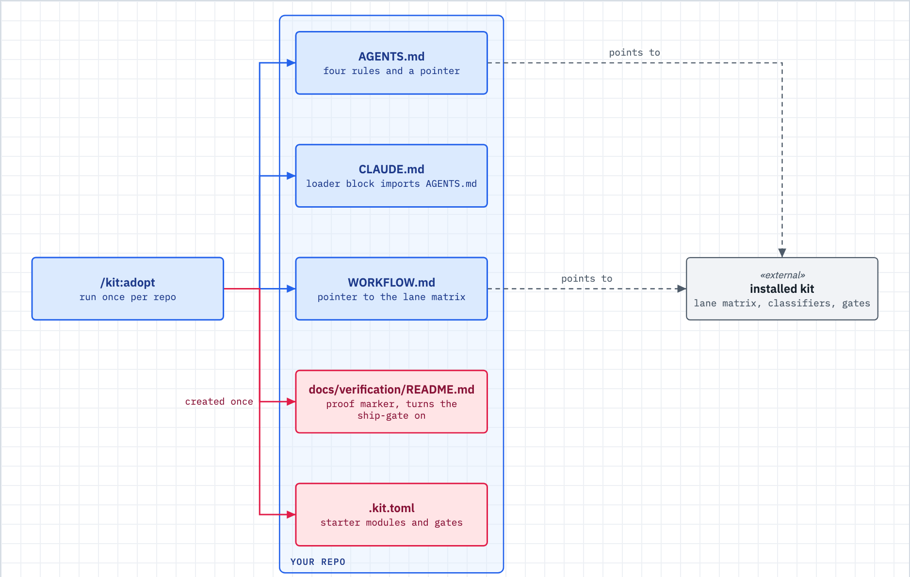

# Adopt a repo

Use this when you installed the kit and want one of your repos to use it: classify the work, pick a lane, and have the ship gate engage on push.



_Figure: adoption writes a few small pointer files. The engine stays in the kit install and is never copied into your repo._

## What happens

- `/kit:onboard` is the guided first run. It detects how the kit is installed, offers to adopt the current repo, lets you pick modules, and ends with a short tour.
- `/kit:adopt` is the part that writes. It calls `lib/adopt.sh`, which only creates files and never overwrites one you wrote.
- The files are small pointers. `AGENTS.md` carries four rules and a link to the full contract. `WORKFLOW.md` points at the installed lane matrix.
- `CLAUDE.md` gets a loader block, because Claude Code reads `CLAUDE.md` and not `AGENTS.md`.
- The proof marker `docs/verification/README.md` is what makes the ship gate engage. A fresh `.kit.toml` turns `proof_of_done` and `lane_gates` on for the repo.

## What you do

1. Install the kit, then open a session in the repo you want to adopt.
2. Say `/kit:onboard` for the guided path. Every write is previewed and confirmed, and a "no" changes nothing. Or run `/kit:adopt` directly.
   `/kit:onboard` asks, in order, with a default on every question so Enter takes the sane choice:

   - How is the kit installed here: plugin, bash, both, or not at all? "Both" gets a warning, because the hooks would fire twice.
   - Adopt this repo now? Yes is the default. The kit shows a dry run first.
   - Which modules do you want? The default is the kit baseline. Adoption happens once, after you pick, in one call.
   - Does any chosen module need a setting before it does anything? The kit prints the exact line to add or the `export` to run.
   - After `/kit:wrap` reports, should it build and merge the follow-ups itself? The choices are `off`, `lanes`, and `all`. The answer goes in your own `kit.toml`, never in the repo.
   - Do you want a board in this repo? The kit offers it and never assumes it.

   It ends with a short tour of two ideas: the lane and the proof of done.
3. To check first, run `bash ~/.claude/dwarves-kit/lib/adopt.sh --check .`. It exits 0 when adopted and 1 when not, and writes nothing.
4. To preview, add `--dry-run`. To seed modules in a fresh `.kit.toml`, add `--with board,session` (exactly the modules you name start on).
5. Commit what adoption wrote. `lib/adopt.sh` does not commit. To adopt several repos and land one PR each, use `bin/wrap adopt <repo>...`; it is a dry run until you add `--apply`.
6. Open a session in the adopted repo and say `/kit:start`.

**Refresh.** After you edit `[modules]` in `.kit.toml`, run `/kit:adopt --refresh`. It re-syncs the `WORKFLOW.md` pointer and the `CLAUDE.md` block and re-wires the project settings file to match. An existing `AGENTS.md`, `.kit.toml`, and proof marker are never touched. An old, unmodified kit `AGENTS.md` is replaced only with `--refresh --swap-agents`.

**Undo.** Nothing removes adoption for you. Delete the files it created, or revert the commit that added them. Removing `docs/verification/README.md` takes the repo out of the ship gate. Remove the `kit:adopt` block from `CLAUDE.md` by hand.

**One guide file.** `--single-source` folds `CLAUDE.md` into `AGENTS.md` and leaves `CLAUDE.md` as a one-line import. If both files exist and differ, it refuses and writes nothing.

## What you will see

A first run in a fresh repo, on a machine with the kit plugin installed:

```
$ bash ~/.claude/dwarves-kit/lib/adopt.sh --check .
not adopted: .
$ bash ~/.claude/dwarves-kit/lib/adopt.sh .
adopt: project hook-module wiring for . -> modules: board (project settings.json left alone, the kit plugin already registers every hook)
adopt: . (updated)
$ bash ~/.claude/dwarves-kit/lib/adopt.sh --check .
adopted: .
$ bash ~/.claude/dwarves-kit/lib/adopt.sh .
adopt: project hook-module wiring for . -> modules: board (project settings.json left alone, the kit plugin already registers every hook)
adopt: . (already adopted, no-op)
```

The repo now holds `AGENTS.md`, `CLAUDE.md`, `WORKFLOW.md`, `.kit.toml`, and `docs/verification/README.md`. If you already had an `AGENTS.md`, the dry run says so and leaves it:

```
adopt: AGENTS.md is not a kit file, 1 lines (left alone)
```

## When it breaks

| You see | Do this |
|---|---|
| `/kit:onboard` says the kit is not installed | Install it first: `/plugin marketplace add dwarvesf/dwarves-kit`, then `/plugin install kit@dwarves-marketplace`. Run `/kit:onboard` again. |
| `onboard` warns that a plugin and a bash install are both present | The hooks fire twice. Keep one path; the warning names how to remove the other. |
| `AGENTS.md is not a kit file ... (left alone)` | Expected. Your file stays. The operate-contract block lands in `CLAUDE.md`. |
| A module change had no effect | Edit `[modules]` in `.kit.toml`, then run `/kit:adopt --refresh`. On a plugin machine the plugin registers every hook, so the choice is recorded but adds no project hooks. |
| The ship gate never engages | Run `--check`. If it says not adopted, check that `docs/verification/README.md` exists. |
| `--single-source` exits 1 | Both guide files exist and differ. Merge them by hand, then run it again. |

## Related

- [gates-and-proof.md](gates-and-proof.md) explains the ship gate the proof marker turns on.
- [spine.md](spine.md) is the map of what to do after adoption.
- [wrap.md](wrap.md) covers landing the adoption PR with the rest of a session.
- `docs/consumer-contract.md` is the contract adoption wires up.
