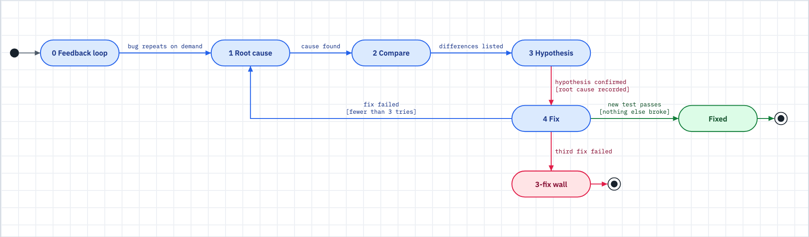

# The debug loop

Use this when you say "fix this bug" and the kit goes hunting for a root cause instead of editing code.



_Figure: no fix without a recorded root cause, and no fourth fix after three have failed._

## What happens

- The kit opens an evidence ledger at `.claude/debug/<slug>.md` before it touches code. It writes each action there before it runs it, so a context reset shows what was about to happen.
- It works in phases. **Phase 0** builds a fast, repeatable pass or fail signal for the bug. **Phase 1** investigates the root cause. **Phase 2** compares broken code with working code. **Phase 3** tests one hypothesis at a time. **Phase 4** writes a failing test, makes one fix at the root cause, and checks it.
- While `## Root cause` in the ledger is blank, a guard blocks any "fixed" claim that rests on a guess. The `understanding_gate` setting turns the guard on or off.
- On a bug-lane change, a confirmed fix records the `debug` gate. The ship gate refuses a bug-lane push without it.
- Three failed fixes on one symptom stop the loop. The problem is the design, not the hypothesis.

## What you do

1. **Report the symptom, not a diagnosis.** "The invoice job returns 500 after 14:00 UTC" beats "the cache is broken". A wrong diagnosis anchors the search in the wrong place.
2. **Hand over reproduction steps if you have them.** Phase 0 is the slowest phase. Inputs, timing and environment all shorten it.
3. **If the kit cannot build a repeatable signal,** it stops and says what it tried. Give it one of three things: access to an environment that reproduces the bug, a captured artifact (a log dump, a recording, a HAR file), or permission to add temporary instrumentation.
4. **Accept the guard when it refuses a "done" on a quick patch.** A patch before the root cause usually moves the symptom and destroys the evidence.
5. **At the wall, change level.** After three failed fixes the kit shows you its list of ruled-out causes and questions the design. Have a design conversation. Do not ask for fix number four.
6. **Reopen with the old ledger if the bug comes back.** A recurrence with evidence is a faster search than a fresh symptom.
7. **Hold the fix for your own check if you want one.** The kit declares a fix done on its own evidence: the new test passes, no other test broke, and the symptom is gone. Set `debug.confirm_fix` to `true` to make it wait for you.
8. **Review the fix.** After a confirmed fix, run `/kit:review` on the diff.

## What you will see

The ledger starts from this template. The kit leaves `## Root cause` blank until it finds the cause:

```
## Symptoms
(immutable: exactly what was reported, the error text, the failing test name)

## Root cause

## Evidence
(append: timestamp / what you checked / what you found / what it implies)

## Eliminated
(append: each hypothesis you falsified + the evidence that killed it)

## Fix attempts
(append: a count; the 3-fix wall reads this)

## Resolution
(the fix + the verification result)
```

When the cause is confirmed and the fix is verified, the kit records the gate with a one-line cause. The ledger then shows:

```
2026-10-25T16:15:25Z | GATE | debug | ran | cache key ignored the tenant id
```

In phase 0 the kit prefers these signals, in this order: a failing test at the right seam, an HTTP script against a dev server, a command with a fixture and a known-good output, a headless browser script, a replay of a captured trace, a throwaway harness, a fuzz loop, a bisection harness, and a diff of old against new. It then makes the signal faster, sharper and more deterministic.

After the root cause is fixed, the kit also lists each layer the bad value crossed and adds a cheap check at each one, so the same bug cannot return by another route. It skips layers where a check would be speculative.

Instrumentation the kit adds is tagged `[DEBUG H1]`, `[DEBUG H2]` and so on, wrapped in `# #region DEBUG` markers, and removed in one pass when the fix is verified.

## When it breaks

| You see | Do this |
|---|---|
| The guard refuses "done" | The root cause is still blank. Go back to investigation. Do not reword the claim. |
| The kit says it cannot build a feedback loop | Supply an environment, a captured artifact, or permission for temporary instrumentation. |
| A bug-lane push is refused for a missing `debug` gate | The cause was never confirmed. Finish the loop, or log an audited override if the operator agrees. |
| Three fixes failed | Stop fixing. Read the ruled-out list and question the design. |
| The bug is a flaky test | Ask for a higher repro rate, not a clean one. The kit loops the trigger and polls the real condition instead of sleeping. |
| A test passes alone and fails in the suite | The kit bisects the suite for the test that leaks state. Treat the leak as the root cause. |
| You want the ledger in version control | It is a working file. Check your `.gitignore` first; the kit's own repo ignores `.claude/`. For a costly incident, copy it into your incident record. |
| You think the fix is a one-liner | The phases are short for an obvious bug. The ledger is three lines. The cost grows only when the bug is hard. |

## Related

- [loops.md](loops.md): how the debug loop compares with the other bounded loops.
- [gates-and-proof.md](gates-and-proof.md): the iron law and the `debug` gate at ship time.
- [spine.md](spine.md): why a bug uses its own lane, and where a fix goes next: review, then ship.
