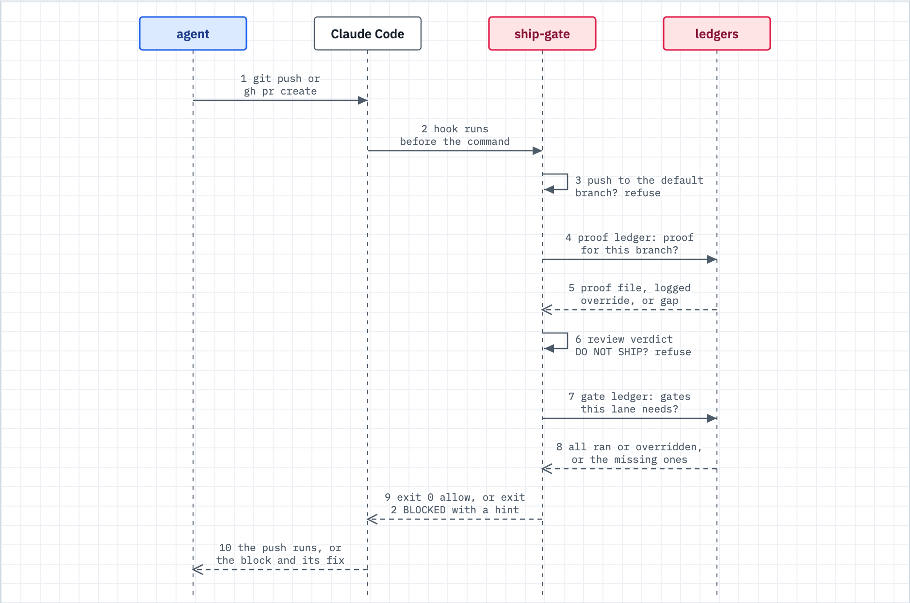

# Gates and proof of done

Use this when something BLOCKED (the ship gate, proof of done, a hard stop) and you want the way through.



_Figure: a push passes only when the ship gate finds a proof of done and the gates the lane requires; otherwise it blocks with a message that names what is missing._

## What happens

- Almost everything in the kit advises. A short list of rules blocks. Each blocking rule is backed by code and a test (`docs/hard-rules.tsv`). Several are off until a `[gate]` key turns them on. `/kit:adopt` seeds `proof_of_done` and `lane_gates` on.
- When the agent runs `git push` or `gh pr create`, the ship gate reads two records: the proof ledger (`docs/verification/`) and the gate ledger (the gates the spec's lane requires).
- A push straight to the default branch is refused in any repo. Branch plus pull request is the only door.
- A push is also refused while the spec's `## Review` verdict is DO NOT SHIP (see [review.md](review.md)).
- Every block names what is missing and the designed way through. The way through is to produce the missing record, not to switch the gate off.

## The four hard stops

An autonomous run stops at these four at every autonomy position ([autonomy.md](autonomy.md)). Other rules block too, but these four are never waived:

| Hard stop | Fires on | Way through |
|---|---|---|
| safety-gate | Destructive Bash: `rm -rf`, force-push, `git reset --hard`, `DROP TABLE` | Run a safer command, or have the human run it |
| push-to-main | A direct push to the default branch | Branch, push, open a PR |
| anti-rationalization | A premature "done" or a guess-fix, only while `[gate] understanding_gate` is on | Record the root cause first ([debug.md](debug.md)) |
| verification pipeline | A task that failed its verifier | The fix agent retries (two at most), then you escalate: the task or the spec is wrong |

The spec-drift guard is different. It only warns when the build drifts from the contract. Amend the spec (add-only) or re-scope, then continue.

## What you do

1. **Blocked at ship with no proof?** Run `/kit:verify`. It records the run for you. If the work works, this takes two minutes.
2. **Docs-only or scratch change?** Log an audited override with a reason. Overrides are visible and reviewed. Honest skips beat fake proofs.

   ```
   ~/.claude/dwarves-kit/bin/gate proof-ledger override <branch-slug> "<why>"
   ```

3. **A behavioral change needs a proof file.** The ship gate wants a file in `docs/verification/` added by your branch, with three parts:
   - **A green run.** The command, its exit code, its real output and the verdict PASS. For visual work, a committed screenshot or GIF.
   - **A negative control.** Proof the check can fail: revert the change (or stub the input), see it go RED, restore, see it go GREEN. A check that cannot go red proves nothing.
   - **Reproducibility.** The commands can be pasted, so someone else can re-run them.
4. **Produce the proof as you finish.** `/kit:verify` does this, so the gate confirms instead of surprising you at push time.
5. **A verifier keeps failing a task?** Two retries then escalation is the cap on purpose. Three failures is a design problem. Reread the spec's task.

## What you will see

A push with no proof of done (trimmed output from `lib/gate/proof-ledger.sh check` on a repo that changed source and added no proof):

```
BLOCKED: proof of done. This is a 'behavioral' change; it cannot ship/merge without a matching proof-of-done entry in docs/verification/.
  Need: a docs/verification/<slug>.md added by this branch with a green run AND a NEGATIVE CONTROL (revert -> RED -> restore).
  Produce it via /kit:verify (or record it), or log an explicit override (audited):
    bash lib/gate/proof-ledger.sh override 'retry' "<reason>"
  Or switch this gate off for the repo: [gate] proof_of_done = false in a committed .kit.toml (lib/gate/README.md, 'Switching a gate off').
```

A push straight to the default branch (the text comes from `hooks/ship-gate.sh`; the branch and remote names fill in):

```
BLOCKED: ship-gate. This push lands on 'main', the default branch of 'origin'. Never push straight to a default branch.
Move the work to a feature branch and open a PR:
  git switch -c <type>/<slug>
  git push -u origin HEAD:refs/heads/<type>/<slug>
  gh pr create --base main
```

## When it breaks

| You see | Do this |
|---|---|
| `BLOCKED: proof of done` | Run `/kit:verify`, or write the proof file with a green run and a negative control. |
| The gate says your verdict is FAIL or INCONCLUSIVE, but you have a green run and a negative control | The gate reads the last `Verdict:` line in the file. End the file on `Verdict: PASS`, and record the negative control's own result as `Result: RED as expected`. |
| `BLOCKED: ship-gate. The '<lane>' lane requires gates that have not run` | Run the missing gate, or log an audited override with a reason. The message prints the exact command. |
| `Spec ... has no 'Lane:' header` | Add `Lane:` (and `Depth:`) to the spec header. The lane sizes the gates ([spine.md](spine.md)). |
| `BLOCKED: ship-gate` with DO NOT SHIP | Fix what the review found, re-run `/kit:review`, commit the spec, push again. |
| Direct push to main refused | Branch, push the branch, open a PR. A human who owns the repo can push from their own terminal. |
| The negative control feels silly | It has caught real false-green tests. Stub, red, restore takes a minute. |

Who reviews overrides? They land on a ledger that is surfaced at retro and audit time. Overuse is visible by design.

## Related

- [review.md](review.md): the DO NOT SHIP refusal at ship
- [v-model.md](v-model.md): what `/kit:verify` runs and records
- [autonomy.md](autonomy.md): the dial, and the four stops that never move
- [debug.md](debug.md): the root-cause record the iron law wants
