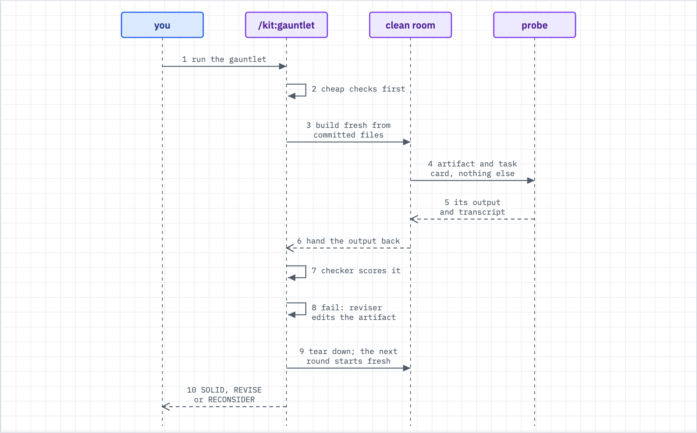

# Run the gauntlet

Use this when an artifact must work for a cold reader with nobody helping: contributor docs before outside developers arrive, a runbook before the incident, a spec before a cold implementer, an API surface before outside integrators.



_Figure: the probe is the thermometer and the artifact is the patient. You never fix the probe and you never help it._

## What happens

- The kit builds a fresh clean room from committed state and hands a probe agent the artifact and one task card.
- The probe is a mid-tier model on purpose. A frontier model succeeds despite a bad artifact and hides the defect.
- The probe follows the artifact. Where it gets stuck, the artifact is the bug.
- On a fail, the kit revises the artifact, tears the room down, and tries again with a fresh probe.
- The loop stops on two passes in a row, or on the round cap (three by default). Every round is saved.

The mechanics (the four slots, presets, rules) live in `commands/gauntlet.md`. The design rationale and known limits live in `docs/patterns/gauntlet.md`. This page is what you do.

## What you do

Four slots configure a run. The engine does not change.

| Slot | Plain meaning | What you create |
|---|---|---|
| Artifact | the files being improved | a list of globs |
| Outcome contract | how the kit knows the probe succeeded | a card, a checker script, a Tier 1 script |
| Probe framing | who the probe pretends to be | one sentence |
| Clean-room recipe | how a fresh sandbox is built | one script, or an existing one |

**Path A: run the kit's own onboarding preset.** Zero building, about ten minutes of prep.

1. Open the dwarves-kit checkout on a clean tree.
2. Provide the probe key, a spend-capped Anthropic key. A local run (`runner_host = "local"`, the default) reads `ANTHROPIC_API_KEY` from your environment. A remote run resolves the key on the runner host from `probe_key_ref`, which you set under `[gauntlet]` in `~/.config/dwarves-kit/kit.toml`. The project `.kit.toml` cannot set it. This key is the only credential the room gets.
3. Run `bash tests/gauntlet/tier1.sh`. It must be green before any paid round.
4. Say `/kit:gauntlet onboarding`. Confirm the inputs table the kit fills from `tests/gauntlet/README.md`.
5. Wait. When it stops, read `ROUNDS.md`.

**Path B: build your own run.** The worked example is a spec gauntlet: a cold probe implements one spec in a fixture repo without hitting a question the spec cannot answer. The same steps fit a runbook or an API surface; only the file contents change.

1. Name the artifact. One file is fine, for example a spec called rate-limiter.md under your specs folder.
2. Write the card. It is a goal contract: outcome, acceptance criteria, a verification command, a stop-on-blocker clause. Keep it to one agent-day.

   ```markdown
   # Card: implement the rate-limiter spec in the fixture repo

   A fixture repo is at /work/fixture and the spec is at /work/spec.md.
   Implement the spec exactly. If the spec does not answer a question you
   need answered, write it to /work/OPEN-QUESTIONS.md and stop.

   Acceptance:
   - `npm test` is green in /work/fixture
   - /work/OPEN-QUESTIONS.md does not exist or is empty
   Verification command: `cd /work/fixture && npm test`
   ```

3. Write the checker. It prints PASS or FAIL on what the probe left behind. No checker yet? The kit derives one from the card's verification line at the confirm step.

   ```bash
   #!/bin/bash
   set -e
   work="$1"
   cd "$work/fixture" && npm test || { echo "FAIL: tests red"; exit 1; }
   [ -s "$work/OPEN-QUESTIONS.md" ] && { echo "FAIL: spec left questions"; exit 1; }
   echo PASS
   ```

4. Write Tier 1. These are free mechanical checks that run before any paid probe: the artifact exists, it has the load-bearing sections, its commands parse. Any finding you can reduce to a grep moves here, and the next round gets cheaper.

   ```bash
   #!/bin/bash
   set -e
   spec="docs/specs/rate-limiter.md"
   [ -f "$spec" ] || { echo "FAIL: spec missing"; exit 1; }
   for h in "## Verification" "## Acceptance"; do
     grep -qF "$h" "$spec" || { echo "FAIL: $h missing"; exit 1; }
   done
   echo PASS
   ```

5. Build the clean room. Copy `tests/gauntlet/cleanroom/run.sh` and `Dockerfile`, then remove the onboarding parts. Keep this shape: stage `git archive HEAD` (an uncommitted fix does not exist for the probe), strip the answer key (your checker, Tier 1, earlier run records), inject only the artifact, the card, a fixture, and one capped key, run the probe, copy the record out, tear the room down.
6. Run it. Say `/kit:gauntlet`, answer "custom", or give everything in one line:

   > run the gauntlet: artifact docs/specs/rate-limiter.md, card gauntlet/card.md, checker gauntlet/check.sh, tier1 gauntlet/tier1.sh, clean room gauntlet/run.sh, probe framing "you are a contractor with no prior context implementing this spec", cap 3

   The kit validates every input before it spends anything. Three or more missing inputs is a designed good outcome: you get the build checklist in dependency order and no round runs.

**A host artifact** (a runbook against a real machine) adds two things. The room must be a credential-stripped clone or VM, because the kit rejects a snapshot that carries any credential beyond the probe key. Teardown is destructive, so the kit asks you to confirm it before round 1. Do your first run with a container.

**Do not help the probe.** If you answer its question, the round is void and that question was a finding you just lost. Do not hand-polish the artifact beyond "the suite is green" either: the gaps a cold reader hits are invisible to you.

## What you will see

Everything lands in `docs/verification/gauntlet/<date>-<preset>-<slug>/`.

- `ROUNDS.md` is the one-page story: what failed each round, how bad, what got fixed, the cost, the verdict. Read it first.
- `round-N/` holds the evidence: `findings.md` (each finding carries a transcript quote), `transcript.md`, `submission/`, and `artifact-diff.patch` (what the reviser changed after the round).

A real `ROUNDS.md` from a campaign over the kit's onboarding surface ends its verdict like this:

```
## Verdict: REVISE (10/11 GREEN; both findings are HARNESS findings, the surface itself took no hit)
```

| Verdict | Meaning | You do |
|---|---|---|
| SOLID | two unaided passes in a row | ship the artifact; watch the first real consumer anyway |
| REVISE | improving, but the round cap hit | apply the open findings yourself, rerun later |
| RECONSIDER | not converging; a structural gap | the gap list names the missing tool or section; decide, then rerun |

## When it breaks

| You see | Do this |
|---|---|
| The probe failed on something obvious | It is obvious to you only. That is the signal you paid for. Fix the artifact. |
| You want a stronger model so it passes | Do not. Real consumers do not get frontier intuition. |
| It passed once | Run again. One pass can be luck; SOLID needs two in a row. |
| The kit stops before round 1 with a list of inputs | A designed outcome. Build the missing pieces in the order shown. |
| A remote run exits 65 before any ssh | `probe_key_ref` is empty. Set your own reference under `[gauntlet]` in `~/.config/dwarves-kit/kit.toml`. |
| The card is too big and the probe flails | Cut it to one bounded slice. "Implement the whole feature" mixes a bad artifact with a hard task. |
| You answered the probe's question | The round is void. Rerun it. |

**Cheap probe.** A flat-rate OpenAI-compatible model run through `omp` makes a replication round close to free. The recipe and the rules that cost real rounds to learn are in `tests/gauntlet/deploy/README.md` under "Cheap probe". A mid-tier Anthropic probe stays the primary signal. To watch a round live, run `bash tests/gauntlet/cleanroom/watch.sh`.

**Common mistakes.**

1. Helping the probe. One answered question voids the round.
2. A frontier probe. It passes despite the bad artifact. Mid-tier is load-bearing, not a cost saving.
3. An oversized card. Park the rest.

**Reruns.** Run one round after any major change to the artifact or the card. A converged artifact is a snapshot, not a property.

## Related

- [loops.md](loops.md) explains the round cap, honest halts, and the verdict words.
- [adopt.md](adopt.md) covers the adoption step the onboarding preset exercises.
- `commands/gauntlet.md` is the engine contract; `tests/gauntlet/README.md` holds the kit's own instance files.
