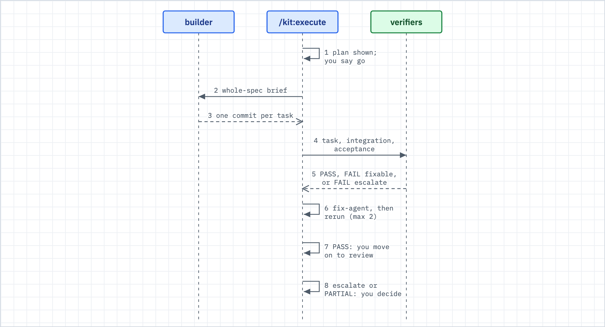

# Bounded loops

Use this when a command reported a round cap, an honest halt, or a verdict of SOLID, REVISE or RECONSIDER, and you want to know what to do next.



_Figure: /kit:execute is the loop you meet most. The others follow the same shape: try, check, revise, stop at a cap._

## What happens

- Several kit commands loop: try, check, revise, try again.
- Every loop has a hard cap and a stop you can verify. "Did not converge" is a reported result. The kit never retries forever in silence.
- When the stop holds, you get a verdict and a record. When the cap hits with progress, or when there is no progress, the kit halts and tells you what is left.
- Each loop writes a record: verification output, an evidence ledger, or round files. The record is what review and ship read.

| Loop | It converges | Cap | You see |
|---|---|---|---|
| Goal (`/goal`) | One objective until its verification command passes | Your stated stop | Done, or a named blocker |
| Debug (`/kit:debug`) | A root cause before any fix | 3 failed fixes is the architecture wall | An evidence ledger, then a confirmed cause, then the fix |
| Execute (`/kit:execute`) | One builder for the whole spec, then one end verification pass | 2 fix rounds | A verdict per task; an unmet criterion is named, not retried |
| Revise engines (`/kit:test-plan-review-team`, `/kit:gauntlet`) | One artifact until findings clear | 3 rounds | SOLID, REVISE or RECONSIDER |

## What you do

1. **Say the intent; the kit picks the loop.** "Fix this bug" is debug. "Build this spec" is execute. "Keep going until X passes" is a goal. "Make this artifact good" is a revise engine.
2. **When it converged,** read the record. Do not re-verify by feel. The record is the proof, and it is what the review and ship gates consume.
3. **When it says REVISE, or the cap hit with progress,** the artifact is better but not clean. The kit lists what is left. Apply the findings yourself, or run the loop again later. Revise engines advise; they do not block by default.
4. **When it says RECONSIDER, or there was no progress,** the problem sits above the level the loop can fix: a design gap, a task that is the wrong size, a missing tool. Change the level. Revisit the spec, the requirement or the approach. Running the same loop harder is the one sure waste.
5. **Raise a cap only for a reason.** You can raise it for one run. First ask what extra rounds would learn that the recorded rounds did not. Three rounds with no drop in severity is a design signal, not a patience problem.

## What you will see

The end of `/kit:execute` prints this summary. `Result: PARTIAL` means a criterion was not met after the fix rounds; the kit names it with a file and line:

```
## Execution complete
Tasks: [N]/[N] done ([N] verified, [N] manually approved)
Result: [PASS | PARTIAL: unmet criteria with file:line]
Retries: [N] total
Escalations: [N] (required human intervention)
Closed: [N] (spec judged wrong-shaped, dropped rather than retried)
Commits: [N]
Tests: [pass/fail]
```

The three ways a verifier can judge a task:

| Verdict | Meaning | What the kit does |
|---|---|---|
| `PASS` | The criteria hold | Moves on |
| `FAIL:fixable` | A defect with a clear fix | Dispatches the fix-agent, then re-runs the verifier, up to 2 times |
| `FAIL:escalate` | A decision only a human can make, or the spec itself looks wrong | Stops. It does not retry. |

After the builder returns, the end check runs in this order:

1. The test suite, with the command, exit code and output saved to `docs/verification/<spec-slug>.md`.
2. The task verifier, once, over every task.
3. The integration verifier, when the spec has more than one task.
4. The acceptance verifier, on every build.
5. A check-edit scan. It reports `check-edited` or `check-weakened` when a test file changed or a test was skipped. This is a finding, not a block.

A fresh-context recheck also re-runs a sample of the passing verdicts. On the full lane it re-runs all of them. A recheck failure is advisory and recorded.

## When it breaks

| You see | Do this |
|---|---|
| `Result: PARTIAL` | Read the named criterion. Open a follow-on for the gap; do not widen this spec. |
| `FAIL:escalate` | A human call is needed. Read the reason: a design or risk question goes to you; a wrong spec means close it. |
| The fix rounds ran out | Three or more fixes means a design problem, not a code bug. Re-slice or rethink the spec. |
| Five or more verifier findings at once | The work needs a rebuild, not patches. Escalate. |
| The builder stopped near its context limit with `PROGRESS: done=... remaining=...` | The kit checks the commit log and continues with a narrower brief, up to 2 times. A third need stops and asks you. |
| The builder went quiet | Resume it with `SendMessage`. Do not start a second builder on the same files. |
| A revise engine ends at the cap with the same findings | Treat it as RECONSIDER. Fix the level above the artifact. |

## Related

- [debug.md](debug.md): the loop with the strictest rule, no fix without a root cause.
- [gauntlet.md](gauntlet.md): a revise engine that tests an artifact with a clean-room probe.
- [v-model.md](v-model.md): why the end verifiers test at several levels.
- [gates-and-proof.md](gates-and-proof.md): what the ship gate does with each loop's record.
