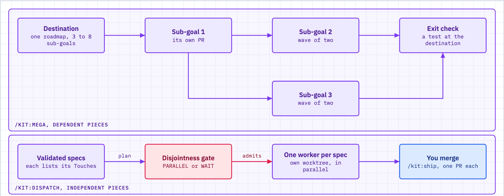

# Several pieces of work

Use this when your work is more than one piece and you do not know how the pieces should run: in order toward one destination (`/kit:mega`), or side by side as separate specs (`/kit:dispatch`).



_Figure: mega-goal is for pieces that depend on each other; dispatch is for pieces that do not._

## What happens

- The kit asks one question first: do the pieces depend on each other?
- **Dependent pieces, one destination:** `/kit:mega` writes a roadmap of 3 to 8 sub-goals. Each sub-goal runs the normal loop and ends in its own PR through the ship gate. Sub-goals that do not depend on each other and write to different directories run together in a wave of 2.
- **At the end of a mega-goal,** the kit reviews the whole assembled chain with the advisor lens, then writes `RUN_REPORT.md` in the mega-goal folder. The final PR waits for you.
- **Independent pieces, any order:** `/kit:dispatch` checks that the specs cannot collide, then runs one worker per spec, each in its own worktree. It never merges. You merge at ship.
- **A real graph** (fan-in, fan-out, strict topological order) fits neither command. The kit says so and stops; it does not grow into a scheduler.
- **One bounded change, or tiny items:** a plain goal or an ordinary change is enough. The kit routes you down; do not fight it.

| Your pieces | Command | How they run | Merge |
|---|---|---|---|
| Dependent, one destination, 3 to 8 steps | `/kit:mega` | A chain; disjoint ones share a wave of 2 | One PR per sub-goal, through the ship gate |
| Independent, no shared files | `/kit:dispatch` | Parallel workers, one worktree each | You merge each branch at ship |
| One objective, one stop condition | A plain goal | One loop | One PR |
| A dependency graph | Neither | The kit says so and stops | None |

Why the split is strict: two workers on coupled files cost more in merge repair than parallelism saves. Unrelated tasks queued behind each other gain no safety. Pretending a graph is a chain makes the kit a poor scheduler.

## What you do

1. **Describe the pieces and how they couple.** "These five doc fixes are unrelated" routes to dispatch. "These five steps each need the last one's output" routes to mega.
2. **For mega, state the destination, not the steps.** "I want X to be true" beats a task list. The kit shows the split and waits for your approval before it writes anything.
3. **Answer the clarification batch once.** Every open question from every sub-goal comes in one interview, each with a recommended answer. After you approve, the run is unattended. A reversible decision is made and logged; an irreversible one goes to `DECISIONS.md` for you to read later.
4. **Give each sub-goal a `## Touches` list** (directory prefixes such as `lib/parser/**`). Without it a sub-goal runs alone. Two sub-goals that write the same module never share a wave.
5. **For dispatch, meet three prerequisites first.** A bare prose ask cannot dispatch.
   - Each spec is `Status: VALIDATED` and has a `## Touches` section.
   - The session runs under `bypassPermissions`.
   - The git working tree is clean.
6. **Trust the gate.** If it makes a spec wait because two specs share files, that wait just saved you a merge conflict. Re-slice the specs or accept the order.
7. **Watch PRs, not progress.** Merging stays gated like any other work. Each sub-goal carries `Merge policy: auto` or `gate`. An `auto` sub-goal merges when its ship gate passes. A `gate` sub-goal and the final PR stop for you. Set `MEGA_MERGE_POSTURE=per-pr-review` if your team wants to review every PR.
8. **Add new scope as a new sub-goal.** Something new mid-program goes on the roadmap (or into a new mega-goal), never into a silent widening of the current sub-goal.

## What you will see

The dispatch gate prints one line per spec. Here three specs go in, and the third overlaps the first, so it waits:

```
PARALLEL SPEC-00a-a.md
PARALLEL SPEC-00b-b.md
WAIT SPEC-00c-c.md after SPEC-00a-a.md
```

A dry run of the mega driver prints the plan from the roadmap and stops at the first `gate` sub-goal:

```
  -> SG-01 (auto)  [model: sonnet, effort: medium]  [prompt: POINTER_PROMPT + goal-file + no-handoff]
  -> SG-02 (auto)  [model: sonnet, effort: medium]  [prompt: POINTER_PROMPT + goal-file + no-handoff]
  -> SG-03 (gate, dispatch then hold for human merge)  [model: sonnet, effort: medium]  [prompt: POINTER_PROMPT + goal-file + no-handoff]
  == STOP at SG-03 (gate: human review) ==
```

The dry run is `bash lib/queue/orchestrate.sh run <dir> --dry-run`. The roadmap file records progress: a sub-goal is done only when its box is checked and a PR number is recorded. State lives in the roadmap and the PRs, so a new session picks up where the last one stopped.

## When it breaks

| You see | Do this |
|---|---|
| The kit sends you to `/kit:assign` or a plain goal | Your work is fewer than 3 sub-goals. Take the lighter route. |
| `REJECT: a dispatch-eligible spec has no '## Touches' globs`, or a spec that always waits | The spec has no `## Touches` list. Add one. Do not bypass the gate. |
| A dispatched spec shows `WAIT ... after ...` | It overlaps another spec. It runs after that one finishes. Re-slice to run both at once. |
| The worker is quiet and you think it died | Resume it with `SendMessage`. Do not start a second worker on the same branch. |
| A dispatch worker reports `STATUS: BLOCKED` | It hit a decision it should not make alone. Read its WIP commit and answer. |
| A `gate` sub-goal or the final PR will not merge | That is by design. Review it and merge it yourself. |
| You want to watch sub-goals in Orca instead of headless sessions | Add `--backend orca` to the run. It is an opt-in trial and off by default. `bash lib/queue/orchestrate.sh status <dir>` then shows one state per sub-goal. |
| `/kit:dispatch` stops before it starts | A prerequisite failed: unvalidated spec, no `bypassPermissions`, or a dirty tree. Fix it and run again. |

## Related

- [spine.md](spine.md): the loop each sub-goal runs through.
- [gates-and-proof.md](gates-and-proof.md): the ship gate that every sub-goal PR passes.
- [loops.md](loops.md): what a round cap and an honest halt mean.
- [autonomy.md](autonomy.md): how often the kit checks in.
