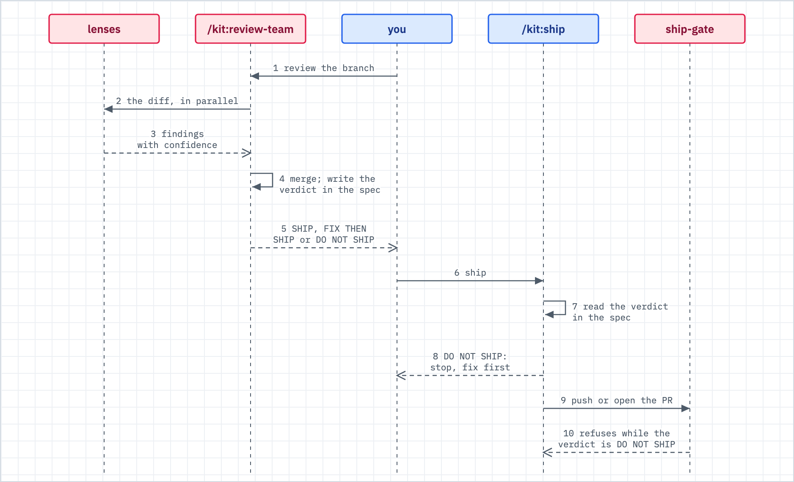

# Review and the verdict

Use this when you got a SHIP, FIX THEN SHIP or DO NOT SHIP verdict and want to know what it means, where it lives and what happens at ship.



_Figure: the review writes one verdict into the spec, and `/kit:ship` reads that verdict before anything else happens._

## What happens

- The review reads your diff. It does not run your tests. For test state it cites the verification log that `/kit:execute` or `/kit:verify` wrote ([v-model.md](v-model.md)).
- It writes one `## Review` section into the active spec (`docs/specs/SPEC-NNN-<slug>.md`). A new review replaces the old section. Sections do not stack.
- With no active spec (an arbitrary diff, or someone else's PR), the report prints in chat and nothing is written. Without a spec, the ship gate has no verdict to read.
- It records the same verdict in the run ledger. The ship gate checks that the two agree.
- `/kit:ship` reads the verdict first. On DO NOT SHIP it stops. The ship gate also refuses the push or PR while the verdict is DO NOT SHIP.

## The three verdicts

| Verdict | It means | What happens next |
|---|---|---|
| SHIP | No finding blocks the change | `/kit:ship` goes on |
| FIX THEN SHIP | There are specific fixes to make | The kit lists them. Fix them, then ship. `/kit:ship` accepts this verdict once the fixes are applied. |
| DO NOT SHIP | Something is fundamentally wrong | `/kit:ship` stops. Fix the issues, then re-run the review. |

Findings carry a severity: CRITICAL (must fix, blocks ship), HIGH (should fix, creates risk), MEDIUM (fix before the next release) and LOW (improve when convenient).

## Which review to ask for

| Command | What it is | Use it for |
|---|---|---|
| `/kit:review` | One reviewer, one pass: security, architecture, regressions, tests, edge cases | Small changes, solo work, quick iteration |
| `/kit:review-team` | Three lenses in parallel (security, architecture, test coverage), plus the `kit:advisor` lens, merged into one report | PRs before merge, auth, payments, data. About 1.5 to 2 times the tokens. |
| `/kit:battery` | A fresh-context acceptance verifier that re-runs the verification commands, a multi-lens review and the advisor, merged into one verdict | A finished branch that needs independent proof. It skips changes under the size floor (150 changed lines by default) unless they touch a hard path. |

The normal lane runs one review pass. The full lane uses `/kit:review-team`. After you fix a FIX THEN SHIP batch on the full lane, the review runs again over the fix diff, at most twice in total.

## What you do

1. Run `/kit:review` after `/kit:execute`. Use `/kit:review-team` or `/kit:battery` for risky work.
2. Fix what it lists. For `/kit:review-team`, each finding has a route: `gated_auto` (the fix is verified, then applied), `manual` (it becomes a board row, because it needs design input) or `advisory` (recorded, nothing owed).
3. Disagree with a finding? Say it is by design or a false positive. The kit appends a row to `docs/verification/rejected-findings.md`, so the next review lists it as previously rejected and does not raise it again.
4. Commit the spec. The ship gate reads the `## Review` section at the pushed commit, so an uncommitted review does not count.
5. Run `/kit:ship`.

## What you will see

The end of a `/kit:review` run (the shape comes from `commands/review.md`):

```
## Review Summary
Files reviewed: [N]
Issues found: [critical] critical, [high] high, [medium] medium, [low] low
Previously rejected: [M] (see the ### Previously rejected section)
Completeness: [X]/10

### Verdict: SHIP / FIX THEN SHIP / DO NOT SHIP
```

The same verdict lands in the spec under `## Review`, as a `### Verdict:` line, with the findings and the open TODOs below it.

A push while the verdict is DO NOT SHIP (from `lib/gate/ship-rules.sh`):

```
BLOCKED: ship-gate. The '## Review' section of spec '<rid>' ends in the verdict DO NOT SHIP:
  <path to the spec>
Fix what the review found, then re-run /kit:review (or /kit:review-team), commit the spec, and push again. The re-run replaces the '## Review' section, so the new verdict clears this block.
```

## When it breaks

| You see | Do this |
|---|---|
| `/kit:ship` warns that the spec has no `## Review` section | Pick: run `/kit:review`, run `/kit:review-team`, or skip the review on purpose. The kit never skips it silently. |
| `BLOCKED: ship-gate` and DO NOT SHIP | Fix the findings, re-run the review, commit the spec, push again. |
| The spec and the run ledger disagree on the verdict | The spec was edited after the review. Re-run the review, commit the spec, push again. |
| `UNRESOLVED AT CAP` after two review rounds | A finding that several lenses raised is still open. Judge it yourself. The kit will not call it SHIP. |
| `/kit:battery` prints a SKIP line | The change is under the size floor. Use `/kit:verify` or write the proof file ([gates-and-proof.md](gates-and-proof.md)). |
| You do not want the verdict check in a repo | Set `review_verdict = false` under `[gate]` in a committed `.kit.toml`. It is on by default. |

## Related

- [gates-and-proof.md](gates-and-proof.md): the other ship-time blocks and the way through
- [spine.md](spine.md): where review sits between execute and ship
- [v-model.md](v-model.md): the verification log the review cites
- [loops.md](loops.md): round caps and honest halts in the bounded loops
