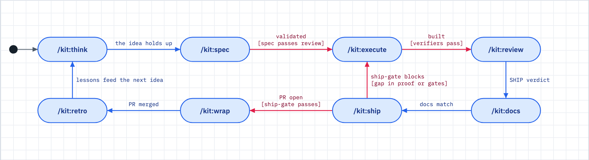
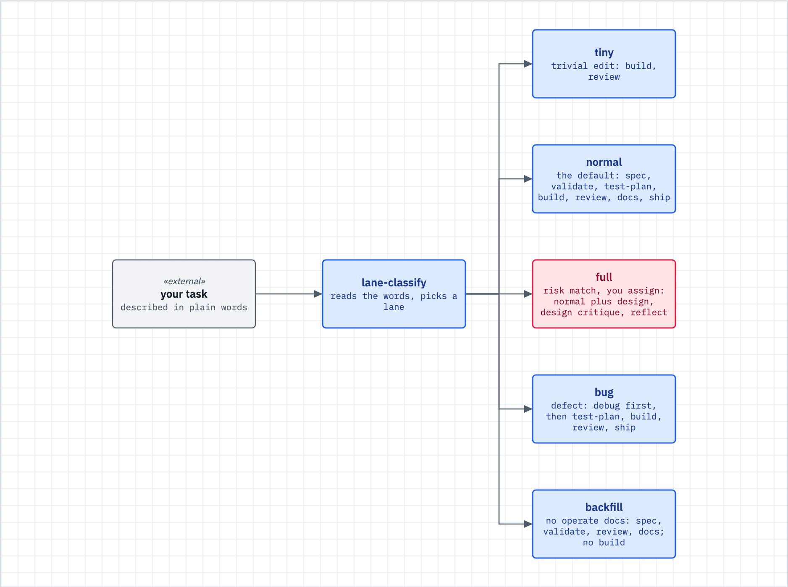

# The spine and the lanes

Use this when you want the map: what comes after what, from "what should I do" to shipped and learned from, and why a small change got small ceremony (or a big one got a lot).



_Figure: work moves from think to retro in one loop; only the verification pipeline and the ship gate stop it, and the retro feeds the next round._

## What happens

- Each step leaves one artifact on disk (a board row, a goal draft, a spec, a `## Review` section) and the next step reads it. You can stop anywhere. A fresh session resumes from `/kit:start`.
- The kit sizes the change before it starts. A classifier picks one of five lanes: tiny, normal, full, bug, backfill. The default is normal.
- The classifier never picks full from the words of a task. When the words look risky it prints one `LANE-SUGGEST` line, and you decide whether to assign full.
- At push, the ship gate looks at the files you changed. A hard path (a migration, auth or secrets file, a CI workflow, kit config, or an added data-loss line) gets the full lane's gates whatever lane the spec says. This runs only where the repo turned `[gate] lane_gates` on.
- Most steps advise. Only the verification pipeline, the ship gate and a few hooks block (see [gates-and-proof.md](gates-and-proof.md)).

## What you do

1. Run `/kit:start`. It reads the repo state and suggests the next step. It never runs it.
2. Say what you want. "Fix this bug", "spec this idea" and "ship it" route to the right step. The steps below are the ones the kit runs for you.
3. Give your opinions early, at assign and spec time. The spec is the cheapest place to change your mind. Execute is the most expensive.
4. Do not skip forward. Asking to ship what was never specced or reviewed does not remove the gates. It makes you meet them all at the ship step, where fixes cost the most.

The spine, step by step:

| Step | What it does | What it leaves behind |
|---|---|---|
| `/kit:start` | Shows where you are and what to do next | nothing (read-only) |
| `/kit:assign` | Turns a board row into a scoped goal, picks the lane, claims the row | a goal draft in `.claude/goals/` |
| `/kit:spec` | Writes the contract: tasks, acceptance criteria, verification | `docs/specs/SPEC-NNN-<slug>.md` |
| `/kit:spec-validate` | Attacks the spec with seven lenses; Status becomes VALIDATED | the verdict in the spec |
| `/kit:execute` | One builder, then end verifiers, then up to two fix retries | commits and a verification log |
| `/kit:review` | A verdict on the diff: SHIP, FIX THEN SHIP or DO NOT SHIP | a `## Review` section in the spec |
| `/kit:docs` | Brings README and CHANGELOG back in line with the code | doc edits |
| `/kit:ship` | Review gate, tests, version, changelog, commit, PR | a PR |
| `/kit:wrap` | Lands the session: flips board rows, merges green PRs, tidies worktrees | a skim-first report |
| `/kit:retro` | What worked, what did not | a note under `docs/retro/` |

Some beats sit beside the spine. `/kit:think` and `/kit:design` come before the spec. `/kit:grill` interviews you when intake needs it ([grill.md](grill.md)). `/kit:test-plan` comes before execute. `/kit:verify` re-runs the checks on demand ([v-model.md](v-model.md)). The verb lookup for wrap is [docs/reference/wrap.md](../reference/wrap.md).

## How lanes size the spine



_Figure: lane-classify sizes every change into one of five lanes, and each lane runs only the phases it needs._

The intake asks these questions in order:

| Question | Answer | Lane |
|---|---|---|
| Is it a defect, a regression or a failing test? | yes | bug |
| Is it new work on an existing repo with no operate-layer docs? | yes | backfill |
| Is it a trivial edit (a typo, copy, a comment)? | yes | tiny |
| Does it touch auth, authz, hooks, the data model, data loss, an external provider, an API contract or a migration, or weaken validation? | suggested | full |
| Anything else | default | normal |

What each lane runs:

| Lane | What runs |
|---|---|
| tiny | Edit, verify, done. No spec. |
| normal | Spec, execute, review, ship. The seven-lens validation runs on large specs only. |
| full | Think, spec with validation, execute, `/kit:review-team`, docs, ship, retro. |
| bug | `/kit:debug` first (root cause before any fix), then review. See [debug.md](debug.md). |
| backfill | Review the code and write the operate-layer docs. No app-code edits. |

- **Describe the change honestly.** Downgrading ("it is tiny, trust me") is what the floor check exists to catch. `/kit:assign` warns when your lane is lighter than the classifier's floor. It warns and logs; it never blocks.
- **Let the diff set the floor.** A repo can add its own hard paths with `[lanes] extra_hard_paths`. Moving an assigned lane lighter is a decision you make on purpose, not a default.
- **Expect escalation mid-flight.** If execute finds the change is bigger than specced, the lane moves up, never down. That is the system working, not the agent growing the scope.

## What you will see

`/kit:start` opens with a banner line, then three or four lines. The format comes from `commands/start.md`; the numbers here are an example:

```
[kit:start] Detect project state and suggest the right next command.
Spec approved. 3/8 tasks complete.
> Suggested: /kit:execute to run the verification pipeline, or /kit:next for manual task-by-task.

Branch: feat/retry | Dirty: 2 files | Spec: VALIDATED
```

The classifier prints the lane. A risky task also prints one suggestion line (real output, run from the kit checkout as `bin/classify`):

```
$ ~/.claude/dwarves-kit/bin/classify lane classify "fix typo in README"
tiny
$ ~/.claude/dwarves-kit/bin/classify lane classify "add a database migration for user auth"
LANE-SUGGEST: full (auth,data-model); default stays normal; the operator assigns full with: gate-ledger.sh start --amend <rid> full ...
normal
```

## When it breaks

| You see | Do this |
|---|---|
| Your one-line change got the full lane | You assigned it after a suggestion, or the diff floor caught a hard path. One line in a migration is full lane at push. |
| You want tiny and the kit says no | Say so in the ask. The kit records it as your call. The floor check still refuses an unsafe downgrade. |
| Your finished task is missing from the board | Shipped rows leave the board. `CHANGELOG.md` is the shipped record. `/kit:start --full` adds the open queue, goal drafts and the last five commits. |
| `/kit:start` says the spec is ambiguous | More than one spec is live. Name the one you mean, or set it to SHIPPED or PARKED. |
| You are not sure where you are | Run `/kit:start` again. State lives on disk, so it always answers. |

## Related

- [autonomy.md](autonomy.md): how often the kit checks in along the spine
- [gates-and-proof.md](gates-and-proof.md): what blocks, and the way through
- [review.md](review.md): the review step in depth
- [loops.md](loops.md): the bounded loops inside execute and review
