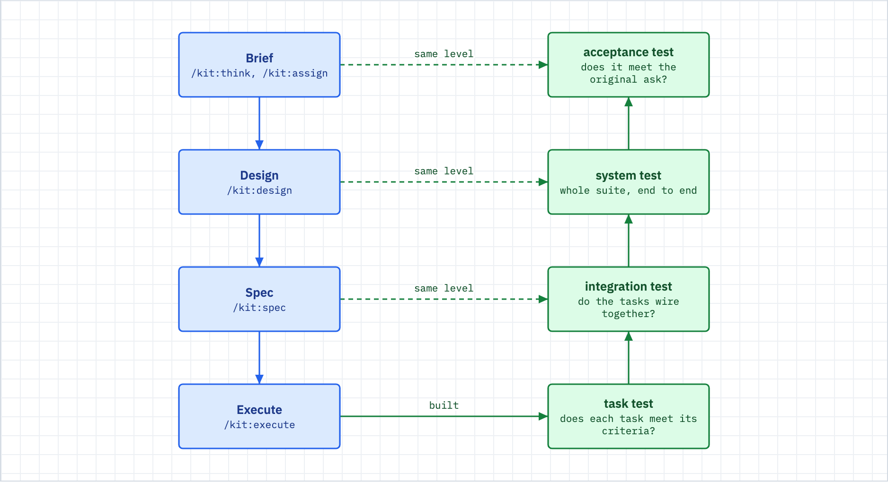

# The V-model

Use this when you wonder why the kit tests at every level, or why "every task is green" can still end in a failed acceptance run.



_Figure: each build level on the left has a mirrored test on the right, and each right-arm level catches what the level below cannot see._

## What happens

- You shape work down the left arm: the brief (`/kit:think`), the design (`/kit:design`), the spec (`/kit:spec`), then the code (`/kit:execute`). Each artifact gets a static review when it is produced.
- The kit tests up the right arm. The task level checks that each task is right. The integration level checks that the tasks wire together. The system level runs the whole project suite. The acceptance level checks that the program meets the original ask.
- `/kit:execute` runs the task, integration and acceptance levels at the end of the build, with a fix agent for failures that can be fixed (two retries at most).
- `/kit:verify` re-runs the whole right arm on demand, read-only. It rebuilds nothing and fixes nothing.
- Each level is a different agent, in a fresh context, that did not write the code.

## What you do

1. **Give every level something to check.** Acceptance needs a stated requirement ("done means a user can X"). Integration needs the spec's wiring claims. Tasks need acceptance criteria with commands that run. A level you gave nothing to check passes without proving anything.
2. **Read a failure at its own level.** A task failure gets a task fix. An acceptance failure means you revisit the spec or the requirement. Do not patch a task until the symptom moves.
3. **Start from the bottom.** Run `/kit:verify` after a manual edit, on a branch built elsewhere, or before you ship. Do not ask for "just the acceptance check" while task tests are red. You get a slow, vague failure instead of a fast, exact one.
4. **Keep the insight.** Each right-arm level catches what the level below cannot see:
   - All tasks green and integration red: the pieces are right and wired wrong.
   - Everything green below and acceptance red: you built the spec faithfully and the spec missed the requirement.
   - Neither is a contradiction. Both are the model working. The expensive failure is skipping a level and finding its bugs in production.

How the levels pair up:

| Level | Left arm (builds) | Right arm (proves) | Who runs the test |
|---|---|---|---|
| Requirement | `/kit:think`, `/kit:assign` | Acceptance test | `kit:acceptance-verifier` |
| Solution design | `/kit:design` | System test | `kit:system-verifier` |
| Spec | `/kit:spec` | Integration test | `kit:integration-verifier` |
| Code | `/kit:execute` | Unit and task test | `kit:task-verifier` |

A lane scales the arm. A tiny change runs a short arm. The full V is for full-lane work (see [spine.md](spine.md)). The model is a map, not a toll.

## What you will see

`/kit:verify` prints one section per level and a verdict (the shape comes from `commands/verify.md`):

```
# Verify Report
Spec: SPEC-NNN-<slug>
Base ref: <sha> (<how it was resolved>)

## Unit / task level (kit:task-verifier)
- TASK-NNN: PASS | FAIL -- [finding, file:line]

## Integration level (kit:integration-verifier)
- PASS | FAIL -- [wiring gap]

## Acceptance level (kit:acceptance-verifier)
- PASS | FAIL -- [AC-N gap, or NO EXECUTABLE CHECK]

## System level (kit:system-verifier)
- PASS | FAIL -- [suite/regression, or NO EXECUTABLE CHECK]

## Verdict: PASS / FAIL / INCONCLUSIVE
```

It also appends the run to `docs/verification/<spec-slug>.md`. That record is the proof of done the ship gate reads ([gates-and-proof.md](gates-and-proof.md)).

## When it breaks

| You see | Do this |
|---|---|
| Task level FAIL | Fix the task. `/kit:next` drives one fix. `/kit:execute` re-runs the build loop. |
| Integration FAIL, tasks PASS | A new piece never reaches its activation point. Fix the wiring, not the tasks. |
| Acceptance FAIL, everything below PASS | The spec missed the requirement. Amend the spec, then re-run. |
| `NO EXECUTABLE CHECK` | The spec has no runnable `## Verification` command, or the project has no suite. Add one. The kit will not invent a substitute. |
| Verdict INCONCLUSIVE | The signal is noisy or there is no valid baseline. It is not a pass. Design a better check (a baseline pair, a fixed environment), then re-run. |
| The same task fails after two retries | This is a design problem. Reread the spec's task. Do not ask for a third retry. |

## Related

- [gates-and-proof.md](gates-and-proof.md): what the ship gate does with the verify record
- [loops.md](loops.md): the execute loop and its retry cap
- [gauntlet.md](gauntlet.md): an acceptance test whose requirement is "an outside developer can work here"
- [spine.md](spine.md): where each build step sits in the flow
