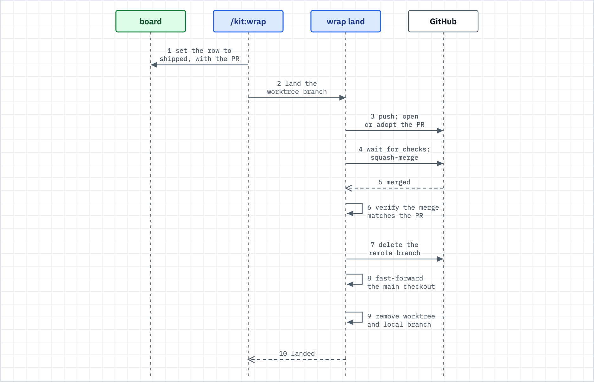

# Land the session

Use this when you are done for now and want the work landed: PRs merged, board rows flipped, worktrees and branches tidied, and one short report of what is left for you.



_Figure: `wrap land` takes one finished worktree to a merged, verified, cleaned-up state in a fixed order._

## What happens

- `/kit:wrap` is the landing step after ship. It runs once per repo the session touched. Name the repos, or it uses the current one.
- It flips the board rows the session closed, then merges only this session's own green PRs, one call per PR.
- It checks that a merged PR actually deployed. It never dispatches a deploy on its own.
- It removes merged worktrees and branches, pulls the default branch with a fast-forward, and writes the activity line.
- It prints a report that leads with what needs you. It never force-pushes, never merges a PR you did not open, and never removes a dirty worktree.

By default the distill half also runs: it scans the session for repeated work worth turning into a tool or a note. Add `distill = false` under `[wrap]` in your own `kit.toml` for landing only.

## What you do

1. Finish and commit the work on a branch. Say `/kit:wrap`, or "wrap up".
2. To start new work in an isolated worktree, run `bin/wrap start <repo> <branch>`. It prints only the worktree path.
3. To land one worktree by hand, run `bin/wrap land <worktree>`. It pushes, opens or adopts the PR, squash-merges, verifies the tree, pulls the main checkout, and removes the worktree and branch. There is no dry run.
4. To land without a merge, add `--draft`. It opens a draft PR and stops.
5. To tidy a repo, run `bin/wrap apply --worktrees <repo>` first. It is a dry run and prints `WOULD ...` lines. Read every `SKIP` line, then add `--apply`.
6. On a shared checkout where other sessions are live, name only your own worktrees: `bin/wrap apply --apply --own <worktree> <repo>`. Add `--no-pull` to leave the main checkout alone.
7. Read the report from the top. Only the `Needs you` section asks anything of you.

A `<repo>` or `<worktree>` argument is a path. Pass an absolute path. `wrap <verb> --help` is not supported; only `wrap --help` prints usage.

## What you will see

`bin/wrap scan` reports state and changes nothing. This is a shortened real run on a repo with one fresh worktree:

```
== <repo>
-- checkout on: main
-- vs origin/main: ahead=0 behind=0
-- dirty files (do NOT assume they are yours):
     (clean)
-- worktrees:
     <repo>                                   55f32d0 [main]
     <repo>/.claude/worktrees/demo-change     55f32d0 [feat/demo-change]
-- local branches (an ancestor of origin/main is SAFE-d; a squash merge needs the gh proof):
     feat/demo-change  [SAFE-d: ancestor of origin/main]
```

The tidy dry run, on the same repo:

```
-- worktrees:
     WOULD remove worktree <repo>/.claude/worktrees/demo-change [feat/demo-change, unlocked] and delete feat/demo-change (ancestor of origin/main)
-- pull:
     [DRY-RUN] pull --ff-only (checkout on main)
== DRY-RUN complete. PR merges, deploy dispatch and board rows stay with the command.
```

A `wrap land` run prints these lines among others, in this order (the format strings are in `lib/wrap/wrap-land.sh`; `<...>` marks a value):

```
     pushed <branch> (<short sha>)
     opened PR #<n>
     merged #<n> (<sha>): tree verified
     pulled <repo>: <latest commit>
     removed worktree <path>
     deleted <branch>
```

The report that `/kit:wrap` prints leads with the one question that matters:

```
## Wrap: <session slug>

✅ **Needs you:** NOTHING
**What happened**
**Shipped**   | Repo | PR | Merge | Deploy |
**Left alone:**
**Built:**
**Seam:**
**FYI:**
```

A `🔴 **Needs you:**` block lists lettered actions instead. Each one opens with `DECIDE`, `RUN`, `REVIEW`, or `UNBLOCK`. A merged PR that did not deploy shows `MERGED, NOT DEPLOYED` under `Shipped`.

## When it breaks

| You see | Do this |
|---|---|
| `is not a git repo` | You passed a bare name. Pass an absolute path. |
| `wrap start` says `branch <name> already exists` | No verb adds a worktree for an existing branch. Pick a new name. |
| `PULL BLOCKED` | The main checkout stayed behind. Another session may own it, or a dirty file blocks the pull. The report names the checkout under `Left alone`. |
| `SKIP <worktree>: busy, held by pid ...` | A live process sits in that worktree. Let it exit, then run the tidy again. |
| `LAND REFUSED` | The worktree holds an ignored file under a directory the branch touches. A clean checkout would not have it. Commit it, move it, or remove it. |
| `TREE MISMATCH` | GitHub says merged but the tree disagrees. Treat the merge as not landed and re-check the PR by hand. |
| A PR shows `CONFLICTING` | Run `bin/wrap merge --apply --pr <n> <repo>`. It tries one re-merge of the default branch. |
| `gh` is missing or not signed in | Branches without a plain ancestor proof are left alone and `merge` refuses. Sign in with `gh auth login`. |

## Related

- [gates-and-proof.md](gates-and-proof.md) covers the ship gate that checks a push before `land`.
- [spine.md](spine.md) shows where wrap sits at the end of the loop.
- [adopt.md](adopt.md) covers `bin/wrap adopt` for landing an adoption PR.
- `docs/wrap.md` is the verb lookup; `commands/wrap.md` is the full playbook.
