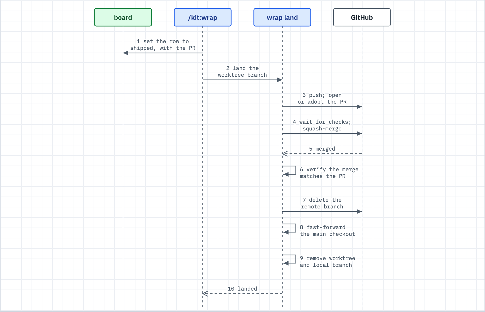

# Land the session

Use this when you are done for now and want the work landed: PRs merged, board rows flipped, worktrees and branches tidied, and one short report of what is left for you.



_Figure: `wrap land` takes one finished worktree to a merged, verified, cleaned-up state in a fixed order._

## What happens

- `/kit:wrap` is the landing step after ship. It runs once per repo the session touched. Name the repos, or it uses the current one.
- It flips the board rows the session closed, then merges only this session's own green PRs, one call per PR.
- It checks that a merged PR actually deployed. It never dispatches a deploy on its own.
- It removes merged worktrees and branches, pulls the default branch with a fast-forward, and writes the activity line.
- It prints a report that leads with what needs you. It never force-pushes, never merges a PR you did not open, and never removes a dirty worktree.

By default the distill half also runs: it scans the session for repeated work worth turning into a tool or a note. Add `distill = false` under `[wrap]` in your own `kit.toml` for landing only.

## What you do

1. Finish and commit the work on a branch. Say `/kit:wrap`, or "wrap up".
2. To start new work in an isolated worktree, run `bin/wrap start <repo> <branch>`. It prints only the worktree path.
3. To land one worktree by hand, run `bin/wrap land <worktree>`. It pushes, opens or adopts the PR, squash-merges, verifies the tree, pulls the main checkout, and removes the worktree and branch. There is no dry run.
4. To land without a merge, add `--draft`. It opens a draft PR and stops.
5. To tidy a repo, run `bin/wrap apply --worktrees <repo>` first. It is a dry run and prints `WOULD ...` lines. Read every `SKIP` line, then add `--apply`.
6. On a shared checkout where other sessions are live, name only your own worktrees: `bin/wrap apply --apply --own <worktree> <repo>`. Add `--no-pull` to leave the main checkout alone.
7. Read the report from the top. Only the `Needs you` section asks anything of you.

A `<repo>` or `<worktree>` argument is a path. Pass an absolute path. `wrap <verb> --help` is not supported; only `wrap --help` prints usage.

## What you will see

`bin/wrap scan` reports state and changes nothing. This is a shortened real run on a repo with one fresh worktree:

```
== <repo>
-- checkout on: main
-- vs origin/main: ahead=0 behind=0
-- dirty files (do NOT assume they are yours):
     (clean)
-- worktrees:
     <repo>                                   55f32d0 [main]
     <repo>/.claude/worktrees/demo-change     55f32d0 [feat/demo-change]
-- local branches (an ancestor of origin/main is SAFE-d; a squash merge needs the gh proof):
     feat/demo-change  [SAFE-d: ancestor of origin/main]
```

The tidy dry run, on the same repo:

```
-- worktrees:
     WOULD remove worktree <repo>/.claude/worktrees/demo-change [feat/demo-change, unlocked] and delete feat/demo-change (ancestor of origin/main)
-- pull:
     [DRY-RUN] pull --ff-only (checkout on main)
== DRY-RUN complete. PR merges, deploy dispatch and board rows stay with the command.
```

A `wrap land` run prints these lines among others, in this order (the format strings are in `lib/wrap/wrap-land.sh`; `<...>` marks a value):

```
     pushed <branch> (<short sha>)
     opened PR #<n>
     merged #<n> (<sha>): tree verified
     pulled <repo>: <latest commit>
     removed worktree <path>
     deleted <branch>
```

The report that `/kit:wrap` prints leads with the one question that matters:

```
## Wrap: <session slug>

✅ **Needs you:** NOTHING
**What happened**
**Shipped**   | Repo | PR | Merge | Deploy |
**Left alone:**
**Built:**
**Seam:**
**FYI:**
```

A `🔴 **Needs you:**` block lists lettered actions instead. Each one opens with `DECIDE`, `RUN`, `REVIEW`, or `UNBLOCK`. A merged PR that did not deploy shows `MERGED, NOT DEPLOYED` under `Shipped`.

## When it breaks

| You see | Do this |
|---|---|
| `is not a git repo` | You passed a bare name. Pass an absolute path. |
| `wrap start` says `branch <name> already exists` | Pick a new name. To work on a branch already on origin (an open PR's), run `wrap start <repo> <branch> --existing`; a branch that exists locally still refuses. |
| `PULL BLOCKED` | The main checkout stayed behind. Another session may own it, or a dirty file blocks the pull. The report names the checkout under `Left alone`. |
| `SKIP <worktree>: busy, held by pid ...` | A live process sits in that worktree. Let it exit, then run the tidy again. |
| `LAND REFUSED` | The worktree holds an ignored file under a directory the branch touches. A clean checkout would not have it. Commit it, move it, or remove it. |
| `TREE MISMATCH` | GitHub says merged but the tree disagrees. Treat the merge as not landed and re-check the PR by hand. |
| A PR shows `CONFLICTING` | Run `bin/wrap merge --apply --pr <n> <repo>`. It tries one re-merge of the default branch. |
| `MERGE REFUSED` or `REFUSED merge` naming the project merge command | Your repo's `[merge] command` said no. Read its message above the line, fix what it names (draft, red check, one-way door approval), and run the merge again. The kit never works around it. |
| `gh` is missing or not signed in | Branches without a plain ancestor proof are left alone and `merge` refuses. Sign in with `gh auth login`. |

**A repo with its own merge script.** Some repos refuse a plain squash: their merge script checks drafts, red or pending checks, conflicts, and a one-way door that needs a second approval. Name it once in the repo's `.kit.toml`:

```toml
[merge]
command = "bash scripts/pr-merge.sh"
```

Then every merge the kit makes runs `<command> <pr-number>` instead of the plain squash: `bin/wrap land`, `bin/wrap merge`, `lib/goal/mega-merge.sh merge` and `lib/goal/stack-merge.sh`. The kit passes no merge flags. The head it checked rides in `KIT_MERGE_HEAD_COMMIT`, and the kit refuses to start the command if the PR head moved off it. That variable is advisory: have your script pass `--match-head-commit "$KIT_MERGE_HEAD_COMMIT"` to its own merge call. If the command exits non-zero, the flow stops with the command's own message; the kit does not retry or fall back to the plain squash, and it sets no timeout. After a zero exit the kit checks that GitHub reports the PR merged (mega-merge also checks the merged head is the one it gated).

**Trust.** Anyone who can push to the default branch can set the key, so treat it like a CI workflow: code pushed there runs on the operator's machine at the next merge, without a local pull (the kit fetches the ref itself; if that fetch fails the ref may be stale). The kit reads the value from the `.kit.toml` committed on the default branch, never your working tree or the PR, so a PR cannot change how it is merged; the edit takes effect once it is merged. It runs the command from a clean checkout of that commit, so the script is the reviewed one and untracked local files are not there. The command inherits your environment (including `GH_TOKEN` and `PATH`) minus `BASH_ENV`, `ENV`, the `GIT_*` repo variables and the `KIT_*` config variables. A value in your operator `kit.toml` applies to every repo on the host.

**What the kit reads.** Only `command = "..."` under a plain `[merge]` header, with no backslash and no `#` inside the quotes. The dotted form (`merge.command = ...`), an inline table, `[[merge]]`, a single- or triple-quoted value, a repeated key and a `#` in the value make the kit refuse to merge; it never reads them as "not set". The same goes for a key it cannot read and for a value that is not one simple command (no `;` `&` `|` `<` `>` backtick `$(`). That denylist guards against mistakes; it is not a security boundary, because whoever can write the value can write the script it names. `bin/wrap merge --repo <owner>/<name>` has no checkout to run it in, so it refuses when the key is set. Default empty: no change for any other repo. A value in your operator `kit.toml` applies to every repo on the host. Detail: `kit.toml` `[merge] command`.

## Related

- [gates-and-proof.md](gates-and-proof.md) covers the ship gate that checks a push before `land`.
- [spine.md](spine.md) shows where wrap sits at the end of the loop.
- [adopt.md](adopt.md) covers `bin/wrap adopt` for landing an adoption PR.
- `docs/reference/wrap.md` is the verb lookup; `commands/wrap.md` is the full playbook.
