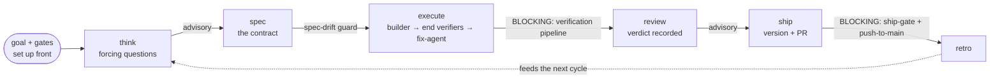
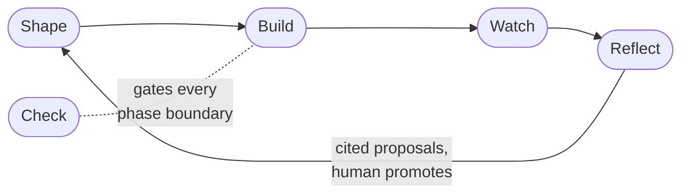

# Lifecycle: the loop, the gates and the five stages

The long-form picture of how one change moves through the kit and how the kit is organized across runs. The per-command detail is [`../MANUAL.md`](../MANUAL.md). The phase contract, lanes and gates are [`../WORKFLOW.md`](../WORKFLOW.md). Component fit is [`architecture.md`](architecture.md). How data moves is [`data-flow.md`](data-flow.md).

## The loop and the toolbox

Agent workflows are shifting from `prompt -> output` to `goal -> loop -> evaluate -> improve -> result`. dwarves-kit is the **closed** kind of that loop: you set the goal and the gates up front, and agents iterate inside them until a read-only verifier passes, never grading their own homework.

It ships as a **toolbox, not an appliance.** Every subsystem is a standalone shell command that already works on its own, `bash lib/board/board.sh --help`, and the same for `gate`/`stats`/`classify`/`spec`/`goal`/`session`/`precedent`/`intake`/`wrap` (for example `bin/precedent find "<query>"`). There is no `kit` uber-binary and no install step to just poke at it, and the same bash reads under pi, opencode, Claude Code, or a bare terminal. Wiring it into Claude Code (`bash install.sh`) adds an always-on safety spine and lets you `--with` exactly the modules you want and nothing else; [`install.md`](install.md) has the layers.

The loop itself is one spec-driven lifecycle, **think → spec → execute → review → ship → wrap → retro**, with a gate at every phase boundary:



That lifecycle is the middle of a longer arc. A board row becomes a landed PR like this:

```
  _meta/BACKLOG.md          /kit:assign                lane-classify.sh
  +----------------+  pull  +----------------+  size   +--------------------+
  | ID-NNN, queued | -----> | goal draft,    | ------> | tiny | normal |    |
  |                |        | scope fence    |         | full | bug |       |
  +----------------+        +----------------+         | backfill           |
                                                       +--------------------+
                                                                 |
      +----------------------------------------------------------+
      v
  think --> spec --> execute --> review --> docs --> ship
    |         |          |          |         |        |
  advisory  spec-    verification advisory advisory  ship-gate +
            drift    pipeline                        push-to-main
            guard                                      |
                                                       v
                                              PR open --> /kit:wrap
                                              board flip, merge own PR,
                                              deploy check, tidy, activity line
                                                       |
                                                       v
                                              ID-NNN row --> shipped
```

Two gate classes sit on those boundaries. **Blocking** gates are mechanical: the verification pipeline, the ship-gate and the push-to-main blocker stop a bad outcome. **Advisory** gates (think, review) surface findings and never block. The autonomous-loop hardening adds a fresh-context re-audit of every done-claim, a kit-default cross-cutting advisor lens on top of the specialized reviewers, and a deployable-done proof gate, so a closed loop can run long without drifting into self-graded slop.

One builder implements the whole spec, then every task runs through one end verification pipeline (verifiers → fix-agent retry), and hooks enforce safety automatically (`rm -rf`, push-to-main, force-push, and secret-file reads are blocked). The builder is a domain specialist when one exists (a migration or data-pipeline worker, picked by a deterministic lookup), and `/kit:draft-agent` installs a reusable named agent.

**You drive it by intent, not by memorizing commands.** Say what you want; the kit reads your intent, runs the right step, and stops only at the real decisions:

```
You: "add a --version flag to the CLI"
Kit: scopes it -> writes the spec -> builds + verifies -> ships,
     pausing only where it needs your call.
```

The `/kit:*` commands in the command reference are those same actions named explicitly, for when you prefer to type them. You rarely need to.

It is bash-first (every hook readable in 30 seconds), and every component traces to a proven pattern, no novel inventions. The point of the kit is the handoff: a solo technical lead writes the spec, a contractor runs `/kit:execute` against the *same* spec.

New here? Start with [`../QUICKSTART.md`](../QUICKSTART.md).

## Why a closed loop

An open loop (the agent roams free and judges its own output) is a fast slop machine unless your standard is airtight and your budget is unlimited. The kit takes the closed shape instead: a human designs the path once, agents iterate inside it. What makes the loop trustworthy is that the gates that block are mechanical (bash hooks, tests, read-only verifiers), never the agent grading its own homework. The remaining phase gates advise and route rather than block: detect, don't dictate.

| Open loop | dwarves-kit (closed) |
|-----------|----------------------|
| agent plans its own route | the spec is the contract, written before any build (validated on the full lane) |
| agent grades its own work | hard gates are mechanical: bash hooks, tests, read-only verifiers |
| loops until the budget dies | bounded: fix-agent retries max 2, then escalates to a human |
| one loop size fits all | risk lanes: tiny work skips the ceremony entirely |

## Command sequence at a glance

```
/kit:start          Detect state, suggest next command (entry point)
/kit:onboard        Guided first-run: install mode, adopt, module picker, two-idea tour
/kit:think          Challenge the idea (5 min)
/kit:design         Opt-in: shape the solution with you before /spec
/kit:spec           Generate the spec + parallel researchers (15-30 min)
/kit:spec-validate  Stress-test the spec (10 min)
                     [hand off to contractor]
/kit:execute        Autonomous: builder > end verifiers > fix-agent retry loop
  or
/kit:next           Manual: pick next task, load context, you drive
                     [hooks enforce during build]
                     [statusline shows context budget]
                     [slop-cleaner flags bloat at stop points]
/kit:review         Single-pass review (10 min)
/kit:review-team    Parallel multi-lens review, confidence-gated + validated findings
/kit:verify         Re-run tests read-only; PASS / FAIL / INCONCLUSIVE
/kit:docs           Update all docs to match code (5 min)
/kit:explain        Literate-diff explainer: understand a change, not click-to-merge it
/kit:quiz-gate      ★-tap nudge: a quiz built from the diff before merging a significant PR
/kit:pitch          Outward buy-in doc from the spec + proof + impl-notes + grill record; ends in an ask, never fabricates
/kit:ship           Review gate, version bump, changelog, commit, PR
/kit:retro          Retrospective (10 min, after shipping)
```

Work is sized by risk lane before it starts (tiny / normal / full / bug, plus a `backfill` lane for reviewing an existing codebase and writing the operating-layer docs without changing behavior). The default is `normal`, and the words of a task never pick `full`: the classifier only suggests it, and the diff floor at push gives any hard-path change the full lane's gates. Each lane's phases are data in `kit.toml` (`[lane.<name>]`), which a repo can override in its own `.kit.toml`. The lanes, the gate at each phase boundary, and the operate-contract the agent follows live in [`../../AGENTS.md`](../../AGENTS.md) and [`../WORKFLOW.md`](../WORKFLOW.md).

## The five stages

The lifecycle above is what one run looks like. Across runs, the kit is organized as five stages (formerly called "legs"; the fifth was renamed from Learn to Reflect): **Shape** turns work into contracts, **Build** builds inside them, **Watch** records what happened, **Check** gates every boundary, and **Reflect** distills the record into proposals for the next cycle.



This diagram is the stages. For how DATA actually moves through them (telemetry -> proposal -> board -> ship, the ledger write/read paths, and the module map of who calls whom), see [`data-flow.md`](data-flow.md).

Stages are metadata, not directories: each module keeps its name and install unit, and declares a primary stage. The authoritative assignment (machine copy in [`../../lib/config/module-registry.md`](../../lib/config/module-registry.md), rendered by `config list`):

| Stage | Modules / subsystems |
|---|---|
| Shape (Specify) | `spec`, `classify`, `precedent`, `intake`, `goal`, `board` (input side), `sync` (spoke intake; outward mirror is its Watch side) |
| Build (Execute) | `queue`, `mega`, `worktree`, `quiz_gate` |
| Watch (Observe) | `stats`, `session` (capture side), `telemetry`, `sync` (outward mirror side; absorbed the bridge cockpit mirror) |
| Check (Govern) | `gate`, `money_gate`, `advisor`, `gauntlet`, `wrap` |
| Reflect | `reflect` (was `learn`), `weekend_batch`, `session` (harvest), `board` (staging/promote), `skill-curator`, `prose_rag` (registry assignment, pending an amendment of the stage taxonomy decision) |
| (no stage) | `cosmetic` (statusline; orthogonal to the loop) |

Two modules honestly span stages: **board** (Shape's intake on one side, Reflect's staging/promote on the other) and **session** (Watch's capture, Reflect's harvest).

**What happens to a run's data after it ships:** every gate decision and run outcome appends to the ledgers (append-only, never rewritten). `stats` projects them read-only; `session intel` writes the weekly digest, harness scorecard included; `reflect propose` distills cross-run evidence into cited proposals in a staging file; `reflect drain` renders that staging for review; `board promote` is the human gate that turns a proposal into a backlog row feeding the next Shape stage. Every automated stage ends at a staging file or a rendered surface, never a direct write to a board or ledger: propose, never dispose.

<!-- provenance: ADR-0034, ADR-0036, SPEC-089 -->
