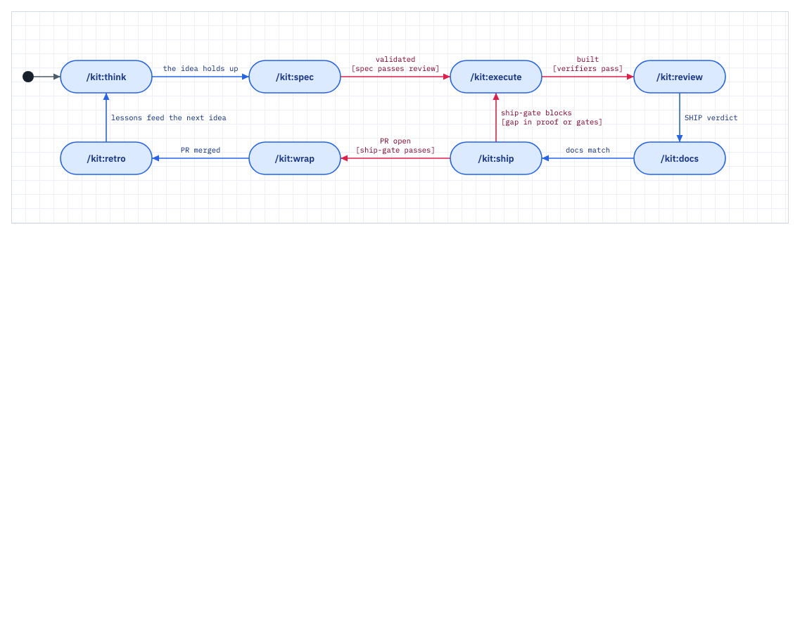
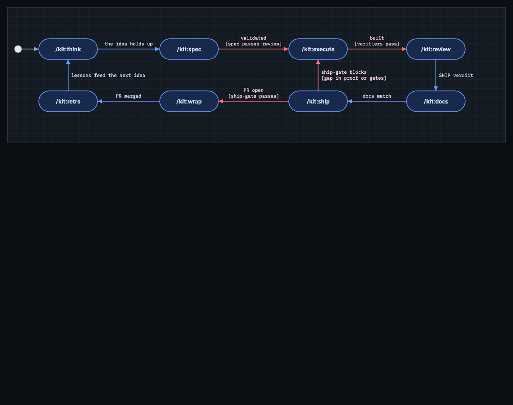

# Verification -- doc-figures-dark-svg

`doc-figures render` gains `--format svg` (theme-aware SVG per sheet, fonts embedded), `--fz` and a front matter `fz:` (figure zoom), and writes 16-hex manifest digests that `check` compares at the stored length.

## Green run
```
Command: CHROME="/Applications/Microsoft Edge.app/Contents/MacOS/Microsoft Edge" bash tests/test-doc-figures.sh
Exit: 0
Output:
  == short digests ==
    PASS a manifest of 16-hex digests passes (render writes these)
    PASS a wrong 16-hex digest fails and names the sheet
    PASS a digest that is neither 16 nor 64 hex fails
  == rendered SVG figures ==
    PASS a rendered <id>.svg stands in for <id>.png
    PASS a hand-drawn SVG beside the figures is left alone
    PASS a rendered SVG the manifest does not list fails
    PASS a hand-drawn <id>.svg does not count as the rendered figure
    PASS both <id>.png and a rendered <id>.svg fail as a stale pair
  == render (browser needed) ==
    PASS render writes MANIFEST.tsv with the id and a 16-hex digest
    PASS render --format svg exits 0
    PASS width equals the viewBox width at fz 1
    PASS the SVG carries the light tokens and a prefers-color-scheme dark block
    PASS fonts are embedded as data URIs, nothing is fetched
    PASS the SVG stays under 150 KB (11558 bytes)
    PASS check passes straight after an SVG render
    PASS front matter fz: 1.5 scales the SVG to 1.5 times its viewBox
    PASS the --fz flag wins over the front matter
    PASS front matter fz scales the PNG too (2344 px for a 780-unit drawing)
  doc-figures: 50 passed, 0 failed (50 checks)
Verdict: PASS
```

```
Command: bash tests/run-all.sh --changed --time
Exit: 0
Output:
  test-doc-figures                               ok (94s)
  test-system-design                             ok (3s)
  run-all: all 10 suites passed, 0 skipped for missing tooling
Verdict: PASS
```

The real flow on the kit's own model, into a scratch directory (the committed `docs/figures` is untouched):

```
Command: CHROME=<Edge> bash lib/system-design/doc-figures render --format svg docs/figures/MODEL.md <scratch>
Exit: 0
Output:
  svg d-loop.svg 21436 bytes md5 9aa53991
  svg d-adopt.svg 44083 bytes md5 ae970757
  svg d-debug.svg 25195 bytes md5 6bb8f784
  rendered 12 svg figures into <scratch>
Verdict: PASS (12 figures, 20 to 45 KB each, xmllint clean)
```

`loop.svg` as a plain `` in a private headless Edge, emulated light and dark:




## Negative control
```
Command: bash lib/gate/negctl.sh "$PWD" "bash tests/test-doc-figures.sh" "git show HEAD~1:lib/system-design/doc-figures > lib/system-design/doc-figures"
Exit: 1 (under mutation, RED expected)
Output:
    FAIL the SVG is well-formed XML
    FAIL check passes straight after an SVG render
    FAIL front matter fz: 1.5 scales the SVG to 1.5 times its viewBox
    FAIL the --fz flag wins over the front matter
    FAIL front matter fz scales the PNG too (1876 px for a -unit drawing)
  doc-figures: 27 passed, 23 failed (50 checks)
Restore: git checkout HEAD -- lib/system-design/doc-figures
Exit: 0 (green after restore)
Verdict: PASS
```

```
Command: bash lib/gate/negctl.sh "$PWD" "bash tests/test-doc-figures.sh" "sed ... 's/prefers-color-scheme\/.test/no-such-media\/.test/' lib/system-design/shots.mjs"
Exit: 1 (under mutation, RED expected)
Output:
  doc-figures: 49 passed, 1 failed (50 checks)
Restore: git checkout HEAD -- lib/system-design/shots.mjs
Exit: 0 (green after restore)
Verdict: PASS
```

The first control runs the new suite against the pre-change `doc-figures`; the second drops the dark media block from the SVG export, and only the dark-token check goes red. Both files were restored by negctl; the tree was clean after.

## Rollback

Revert the feature commit. PNG stays the default, so a consumer that never passes `--format svg` or `fz` sees one difference: a figure wider than the 938 px column now renders at natural size instead of shrinking. A manifest written by the new `render` holds 16-hex digests, which the old `check` reports as stale; re-run the old `render` to rewrite it.

## Not proven
- Safari and Firefox were not tested; dark tokens were checked in headless Edge (Chromium) only, with and without a `color-scheme` meta on the host page.
- The SVG font embed needs network (Google Fonts). Offline it fails the figure, as the page's js-yaml load already does.
- The committed `docs/figures/*.png` and its 64-hex `MANIFEST.tsv` were not re-rendered.
