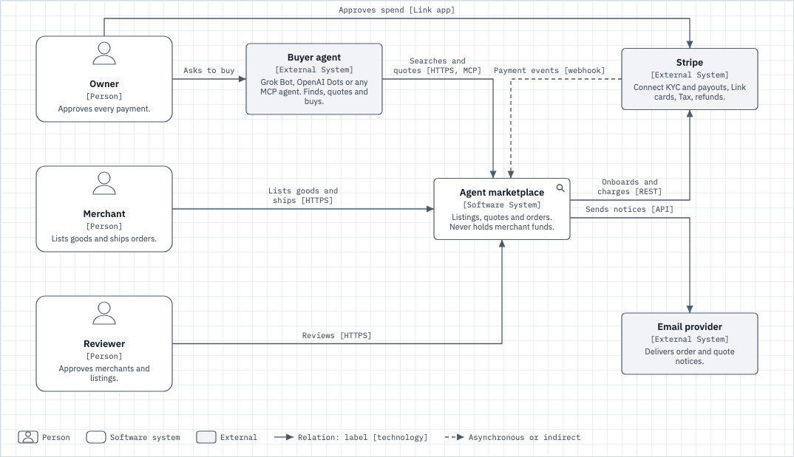
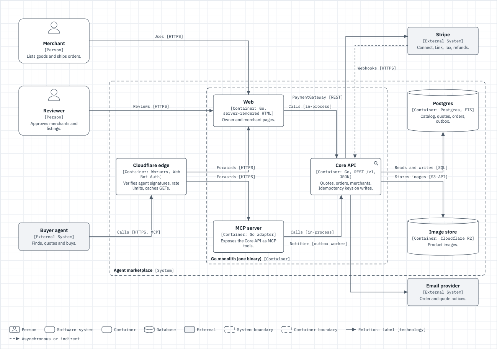
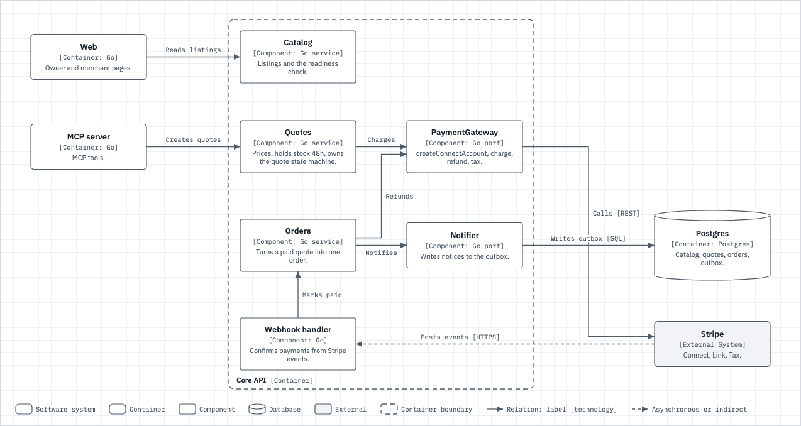
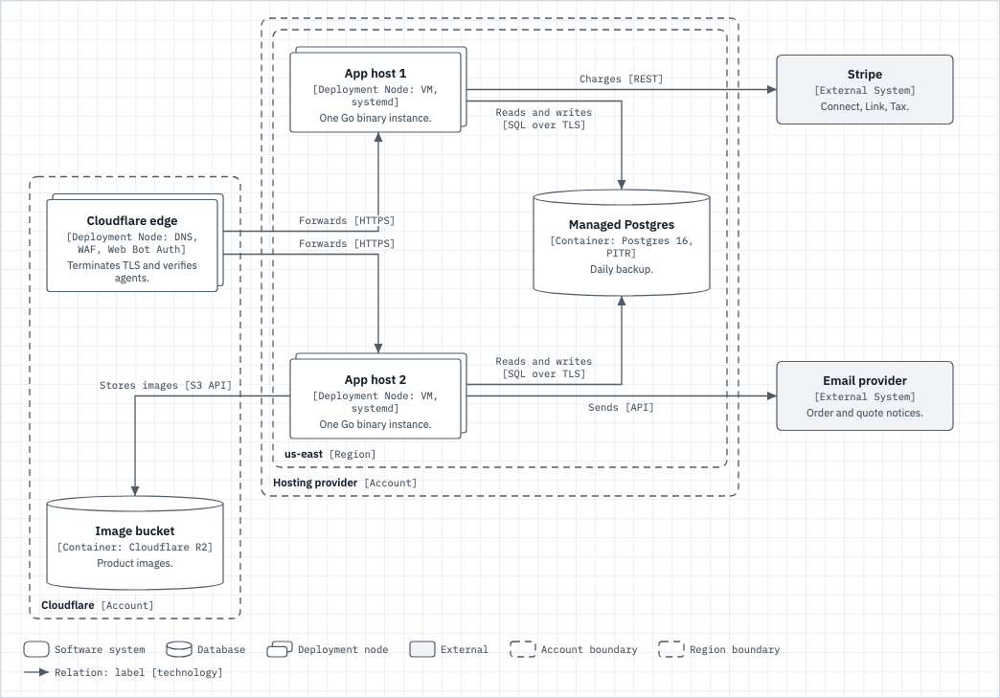

# Proof of done: system-design-c4

The system-design engine gains a native `c4` diagram type: four views (context, container, component, deployment), person, db, queue and node shapes, nested boundaries, an auto legend, zoom links between sheets, and delta on elements and relations. Format: `lib/system-design/FORMAT.md` "C4 views". Example set: `lib/system-design/examples/marketplace-c4/`.

## Gate table

| Claim | Evidence |
|---|---|
| c4 parses, the view is required and checked, and the delta marks elements and relations like component nodes and edges | run 1 |
| Layout keys, tone and zoom never mark a change; a moved boundary and a new view do | run 1 |
| Every zoom link on the example names an existing sheet; a dangling one is reported | run 1 |
| The fallback layout of every C4 sheet is deterministic, orthogonal, with no edge through a box and each boundary frame holding exactly its own elements | run 1 |
| The build renders the C4 example with a base file and the existing build and refusal checks still pass | run 2 |
| The diff-selected suites are green | run 3 |
| The rendered sheets show the notation, in both themes and as standalone SVG | captures below |
| The tests are load-bearing | negative controls 1 and 2 |

## Green runs

Run 1, the engine smoke test (delta, parsing, zoom, fallback layout):

```
Command: node lib/system-design/test.mjs
Exit: 0
Output:
ok: 21 uml and 18 c4 deltas match, 2 zoom links resolve, 13 fallback layouts clean (6 boundary frames)
Verdict: PASS
```

Run 2, the build suite:

```
Command: bash tests/test-system-design.sh
Exit: 0
Output:
== system-design build ==
  PASS build exits 0 on the marketplace fixture with a base file
  PASS model title is non-empty
  PASS output contains the model title
  PASS output embeds the base model
  PASS no build placeholder survives
  PASS build exits 0 on the C4 example with a base file
  PASS C4 output embeds the c4 renderer and its sheets
== refusals ==
  PASS a model containing </script is refused (non-zero exit)
  PASS the refusal names </script
  PASS no output file is written for a refused model
  PASS build without --out is refused
== engine smoke test (node test.mjs) ==
  PASS node lib/system-design/test.mjs exits 0

system-design: 12 passed, 0 failed (12 checks)
Verdict: PASS
```

Run 3, every suite the diff touches:

```
Command: bash tests/run-all.sh --changed --time
Exit: 0
Output:

run-all: slowest:
  73s test-flick
  36s test-precedent
  29s test-kit-foldin-hooks
  21s test-precedent-index
  14s test-registry-freshness-guard
  13s test-config-registry
  9s test-repohygiene
  9s test-meta-docs-registry
  7s test-config-seams
  6s test-system-design

run-all: all 37 suites passed, 0 skipped for missing tooling
Verdict: PASS
```

## Visible surface

Built with `bash lib/system-design/build --model lib/system-design/examples/marketplace-c4/SYSTEM-DESIGN.md --out <html> --shots <dir>`, then cropped to the figure with `SHOT_CLIP=figure`. Every PNG was read: no label on a box or on another label, no edge through a box. The same set also built with the base file (delta colors on new, changed and removed), with the dark theme forced, and as standalone SVG (`SHOT_FORMAT=svg`).

Context (zoom magnifier on the system):



Containers (nested system and container boundaries, cylinders, external boxes):



Components:



Deployment (account and region boundaries, node shapes):



## Negative control

Control 1, zoom is a layout key. Dropping it from the delta's skipped keys makes a zoom edit show as a change:

```
Command: node lib/system-design/test.mjs
Exit: 1 (under mutation, RED expected)
Output:
    code: 'ERR_ASSERTION',
    actual: [ 'changed v element a: ~zoom' ],
    expected: [],
    operator: 'deepStrictEqual',
Mutation: sed -i '' 's/, tone: 1, zoom: 1 }/, tone: 1 }/' lib/system-design/delta.js
Restore: git checkout HEAD -- lib/system-design/delta.js
Exit: 0 (green after restore)
Verdict: PASS
```

Control 2, a parent boundary frame encloses its children. Making `boundaryFrames` ignore nested frames fails the frame assertions on the container and deployment sheets:

```
Command: node lib/system-design/test.mjs
Exit: 1 (under mutation, RED expected)
Output:
    code: 'ERR_ASSERTION',
    actual: false,
    expected: true,
    operator: '==',
Mutation: sed -i '' 's/if (r) { rs.push(r); members/if (false) { rs.push(r); members/' lib/system-design/layout.js
Restore: git checkout HEAD -- lib/system-design/layout.js
Exit: 0 (green after restore)
Verdict: PASS
```

Both mutations were applied to a committed tree and restored with `git checkout HEAD --`; the green run after each restore is the one printed above.

## Rollback

The change classifies as stateful only because the diff and the example talk about databases and deployment. Nothing runs or persists: the engine renders a Markdown file into a static page. rollback: revert the merge commit. A model with no `type: c4` block renders exactly as before, since the c4 code only runs for that type.

## Not proven

- The browser renderer (`template.html`, `rC4`) has no automated assertion beyond the build test grepping for it; its evidence is the captures above, read by eye.
- An edge that runs along a frame's bottom edge can cross that frame's own label: the router avoids frame labels only for edge labels, not for edge lines (seen on a scratch model with mis-hinted frames, absent from the examples).
- Rendered PNG pixels are not diffed in CI, since fonts load from Google Fonts.
