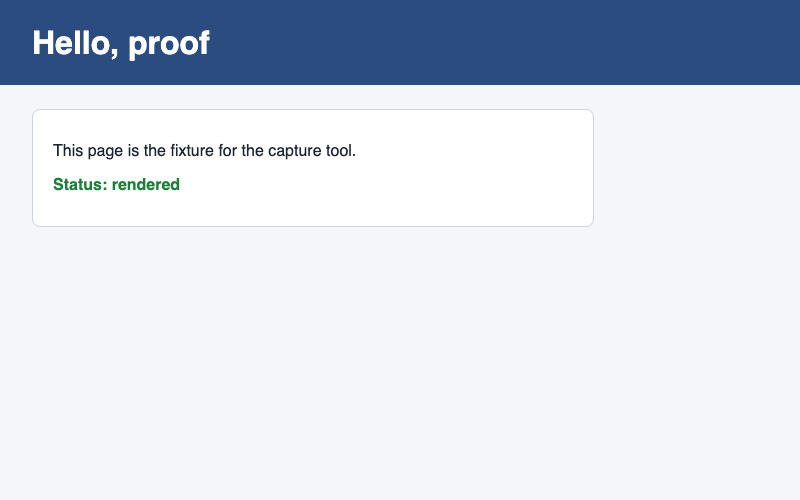

# Verification: visual-proof-module

Spec: `docs/specs/SPEC-427-visual-proof-module.md`. The `proof_capture` module (`lib/proof-capture/`, kit shim `bin/proof-capture`) makes one PNG from a page or one GIF from a terminal tape, so the `capture:` line that `proof-gate.sh contract` now prints names a command that works.

## The capture this change made



Verified content (the image was opened and read, not only counted): a blue header band reading "Hello, proof", and below it one white card with the text "This page is the fixture for the capture tool." and a green line "Status: rendered". The PNG is 800 by 500 (read from the file header), 13613 bytes. Nothing on screen shows a path, a hostname, a token or a name. It was made by Microsoft Edge 157.0.4341.60 on macOS, through the kit shim. Not through `PROOF_CAPTURE_BROWSER`: `PROOF_CAPTURE_BROWSER_CANDIDATES` held one pid-recording wrapper that `exec`s the Edge app that built-in discovery lists, so the recorded group could be checked afterwards. The built-in discovery path itself was not run for this capture.

```
Command: bin/proof-capture run page lib/proof-capture/examples/hello.html docs/verification/visual-proof-module/page.png --width 800 --height 500
Exit: 0
Output:
proof-capture: wrote docs/verification/visual-proof-module/page.png (13613 bytes)
Verdict: PASS
```

Cleanup, read from the pid the wrapper recorded (the tool exposes no pid): the browser's process group and its pid were both gone after the run, and the private temp directory held nothing. No `pkill`, `pgrep -f` or process-table listing was used.

## Results

(filled when the suites ran; see the end of this file)
